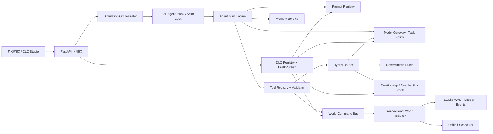

# 世界模拟器完善优化实施计划

> 创建日期：2026-07-10
> 适用项目：`F:\世界模拟器`
> Status: Phases 0-7 core implementation, advanced Studio workflows, deterministic causal event chains with transactional world effects and anchored-value conservation, dependency/migration support, Prompt contracts, model-generation rollback, and replay/live trajectory infrastructure are complete; 451 Python tests plus 16 Studio tests pass. Credentialed live baselines, longer soak testing, deeper economic propagation, and Phase 8 hardening remain ongoing.
> 原则：先补基础设施与可观测性，再扩展 DLC 和 Agent 数量；所有核心改造必须可迁移、可回滚、可测试。

## 1. 总目标

本计划把当前「大明朝廷单 DLC + 单一 LLM 客户端 + 部分 Agent 单轮决策」演进为可长期运行、可扩展 DLC、可按任务选择模型的通用世界模拟器。

重点目标：

1. 普通 Agent、Router、ActionAgent、天玑统一使用可配置的多轮执行框架。
2. 建立分层记忆、检索、压缩、持久化和并发安全机制，支持长期世界运行。
3. 制作通用 DLC 编辑器，可创建、校验、预览、发布、启用和导出 DLC 的全部实体与 Agent。
4. 将路由拆成确定性规则、图关系校验和 LLM 语义仲裁三层，并完整保留调用链。
5. 重构世界模拟写入方式，保证模拟时间、事务、资源守恒和并发一致性。
6. 将库存中的经济资源统一锚定到同一价值尺度；把状态指标和参数从库存中拆出。
7. 建立 Prompt 注册、组合、版本、校验和评测体系。
8. 支持多 Provider、多模型、按任务路由、失败回退、预算和限流。
9. 补齐安全、日志、指标、回放和端到端测试。

## 2. 当前基线与主要问题

### 2.1 已具备的基础

- `ActionAgent` 已有最多 10 轮的工具调用循环和 `fc_trace`。
- 普通 Agent 已支持消息记忆、摘要压缩和 v2 记忆持久化。
- `fc_tools.py` / `fc_handlers.py` 已形成工具定义与执行分离。
- `Orchestrator` 已支持后台 Agent 调用、Timer、ChainLog、OngoingEvent 和运行时持久化。
- 已有官员、人格、Prompt 编辑器，以及世界实体、库存、事件、关系 REST API。
- 当前单元测试基线：31 项通过；前端生产构建通过。

### 2.2 P0 风险

1. `config/llm.json` 当前包含明文 API 密钥。必须立即轮换该密钥，并改成环境变量或本机秘密存储；不得继续写入 Git、存档或导出包。
2. `chat_stream()` 在持有共享 semaphore 时回退调用 `chat()`；当并发上限为 1 时存在重入等待风险。应把请求重试/流式回退下沉到不重复获取信号量的内部方法。
3. 普通 Agent 的记忆会写入伪造的工具结果 `{"status":"已执行"}`，但真实执行发生在 Orchestrator/Router 后面。记忆中的“已执行”与世界真实结果可能不一致。
4. Chain ID 在 Router 生成命令时被重新创建，因果链可能断裂，`MAX_HOPS` 无法可靠覆盖整条传播链。
5. 多个后台任务可在相邻 tick 同时调用同一个 Agent，Agent 的 deque 记忆和摘要缺少 per-agent 锁，存在顺序错乱与压缩竞态。
6. 世界库存更新采用“读取旧值后覆盖”，缺少统一事务、版本检查和原子转账；并发行动可能造成丢失更新。

### 2.3 结构性问题

- DLC 路径、Loader、Prompt 和编辑器 API 全部硬编码为 `daming_court`。
- 普通 Agent 和 Router 每次只有一次 LLM 调用；普通 Agent 也没有查询世界/关系/记忆后再决策的工具链。
- 记忆阈值按消息条数而非 token，摘要是 300 字自由文本，缺少事件、人物、承诺和可信度的结构字段。
- Router 对简单、确定性的上下级通信仍调用 LLM；每批附带全部官员 ID，Agent 增多后上下文会迅速膨胀。
- `AgentAction.action` 和 Router payload 仍以自由文本为主，缺少版本化、可校验的意图协议。
- 世界模拟的后台任务使用不断变化的 `self._sim_time`，请求发生时间、裁决时间和落账时间没有明确区分。
- 当前 `inventory` 混合了经济资源、人口/兵力、满意度、生活质量、税率、生产系数，无法建立清晰的价值守恒。
- 资源不足时通过 clamp 静默归零，调用方无法区分“正常扣除”和“库存不足”。
- LLM 只有全局 `base_url/api_key/model`，所有任务共用同一模型、并发限制和 token 计数。
- 编辑器直接修改 seed JSON 或运行态 SQLite，缺少“草稿/已发布”“种子数据/运行数据”的明确边界。
- 后端缺少完整的 ID 唯一性、引用完整性、层级环、Prompt 变量、资源定义等跨文件校验。

## 3. 目标架构



### 3.1 模块边界

建议新增：

- `multiagent_framework/turn_engine.py`：统一多轮执行、终止、预算、重试和 trace。
- `multiagent_framework/model_gateway.py`：Provider、模型注册、任务策略、回退和指标。
- `multiagent_framework/memory_service.py`：工作记忆、情节记忆、语义记忆、关系记忆和检索。
- `multiagent_framework/prompt_registry.py`：Prompt 组合、变量校验、版本和渲染。
- `multiagent_framework/intent.py`：版本化 `IntentEnvelope` / `WorldCommand`。
- `multiagent_framework/hybrid_router.py`：确定性规则、图校验、LLM 仲裁。
- `multiagent_framework/world_commands.py`：命令、事务、幂等键和 reducer。
- `multiagent_framework/economy.py`：资源定义、价值换算、转账、消费、产出和账本。
- `multiagent_framework/dlc_registry.py`：DLC 扫描、依赖、优先级、启停和加载。
- `routers/dlc_editor.py`：DLC Studio API。
- `frontend/src/DlcStudio.jsx`：通用 DLC 编辑器入口。

不建议继续把所有逻辑堆入 `orchestrator.py`、`world_state.py` 或 `routers/editor.py`。

## 4. Agent 多轮调用

### 4.1 统一 Turn Engine

所有 LLM 角色通过统一执行器运行：

```text
接收入站消息
→ 固化 turn_id / chain_id / occurred_at / sim_time_snapshot
→ 检索记忆和最小世界上下文
→ 渲染 Prompt
→ 调用任务指定模型
→ 校验 tool calls
→ 执行只读工具或提交意图
→ 把真实工具结果写回 messages
→ 判断终止、继续、修复或降级
→ 写入记忆、trace、指标和持久化队列
```

建议 `TurnPolicy` 字段：

- `max_rounds`
- `max_input_tokens`
- `max_output_tokens`
- `max_tool_calls`
- `wall_timeout_s`
- `allowed_tools`
- `terminal_tools`
- `retry_policy`
- `model_task`
- `fallback_action`

### 4.2 普通 Agent 的多轮能力

普通官员/机构 Agent 默认 3～4 轮，不应直接照搬 ActionAgent 的 10 轮：

1. 第一轮可查询：自身状态、地点、关系、最近事件、相关记忆。
2. 第二轮可继续补充查询或形成计划。
3. 最终必须使用 `submit_action`、`request_action` 或显式 `finish_turn/do_nothing` 结束。
4. 只读工具返回真实数据；意图工具返回“已受理 + intent_id”，不能伪造“世界已执行”。
5. 后续真实执行结果以 `action_result` 消息回流到发起 Agent 的 inbox 和 episodic memory。

建议新增只读工具：

- `query_self_context`
- `query_entity`
- `query_relationships`
- `query_recent_events`
- `search_memory`
- `list_reachable_agents`

### 4.3 并发与顺序

- 每个 Agent 一个 inbox 和 `asyncio.Lock`，同一 Agent 任意时刻只运行一个 turn。
- 多条消息按 `priority + occurred_at + sequence` 排序，而不是仅按 tick 临时拼接字符串。
- 可在 turn 开始前合并同一事件的消息，但必须保留每条消息的 sender、chain_id 和 message_id。
- 每个 turn 保存 `turn_id`、输入消息 ID、工具调用、模型、耗时、token、终止原因。
- 存档/读档前应冻结新 turn，等待在途 turn 到安全点，再进行快照。

### 4.4 终止与防失控

终止原因应标准化：

- `terminal_tool`
- `max_rounds`
- `max_tokens`
- `timeout`
- `no_progress`
- `tool_error`
- `model_error`
- `cancelled`

连续两轮没有新信息、重复同一工具参数或重复相同意图时，触发 `no_progress`。失败时产生结构化降级行动，而不是把异常字符串当世界内容传播。

## 5. 多轮记忆

### 5.1 分层记忆

| 层 | 内容 | 生命周期 |
|---|---|---|
| Working Memory | 当前 turn 的原始消息、工具结果、临时推理状态 | turn 结束后裁剪 |
| Episodic Memory | 角色亲历的事件、行动、结果、来源、时间 | 长期保存 |
| Semantic Memory | 对人物、地点、制度的稳定认知与总结 | 可更新、可冲突 |
| Relationship Memory | 信任、敌意、债务、承诺、上下级互动 | 长期保存 |
| Commitments | 未完成承诺、命令、等待回复、截止时间 | 完成后归档 |

### 5.2 结构化摘要

摘要不再只是一段 300 字文本，至少包含：

```json
{
  "facts": [],
  "events": [],
  "relationships": [],
  "commitments": [],
  "open_questions": [],
  "stance": "",
  "last_compacted_at": 0,
  "source_message_ids": []
}
```

### 5.3 Token 预算与检索

- 压缩阈值改为估算 token，而不是消息条数。
- Prompt 上下文按预算分配：系统规则、当前事件、近期原文、相关旧记忆、世界状态分别设上限。
- 先用元数据过滤（实体、事件、时间、关系），再做文本相似度检索；首期不强制引入向量数据库。
- 记忆记录带 `importance`、`confidence`、`visibility`、`source`、`occurred_at`。
- 相互冲突的认知并存，并记录角色相信哪一个版本，避免上帝视角信息泄漏。

### 5.4 迁移与修复

- 保持读取 v1/v2 记忆，新增 v3 schema。
- 首次加载 v2 时延迟迁移，避免一次性调用大量摘要模型。
- 修复 `request_action` 单独发生时记忆可能未标脏的问题。
- 压缩、写入、存档都在 per-agent 锁或快照机制下执行。

## 6. DLC 系统与 DLC Studio

### 6.1 DLC 包格式

建议将当前 `daming_court` 逐步迁移为：

```text
dlcs/daming_court/
  manifest.json
  entities.json
  agents.json
  personas.json
  resources.json
  relations.json
  events.json
  models.json              # 可选，任务策略覆盖
  prompts/
    official.md
    router.md
    action_agent.md
    tianji.md
    agents/<agent_id>.md
  scenarios/
    smoke.json
  migrations/
    001_initial.py
```

`manifest.json` 至少包含：

- `id`、`name`、`version`、`schema_version`
- `engine_version`
- `dependencies`、`load_after`
- `enabled_by_default`
- `entrypoints`
- `content_files`
- `prompt_overrides`
- `resource_catalog`
- `author`、`description`

### 6.2 加载规则

- Framework 不再 import `daming_court.loader`；改由 `DLCRegistry` 扫描 manifest。
- DLC 数据先进入规范化中间模型，再写入 CourtGraph/WorldState/AgentFactory。
- 支持多个 DLC 的优先级、覆盖和冲突报告。
- Seed 与 Runtime 分离：DLC 编辑的是新游戏种子；运行态编辑明确标记为“当前存档修改”。
- DLC 变更分为：可热加载、需重建 Agent、需新游戏、需数据迁移四类。

### 6.3 DLC Studio 页面

建议采用左侧资源树、中间表单/图编辑、右侧校验和预览：

1. **概览**：manifest、版本、依赖、启用状态、内容统计。
2. **实体**：地点、人物、机构、组织、物品，自定义 metadata schema。
3. **Agent**：Agent 类型、角色、所属实体、关系、人格、Prompt、工具、模型策略、记忆策略。
4. **库存与指标**：资源数量、价值换算、状态指标和参数。
5. **关系图**：实体关系与 Agent 上下级统一预览，环检测。
6. **事件**：初始事件、事件模板、触发条件、目标选择。
7. **Prompt**：模板、变量、继承、专用覆盖、渲染预览和测试。
8. **模型策略**：各任务使用的 profile、回退链和预算。
9. **验证与测试**：错误列表、场景试跑、Prompt dry-run、导入导出。
10. **发布**：生成不可变版本、变更摘要、打包 zip、启用/停用。

### 6.4 编辑工作流

```text
创建/导入 DLC
→ 编辑草稿
→ 自动保存草稿
→ Schema 校验
→ 跨引用校验
→ Prompt 渲染校验
→ 场景 dry-run
→ 发布版本
→ 选择是否应用到当前存档或仅用于新游戏
```

必须支持：撤销/重做、脏状态提示、原子写入、自动备份、差异预览。禁止前端直接覆盖多个 JSON 后再寄希望于重启修复。

### 6.5 后端校验

- ID 唯一、字符规范和重命名引用更新。
- Agent 的 location/entity/persona/model/tool 引用存在。
- 官员上下级和 subordinate 关系无非法环。
- Event 目标存在，资源名有效，Prompt 变量完整。
- DLC 依赖存在且版本满足。
- 资源定义兼容存档 schema。
- 发布时所有错误必须为 0；warning 可由用户确认。

## 7. 路由逻辑

### 7.1 三层 Hybrid Router

1. **确定性规则层**：直属上下级、同城、明确目标、`request_action`、简单广播、资源查询等无需 LLM。
2. **图关系层**：检查可达性、最短通信路径、距离、权限、机构归属、越级规则。
3. **LLM 仲裁层**：仅处理自由文本歧义、多目标协调、策略分解和冲突意图。

这样可以降低 token、延迟和随机性，同时保留复杂叙事能力。

### 7.2 意图协议

引入版本化结构：

```json
{
  "schema_version": 1,
  "intent_id": "...",
  "turn_id": "...",
  "chain_id": "...",
  "actor_id": "...",
  "type": "communicate|execute|delegate|report|wait",
  "targets": [],
  "content": "",
  "urgency": "normal",
  "constraints": {},
  "metadata": {}
}
```

Router 输出 `WorldCommand`，包含 `command_id`、`parent_intent_id`、`chain_id`、`scheduled_at`、`idempotency_key`。Chain ID 必须继承，不能每跳重新生成。

### 7.3 批处理和校验

- 按 chain、意图类型或区域分批；设置 action、字符和 token 三种上限。
- 不再向 Router Prompt 塞入全部 Agent ID；先由 deterministic resolver 生成候选集。
- LLM 输出后执行 Pydantic 校验、目标解析、权限检查和去重。
- 不合法命令进入 dead-letter queue，并产生可观察错误，而不是静默丢弃。
- 防循环不仅检查 hop，还检查最近路径中的重复节点、重复意图指纹和重复命令。

## 8. 世界模拟器逻辑

### 8.1 命令与事件分离

- Agent/Router 只产生命令，不直接随意改数据库。
- `WorldCommandBus` 校验命令后交给 `WorldReducer` 在事务中生成状态变更与领域事件。
- 所有写操作记录 `world_ledger`：谁、何时、因何、旧值、新值、chain_id、command_id。
- OngoingEvent 和 Timer 最终应共享统一 Scheduler 接口，保留不同 payload 类型。

### 8.2 模拟时间一致性

每个 turn/command 固化：

- `occurred_at`：事件发生的模拟时间
- `decided_at`：模型完成决策时的模拟时间
- `scheduled_at`：命令计划执行时间
- `applied_at`：世界状态真正落账时间

后台 LLM 再慢，也不能模糊使用完成瞬间的全局 `self._sim_time`。必要时在应用前做版本检查和重新验证。

### 8.3 事务与并发

- SQLite 开启 WAL、busy timeout 和明确事务边界。
- 同一实体的写入使用版本号/乐观锁；转账涉及多个实体时必须单事务。
- `set/update inventory`、事件到期落账、ActionAgent 变更都走同一服务。
- 不允许“先扣款成功、后建事件失败”留下半完成状态。
- 命令带幂等键，读档或重试不能重复扣资源。

### 8.4 可重复与可回放

- 随机数使用 world seed + event/command ID 派生。
- LLM 原始响应、规范化命令和 reducer 结果分开记录。
- 支持从快照 + ledger 回放世界变化。
- 建立固定场景模拟测试，比较结构化结果而非要求叙事文本完全一致。

## 9. 库存代币统一价值锚定

### 9.1 先拆分类别

“统一价值”应理解为统一价值尺度，而不是把所有字段强行变成相同数量。

当前 10 项应拆成：

- **可计价经济资源**：金钱、粮草、工料，以及 DLC 定义的其他物资。
- **能力/约束资源**：兵力、人口、科技能力；可有影子价值或维护成本，但不一定允许自由兑换。
- **状态指标**：满意度、生活质量。
- **规则参数**：税率、生产系数。

满意度、税率等不应继续存放在通用库存表中，也不参与资产总价值相加。

### 9.2 价值单位

引入框架级抽象单位 `V`（Value Unit，价值点），具体 DLC 选择基准，例如以 1 两白银为基准。每种资源定义：

```json
{
  "id": "grain",
  "name": "粮草",
  "unit": "石",
  "kind": "economic_resource",
  "anchor_value": 1.2,
  "precision": 0.01,
  "tradable": true,
  "conserved": true,
  "min": 0
}
```

核心公式：

```text
normalized_value = quantity × anchor_value
transaction_value = quantity_delta × anchor_value
```

首期只使用静态 `anchor_value` 保证平衡和可解释；后续若加入供需价格，使用：

```text
market_value = anchor_value × scarcity_modifier × region_modifier × event_modifier
```

锚值仍是长期基准，市场值只是短期浮动。

### 9.3 数据模型

建议新增：

- `resource_definitions`
- `entity_inventory`
- `entity_metrics`
- `entity_parameters`
- `resource_ledger`
- `resource_transactions`

交易 API 使用业务动作：

- `produce_resource`
- `consume_resource`
- `transfer_anchored_value`（v0.19.0 已接入 ActionAgent）
- `convert_resource`
- `reserve_resource`
- `release_resource`

禁止 ActionAgent 继续通过任意 delta 模拟转账。库存不足应返回明确失败或部分执行，不能静默 clamp 到 0。

### 9.4 迁移策略

1. 备份当前 `runtime/world.db` 和 DLC seed。
2. 增加资源定义与新表，不立即删除旧 inventory。
3. 将金钱/粮草/工料迁到经济资源；兵力/人口迁到 capacity；满意度/生活质量迁到 metrics；税率/生产系数迁到 parameters。
4. 保留旧 API 兼容层，旧中文资源名映射到 resource ID。
5. 在 UI 同时显示数量、单位、单位锚值、总价值。
6. 对当前 seed 做一次总价值报告，由策划确认初始平衡后再冻结锚值表。
7. 至少一个版本后再移除旧字段。

## 10. Prompt 优化体系

### 10.1 Prompt Registry

Prompt 不再由代码直接拼接固定文件路径，而使用：

- `prompt_id`
- `version`
- `task_type`
- `base_template`
- `policy_blocks`
- `dlc_blocks`
- `agent_override`
- `required_variables`
- `max_tokens`
- `compatible_tools`

渲染顺序：框架安全规则 → 任务协议 → DLC 世界规则 → 角色设定 → 当前上下文 → 输出约束。

### 10.2 优化原则

- 把稳定规则和动态上下文分离，减少重复 token。
- 删除互相矛盾的规则；终止条件只定义一次。
- 使用工具 schema/Pydantic 承担格式约束，不在 Prompt 中反复复制全部字段说明。
- Router 只接收候选目标和必要上下文。
- ActionAgent 注入规范化资源定义、锚值和允许操作，而不是散落的自然语言公式。
- Prompt 中明确“事实、推测、角色认知、上帝视角”的边界。
- 每个 Prompt 版本绑定回归场景和评测结果。

### 10.3 Prompt 评测

建立 `tests/evals/`，至少覆盖：

- 普通汇报、逐级传令、越级失败、同城通信。
- Agent 先查询后行动，多轮正常收尾。
- 资源不足、事件对冲、并发调粮、重复命令。
- 记忆召回、错误记忆、承诺完成。
- Router 不输出非法 ID、不丢 chain_id。
- ActionAgent 在规定轮次内 `complete_action`。

指标：工具合法率、终止率、路由准确率、平均轮次、token、延迟、资源守恒错误数、人工评分。

## 11. API 配置与多模型选择

### 11.1 配置结构

将单一 `config/llm.json` 升级为不含秘密的多模型配置，例如：

```json
{
  "providers": {
    "primary": {
      "base_url": "https://example/v1",
      "api_key_env": "WORLD_SIM_PRIMARY_API_KEY",
      "timeout_s": 45
    }
  },
  "models": {
    "fast_tools": {
      "provider": "primary",
      "model": "tool-model",
      "capabilities": ["tools", "json"],
      "max_concurrent": 4
    },
    "deep_sim": {
      "provider": "primary",
      "model": "reasoning-model",
      "capabilities": ["tools", "long_context"],
      "max_concurrent": 2
    }
  },
  "task_policies": {
    "router.simple": ["fast_tools"],
    "router.ambiguous": ["deep_sim", "fast_tools"],
    "agent.turn": ["fast_tools"],
    "action.simulation": ["deep_sim"],
    "memory.compress": ["fast_tools"],
    "tianji.chat": ["deep_sim", "fast_tools"]
  }
}
```

### 11.2 选择逻辑

按以下顺序选择：

1. DLC/Agent 显式覆盖。
2. 任务类型默认 profile。
3. 根据复杂度、上下文长度、工具能力、预算动态升级或降级。
4. Provider 错误、限流或能力不兼容时走回退链。
5. 回退模型仍需通过工具/JSON 能力校验。

### 11.3 Model Gateway 能力

- Provider 连接池独立，不共享一个全局 semaphore。
- 每模型并发、RPM/TPM、超时、重试、熔断和 cooldown。
- 区分可重试错误与 4xx 配置错误，支持 `Retry-After`。
- 统一 chat/stream/tool-call 适配，处理不同 OpenAI-compatible 方言。
- 统计到 task/model/provider/agent：调用数、token、延迟、错误、回退、估算费用。
- 支持启动时 capability probe 和设置页连接测试。
- 设置 API 不返回或持久化明文密钥；只保存 env 名或本机 secret reference。

## 12. 可观测性与测试

### 12.1 Trace

统一字段：

- `trace_id`
- `chain_id`
- `turn_id`
- `span_id/parent_span_id`
- `agent_id`
- `task_type`
- `model_profile/model`
- `sim_time_snapshot`
- `round`
- `tool_name`
- `command_id`
- `token/latency/error/termination_reason`

调试日志应支持脱敏、轮转和关闭完整内容记录；不能无限增长单个 JSONL。

### 12.2 测试层级

1. Schema/迁移单测。
2. Turn Engine fake-model 单测。
3. Memory 检索、压缩、并发测试。
4. Router 规则、图可达性、chain 继承、循环检测测试。
5. WorldReducer 事务、幂等和资源守恒测试。
6. DLC 校验、发布、导入导出测试。
7. FastAPI 集成测试。
8. React DLC Studio 组件和构建测试。
9. 固定场景端到端模拟。
10. 长时间 soak test：数百 Agent、多天模拟、读档恢复。

## 13. 分阶段实施路线

### Phase 0：安全与基线（1～2 个开发日）

- 轮换已暴露 API 密钥，改用环境变量/秘密引用。
- 修复 stream fallback semaphore 重入。
- 增加配置校验、日志脱敏和 debug log 轮转。
- 建立 fake LLM、现有行为快照和基础集成测试。

验收：仓库和导出包无明文密钥；并发为 1 时 stream fallback 不死锁；基线测试全绿。

### Phase 1：Model Gateway + Trace（3～5 个开发日）

- 实现 Provider/Model/TaskPolicy。
- 现有调用点先无行为变化地迁移到 task profile。
- TokenCounter 改为分任务/模型指标。
- 引入统一 trace ID。

验收：Router、Agent、ActionAgent、Memory、天玑可选择不同模型，并能回退。

### Phase 2：Turn Engine + Agent 多轮（5～8 个开发日）

- 抽取 ActionAgent 循环为通用 Turn Engine。
- 普通 Agent 增加只读工具和终止工具。
- 实现 per-agent inbox/lock、真实工具结果、预算和 no-progress 检测。
- 修复记忆标脏和 action result 回流。

验收：普通 Agent 能“查询 → 决策 → 提交”，同一 Agent 不并发执行，所有轮次可追踪。

### Phase 3：Hybrid Router（4～7 个开发日）

- 引入 IntentEnvelope/WorldCommand。
- 实现确定性路由和关系图可达性。
- 修复 chain 继承、候选目标、批量上限、幂等和 dead-letter。
- 仅将歧义任务交给 LLM。

验收：简单通信不调用 LLM；端到端 chain 连续；循环与非法目标被明确拒绝。

### Phase 4：世界命令与经济价值锚（7～12 个开发日）

- 新增 WorldCommandBus、WorldReducer、ledger、事务和版本检查。
- 拆分 inventory/metrics/parameters。
- 加入 resource definitions、anchor value、转账/消费/产出 API。
- 完成旧存档迁移和兼容层。

验收：资源变化可审计、可回滚、可守恒；库存不足不会静默吞掉差额；UI 显示统一价值。

### Phase 5：DLC Registry + 后端编辑服务（7～12 个开发日）

- 定义 manifest/schema 和规范化中间模型。
- 将 `daming_court` 迁为首个标准 DLC，同时保留兼容入口。
- 实现草稿、校验、发布、启停、导入导出和版本迁移 API。
- 建立 AgentFactory/PromptRegistry/ResourceCatalog 注册机制。

验收：框架代码不再硬编码 `daming_court`；第二个最小示例 DLC 可独立加载。

### Phase 6：DLC Studio 前端（8～15 个开发日）

- 实现概览、实体、Agent、库存/指标、关系、事件、Prompt、模型、验证和发布页面。
- 加入树/图编辑、引用选择器、错误定位、差异预览、撤销/重做。
- 区分 Seed 编辑与当前存档编辑。

验收：无需手改 JSON，即可从零创建可运行 DLC，并快速添加实体和 Agent。

### Phase 7：Memory v3 + Prompt Eval（5～10 个开发日）

- 结构化 episodic/semantic/relationship/commitment 记忆。
- token 预算和检索式上下文。
- Prompt 版本、lint、场景回归和指标面板。

验收：长时间运行后可召回关键旧事件；Prompt 改动有可比较的回归报告。

### Phase 8：稳定性与规模化（持续）

- Scheduler 合并、回放、世界 seed、soak test。
- Agent 孵化机制在新 AgentFactory/Memory/Router 稳定后实施。
- 性能优化、DB 索引、批处理、缓存和前端虚拟列表。

## 14. 推荐实施顺序与依赖

```text
P0 安全
→ Model Gateway/Trace
→ Turn Engine/Agent 锁
→ Hybrid Router/Chain
→ WorldReducer/价值锚
→ DLC Registry
→ DLC Studio
→ Memory v3/Prompt Eval
→ Agent 孵化与规模化
```

不要先做 Agent 孵化。当前并发、记忆、Router batch 和模型成本基础尚未完成，直接增加 Agent 数会放大现有问题。

## 15. 第一批建议任务

1. `security: rotate key and remove plaintext config`
2. `llm: split semaphore acquisition from stream fallback`
3. `model: add task-aware ModelGateway with legacy adapter`
4. `trace: preserve chain_id across router commands`
5. `agent: add per-agent lock and inbox sequence`
6. `agent: replace fake tool result with accepted intent/result feedback`
7. `turn: extract reusable multi-round loop`
8. `tests: add fake LLM end-to-end chain test`
9. `economy: write resource classification and migration RFC`
10. `dlc: define manifest v1 and validation schema`

## 16. 完成定义

本轮“大版本优化”完成需同时满足：

- 普通 Agent 支持受控多轮并能真实查询上下文。
- 记忆在并发、压缩、存档后仍一致，长期事件可检索。
- 不修改框架代码即可创建并加载新的 DLC。
- DLC Studio 可编辑全部核心实体、Agent、关系、事件、资源、Prompt 和模型策略。
- 简单路由确定性执行，复杂路由才调用 LLM，完整因果链不断裂。
- 世界写入事务化、幂等、可审计，经济资源使用统一价值尺度。
- 不同任务可选择不同模型并有回退、限流、预算和指标。
- 关键 Prompt 有版本和场景回归评测。
- 无明文密钥，核心测试、前端构建、迁移测试和长跑测试通过。

## 实施进度更新（2026-07-10）

- Phase 0：完成（密钥、配置、stream semaphore、安全设置边界）。
- Phase 1：完成（Model Gateway、任务模型策略、fallback、metrics、脱敏 trace）。
- Phase 2：完成（通用 TurnEngine、普通 Agent 多轮查询/意图/finish、per-Agent 锁与 inbox sequence、真实执行反馈、预算与 no-progress、持久化快照锁）。
- Phase 3：完成（确定性优先 Hybrid Router、IntentEnvelope/RouterCommand v2、关系图可达性、有界歧义候选、chain 继承、幂等、hop/loop/repeated-edge 检查、dead-letter 与路由边持久化）。
- Phase 4：完成（WorldCommandBus、单事务 reducer、成功/拒绝回执、乐观版本、资产/指标/参数分层、资源目录、统一价值锚、库存账本、成熟事件原子落账、批量恢复回滚与前端价值展示）。

### Phase 4 验收检查点

- 幂等：同 command ID + 同 payload 重放返回原回执，不重复修改余额或 ledger；不同 payload 明确拒绝。
- 原子性：余额不足、版本冲突、非法 delta 或恢复失败时无部分写入；成熟事件失败后仍保留。
- 一致性：并发资源调整无丢失更新；资产、metric、parameter 分表且旧数据幂等迁移。
- 价值：资产统一输出 `anchor_rate`、`base_value` 与总基础价值，DLC 可扩展资源目录。
- 链路：Agent tool-call、Router command 和 API Idempotency-Key 均可落到 world command receipt 与 ledger。
- UI：WorldStateView 展示资产锚、基础价值、总价值、指标、参数和版本，并使用 optimistic update 协议。
- 回归：72 项 Python 测试、Python compileall、前端生产构建、`git diff --check` 与乱码扫描通过。

### Phase 5 / Phase 6 MVP 验收检查点

- Phase 5 Registry/Runtime：完成。已实现 manifest v1、legacy-v1/bundle-v1 规范化、package-root 路径安全、原子 JSON、引用和价值锚校验、跨包冲突、依赖排序、draft/publish/enable 生命周期、AgentFactory/PromptRegistry/DLCBundleLoader。
- 兼容迁移：完成。`daming_court/dlc.json` 保留旧数据文件；主启动按 active DLC 加载，legacy loader 仅作 fallback。
- 示例包：完成。`dlcs/example_frontier` 是默认停用、可独立校验和加载的最小 bundle-v1。
- Phase 6 Studio MVP：完成。`/dlc.html` 支持新建草稿、manifest、校验/发布/启停、实体/Agent/资源快速 CRUD、价值锚输入、错误列表和 raw content 编辑。
- 测试：Registry + Runtime 新增 12 项测试；当前全量 84 项 Python 测试及 Vite 多页生产构建通过。


### Phase 6/7 completion checkpoint

- Studio model policy: complete. Task and Agent bindings use configured profile dropdowns from the redacted model-config endpoint; Agent inheritance omits empty `model_profile`; effective precedence is visible; secrets and Provider configuration are read-only/out of scope.
- Runtime task binding: complete for package Agents and primary-DLC world-global LLM tasks. Unknown profiles fail before world seeding, and primary task overrides do not leak into secondary DLC Agents.
- Prompt Registry core: complete. Versioned blocks, priorities, lint, required variables, budgets, hashes, render reports, and compatibility with legacy strings are implemented.
- Memory v3 core: complete. Episodic/semantic/relationship/commitment records, deterministic budgeted retrieval, commitment lifecycle, v1/v2 migration, v3 persistence, and startup restore are implemented.
- Studio core content forms: complete. Inventory, entity values, relations, initial/ongoing events, personas, and Prompt blocks have dedicated editors while raw JSON remains available.
- Publish safety: complete for relation/event/persona/Prompt validation and the catalog-only inventory anchor invariant; runtime ignores item-level anchor overrides as defense in depth.
- Deterministic Prompt eval: complete. A schema-v1 fixture runner scores required/allowed variables, version/hash identity, char/token budgets, and weighted gameplay assertions; four Daming official/action/router/tianji scenarios currently pass at 100%.
- Studio advanced workflow: complete for secret-free `world-simulator-dlc-content-v1` import/export, schema normalization, pre-save keyed/order/extension Diff, atomic full-Content persistence, and persisted Undo/Redo history.
- DLC dependency and migration workflow: complete. Manifest supports SemVer ranges with mismatch/cycle/lifecycle validation; runtime rechecks active versions; Studio edits constraints against installed packages; bundle Content supports reviewable `0.9 -> 1.0` preview/apply with source-schema guard and atomic persistence.
- Trajectory eval infrastructure: complete. Schema-v1 replay/live suites run through the shared TurnEngine and ModelGateway, score tool/termination/routing/budget/token/latency/resource/memory/commitment evidence, support dynamic live tool evidence, fail explicitly without credentials, and emit body/secret-free atomic reports. Four core replay scenarios pass at 100%.
- Verification baseline: 198 Python tests and 6 DLC Studio tool tests pass; the Prompt contract suite passes; compileall, full frontend lint, Vite production build, `git diff --check`, and mojibake scan pass.

### Remaining work toward the full Definition of Done

1. Run credentialed live-model baselines across the complete section 10.3 scenario matrix, compare task/profile choices, and add reviewed human scores. The replay/live runner and four representative replay trajectories are complete.
2. Repeat and calibrate the completed deterministic 100-cycle soak profile across target environments and larger Agent/DLC counts.
3. Calibrate the completed cross-restart archive and external metrics alert thresholds from repeated deployment-specific samples before CI/production enforcement.

### Phase 8 scale optimization checkpoint (2026-07-11)

- Deterministic scale harness: complete for repeatable DLC, Router, World, and Memory smoke workloads with invariant and threshold evidence.
- SQLite lifecycle fix: complete. `CourtGraph` and `WorldState` close short-lived connections deterministically, including on Windows cleanup paths.
- Router scale optimization: complete. Thread-safe, invalidated `CourtGraph` indexes and bulk `executemany()` increased the latest smoke result from 143 to 5,017 actions/s while deterministic routing still made zero LLM calls.
- World scale optimization: complete. Atomic/non-atomic `execute_batch()`, savepoint isolation, rollback outcomes, replay/conflict handling, and concurrent batch tests increased the latest smoke result from 142 to 1,912 commands/s.
- Production integration: `apply_matured_events()` now batches independent tick events with `atomic=False`; one rejected event no longer forces one connection/transaction per valid sibling.
- Scale invariants: 6 DLC packages and 120 DLC Agents validate; 600 Router actions preserve intent/chain data; 600 world mutations plus 20 replays preserve 640 ledger rows and zero base-value conservation error; 2,400 memories retain 100% target recall in 120 queries.
- Latest smoke: PASS, 1,492 ms total, 1.479 MB peak traced memory. Performance numbers are local baselines rather than universal CI thresholds.
- Model configuration hardening: complete for atomic generation swaps, validation/client-build rollback, in-flight ordinary and streaming request retirement, captured-generation traces, lifetime credential redaction, and atomic TaskLLMClient configuration reads.
- Model administration boundary: complete for secret-free public metadata plus opt-in, constant-time token-authenticated local-file preview/reload endpoints. Provider URLs, environment names, configuration bodies, credentials, and Authorization values are not exposed or accepted by these endpoints.
- Deterministic soak profile: complete for 100 repeated DLC content reload/discover cycles, matured-event world ticks, mixed non-atomic accepted/rejected command batches, and bounded memory compaction. Latest local run passed in 5,012.090 ms with zero anchored-value error and all unresolved commitment/event cleanup invariants preserved.
- DLC Runtime hot-reload policy: complete. Candidate package/Agent/world/global-task snapshots are fully materialized and validated before activation; active generations survive validation failures.
- Agent retirement and memory continuity: complete. In-flight turns finish on captured Agents, pending wakeups resolve the next map, final memory snapshots migrate concurrently at turn-lock safe points, and removed-Agent memory is archived for later restoration.
- Non-destructive world activation: complete. Dynamic entity/inventory/value/event state is preserved, initial events are not replayed, and resource-kind or asset-anchor changes require an explicit migration.
- Cross-domain transaction boundary: complete. World schema additions and managed Court officials commit or roll back together before the graph cache refreshes.
- Global runtime rebinding: complete for Router, ActionAgent, MemoryCompressor, and Tianji Prompt/model policies; Tianji retains session history.
- DLC administration boundary: complete for secret-free status/preview/reload APIs with opt-in token authentication and generic external errors.
- DLC Runtime production counters: complete for reload attempts/successes/failures, active reload/waiting-Agent gauges, duration and memory-migration timings, migration rejection classes, cumulative world rows added, and bounded aggregate-only success/failure events. Environment-specific alert thresholds remain pending.
- DLC Runtime generation rollback: complete for a bounded 20-generation configuration-only, memory-empty blueprint history, secret-free preview, admin-authenticated activation, fresh Agent reconstruction, safe-point current/archived memory migration, monotonic generation numbering, and non-destructive world preservation. Persistent cross-restart encrypted archives are complete and fault-isolated.

### Remaining Phase 8 work

1. Run credentialed live-model trajectory baselines across the full scenario matrix, compare task/profile choices, and add reviewed human scores.
2. Repeat the completed 100-cycle soak profile across target environments and define environment-specific regression thresholds from multiple samples before CI enforcement.
3. Repeat and calibrate the completed external metrics alert thresholds from deployment-specific samples before enforcing regression gates.

## Phase 8 checkpoint: atomic task binding publication (2026-07-12)

Status: completed and verified.

- Added one immutable generation snapshot for Router, ActionAgent, MemoryCompressor, and Tianji Prompt/model/profile bindings.
- Added one-reference activation through `RuntimeBindingsHub`; no task can capture a mixed old/new Prompt-client pair.
- In-flight logical calls retain the old generation, while later calls capture the newly activated generation. Tianji retains one binding across all internal rounds of a chat turn.
- DLC load/reload/rollback now seals complete resolved bindings into each generation blueprint and publishes rollback content under a new monotonic generation.
- Public runtime metadata remains secret-free and does not serialize Prompt or client configuration.
- Added six focused concurrency/integration tests; full Python suite is now **186 passed**.

Next Phase 8 priorities remain:

1. Repeated multi-environment 100-cycle soak samples and regression envelopes.
2. Credentialed live-model trajectory runs with reviewed human scores and task/profile comparisons.
3. Calibrate the implemented external alert thresholds against those deployment samples before CI/production enforcement.

## Phase 8 checkpoint: encrypted archive and external metrics (2026-07-12)

Status: completed and verified.

- Added AES-256-GCM encrypted, HMAC-SHA256 signed, HKDF-separated cross-restart generation archives with bounded retention, atomic writes, schema migration, tamper rejection, and corrupt-record fault isolation.
- Added persistent SQLite world-command aggregates and process-lifetime execute/batch/replay/conflict/crash counters without exporting payloads, IDs, or raw errors.
- Added monotonic Orchestrator counters for Router batches/actions/commands/failures and Agent turn completion/error/round/tool/token usage.
- Added one schema-versioned operational snapshot combining simulator, Agent, memory, Router, LLM, DLC reload/archive, world-command, rate, threshold, and alert data.
- Added finite/nonnegative threshold parsing, ratio clamping, safe defaults, and active alerts for LLM, DLC, world-command, Agent, archive, and busy-Agent conditions.
- Added opt-in JSON and Prometheus endpoints protected by an independent constant-time token check. Label cardinality is bounded and sensitive content is excluded by construction.
- Added focused aggregate, replay, redaction, threshold, escaping, API-boundary, and lifecycle tests. Full Python suite is now **198 passed**.

Remaining Phase 8 work:

1. Collect repeated soak samples on each target environment and derive regression envelopes.
2. Run credentialed live-model trajectories, compare task/profile choices, and add reviewed human scores.
3. Calibrate and then enforce environment-specific alert thresholds using those samples.

## Phase 8 checkpoint: robust environment scale baselines (2026-07-12)

Status: completed for the local Windows environment and verified.

- Split every scale phase into independent invariant and source-performance results while preserving the combined `passed` contract.
- Added compatible-report validation, normalized workload fingerprints, explicit phase order, deterministic baseline IDs, P90/P95/MAD statistics, high-outlier isolation, elapsed/memory headroom, and recommended phase thresholds.
- Added secret-free candidate comparison that cannot hide an invariant failure behind fast execution and does not reject a valid candidate merely because an obsolete source threshold failed.
- Added strict environment identifiers, finite/nonnegative validation, legacy-report fallback, atomic CLI artifacts, and `0`/`1`/`2` success/regression/input-error exit semantics.
- Added 23 focused tests. Full Python suite is now **221 passed**.
- Collected five local 100-cycle samples with no excluded outliers. Recommended local thresholds: DLC 258.253 ms, Router 147.314 ms, World 387.191 ms, Memory 240.637 ms, Soak 4,297.548 ms. The current candidate passes every invariant, elapsed, and peak-memory check.

Remaining Phase 8 work:

1. Repeat the same multi-sample calibration on each actual CI/staging/production hardware class before enforcing its baseline.
2. Run credentialed live-model trajectories, compare task/profile/model choices, and add reviewed human scores.
3. Calibrate external operational alert thresholds from deployment samples, then connect both alert and scale regression checks to CI/production gates.

## Phase 8 checkpoint: safety-capped operational alert calibration (2026-07-12)

Status: implementation completed and verified; real deployment sampling remains pending.

- Added multi-snapshot calibration and candidate comparison for all eight external operational alerts.
- Added exposure-aware rate sampling, duplicate-snapshot rejection, P90/P95/MAD statistics, outlier accounting, kind-specific margins, deterministic Baseline IDs, and strict snapshot/schema validation.
- Recommendations can tighten but cannot loosen built-in safety ceilings. Any raw ceiling exceedance makes the baseline review-required even when it is a statistical outlier; archive issues remain permanently zero-tolerance.
- Added secret-free aggregate reports, safe identifiers, unreviewed-baseline rejection, atomic CLI output, and `0`/`1`/`2` ready-or-pass/review-or-regression/input-error semantics.
- Added 23 focused tests. Full Python suite is now **244 passed**.
- Generated a five-snapshot deterministic local fixture with a ready baseline and passing comparison to verify the workflow. It is explicitly not accepted as CI/staging/production evidence.

Remaining Phase 8 work:

1. Collect clean independent operational snapshots and repeated scale runs on each actual CI/staging/production environment, review the generated thresholds, and connect them to environment-specific gates.
2. Run credentialed live-model trajectories across the full task/profile/model matrix and add reviewed human scores.
3. Add rollout policy and operator documentation for promoting, superseding, and rolling back approved scale/alert baselines.

## Phase 8 checkpoint: signed baseline promotion and rollback (2026-07-12)

Status: implementation completed and locally verified; deployment evidence and operator approval remain pending.

- Added immutable versioned approval for scale and operational-alert baselines using SQLite transactions and deterministic Baseline ID validation.
- Added domain-separated HMAC signatures for approved metadata, active environment pointers, and audit events, plus payload hashes and canonical JSON enforcement.
- Added semantic integrity checks that prevent a re-signed pointer or audit event from crossing baseline type or environment boundaries.
- Added idempotent concurrent approval, independently active environments, explicit/default rollback, metadata-only status, and secret-content rejection.
- Added CLI promotion and gate workflows with stable `0`/`1`/`2` exit behavior and sanitized invalid-candidate failures.
- Added 18 focused registry tests. Full Python verification is now **262 passed**. Prompt contracts, deterministic trajectory replay, scale comparison, operational comparison, frontend tests, lint, and build also pass.
- Completed a local three-version exercise with two active environment pointers and a verified scale rollback. The operational input remains a deterministic fixture and must not be represented as production approval.

Remaining Phase 8 work:

1. Collect independent scale runs and operational snapshots on each actual CI, staging, and production hardware class.
2. Review the resulting thresholds through the real change-control process, inject protected registry signing material, and promote environment-specific versions.
3. Connect `gate-scale` and `gate-operational` exit codes to CI/deployment blocking and practice database-plus-key backup and restore.
4. Run credentialed live-model trajectories across the task/profile/model matrix and add reviewed human scores.
5. Decide whether a token-protected management API is operationally necessary; the CLI remains the trusted initial control surface.

## Phase update: deterministic DLC random-event pipeline (2026-07-12)

Status: **completed and verified**.

Delivered:
- deterministic, restart-safe event scheduling with bounded large-time catch-up;
- strict Registry validation and legacy DLC normalization;
- Runtime materialization, generation archive, hot reload, and rollback publication;
- Orchestrator wakeup injection plus metadata-only tick reporting;
- `state.json` snapshot/restore without payload or credential persistence;
- DLC Studio authoring for templates, targets, schedule, probability, occurrence cap, and JSON payload;
- two low-frequency built-in Daming examples;
- **273 passing Python tests**, **6 passing frontend tests**, frontend lint and build passing.

Remaining world-simulation priorities retain their original scope: time-simulator depth, mock-LLM end-to-end scenarios, credentialed live-model trajectory matrices, human scoring, and CI/staging/production operational baselines.
## Phase checkpoint: deterministic action-time simulator (2026-07-12)

Status: **completed and verified**.

Delivered:

- Added a pure deterministic `TimeSimulator` with strict rule validation, atomic publication, stable fingerprints, exact-match/priority/Rule-ID selection, safe runtime hint replacement, clamping, and redacted public metadata.
- Removed LLM authority over action duration. LLM duration is now a bounded workload hint combined with engine-derived severity, travel time, canonical anchored inventory value, and success state.
- Integrated authoritative duration into ActionAgent, Orchestrator timers and logs, ongoing-event function tools, action severity transport, state persistence, and trusted manual API estimate/override flows.
- Added normalized DLC `time_rules` through Registry, Runtime, reload preview/counts, encrypted generation archive, restart restoration, rollback, public runtime status, DLC Studio import/export/diff/history/editor validation, and built-in examples.
- Added API and archive-restoration regression coverage. The API now returns authoritative duration metadata for both create and patch operations and safely falls back when a lightweight orchestrator does not expose `time_simulator`.
- Documented random-event fairness: bounded catch-up chooses the globally oldest `(next_due, template_id)` attempt first.

Acceptance evidence:

- Full Python compile passed and the unit suite completed with **286 passed**.
- Frontend completed with **6 tests passed**, lint passed, and production build passed.
- Prompt contracts and deterministic trajectory replay both scored **100%**.
- Local scale comparison and the deterministic local operational fixture comparison passed. The latter remains toolchain evidence only, not production approval.
- `git diff --check`, UTF-8 replacement-marker scanning, and Markdown CRLF checks passed.

Next implementation phase remains the full Mock LLM end-to-end world scenario: deterministic random event, Agent wakeup, multi-round `request_action`, ActionAgent tool loop, anchored inventory mutation, ongoing-event creation, deterministic expiry, atomic expected-result application, receipt timer, memory/trajectory recording, DLC reload continuation, and restart restoration.

## Progress update: Mock LLM orchestration scenario (2026-07-12)

Status: **completed and fully gated**.

Completed in this checkpoint:

- real deterministic random-event-to-Agent wakeup;
- OfficialAgent multi-round query / `request_action` / `finish_turn`;
- direct request dispatch without Router reinterpretation;
- ActionAgent multi-round query / inventory spend / ongoing-event creation / completion;
- anchored resource discount and coordinate-derived travel time in authoritative duration;
- persistent receipt timer and delayed target-state application;
- SQLite reopen before delayed effects;
- commitment lifecycle from unresolved to resolved;
- trace, chain-log, safe tick metadata, and operational-counter assertions;
- Orchestrator matured-event `TickResult` shadowing bug fixed;
- **51 focused tests passing**.

Next priorities:

1. Add a generation-reload-in-flight scenario proving that delayed work keeps its committed semantics while new Agent/model/prompt bindings publish atomically.
2. Add credentialed live-model trajectories across task, DLC, Agent, provider, and model-profile combinations, with reviewed human scores.
3. Replace local operational fixtures with independent CI, staging, and production evidence before approving deployment thresholds.

Full checkpoint gate: **287 Python tests**, **6 frontend tests**, frontend lint/build, Prompt contracts, trajectory replay, local scale comparison, and deterministic operational-fixture comparison all pass.

## Progress update: generation reload with delayed work in flight (2026-07-12)

Status: **completed and fully gated**.

Completed in this checkpoint:

- identified and fixed a cross-generation policy race in ActionAgent duration adjudication;
- changed time-rule publication from in-place mutation to atomic engine replacement;
- captured one generation-scoped time engine for the complete multi-round ActionAgent call;
- applied that frozen engine to both ongoing-event scheduling and final action duration;
- added safe action provenance through runtime generation and time-rule fingerprint;
- added a real generation 1 -> generation 2 integration scenario with different Prompt, model profile, and time rules;
- proved old in-flight work retains generation-1 semantics and the next turn uses generation 2;
- proved SQLite restart preserves the delayed event while publishing monotonic generation 3;
- proved rollback to archived generation 1 creates generation 4 without rewinding live world state or recalculating the delayed commitment;
- proved the delayed event later applies its originally committed expected result;
- completed **56 focused tests** and the **289-test** full Python gate.

Next priorities:

1. Build a credential-gated live trajectory matrix for `agent.turn`, `router.ambiguous`, `action.simulation`, `memory.compress`, and `tianji.chat` across DLC/Agent/provider/model-profile overrides.
2. Add normalized, secret-free run artifacts plus reviewed human scores for correctness, tool discipline, memory quality, world consistency, latency, and cost.
3. Use those results to refine task-specific model selection and fallback policy rather than selecting models only by static configuration.
4. Collect independent CI/staging/production scale and operational samples, approve signed environment baselines, and connect them to deployment gates.
## Progress update: credential-gated live model matrix and reviewed selection (2026-07-12)

Status: **implementation completed and locally gated; real credentialed evidence remains pending**.

Completed in this checkpoint:

- added strict profile selection to ModelGateway and TaskLLMClient without changing normal production fallback defaults;
- prevented a failed evaluation profile from falling through to another model and contaminating comparisons;
- added a dedicated task/profile/repetition live trajectory matrix runner;
- added safe Provider/Profile/Model metadata and aggregate score, pass, latency, token, tool, memory, routing, termination, and world-consistency evidence;
- added six-dimensional human review import with finite-range, duplicate, target, and no-free-text validation;
- added safe review-template generation that does not require credentials;
- separated `provisional`, `reviewed`, and `not_approved` recommendations;
- limited production policy patches to reviewed, fully passing task winners and kept active model configuration unchanged;
- added controlled live scenarios for `agent.turn`, `router.ambiguous`, `action.simulation`, `memory.compress`, and `tianji.chat`;
- added exact required-tool and tool-sequence trajectory assertions;
- added fake-live coverage for the complete five-task suite with no network calls;
- completed **51 focused tests** and the **312-test** full Python gate.

Next priorities:

1. Run the matrix repeatedly with protected credentials on an isolated dry-run environment.
2. Have independent reviewers score every cell/scenario target and archive the resulting reviewed report outside public artifacts.
3. Compare the reviewed task winners with current static task policies, then promote changes through controlled configuration reload rather than direct file mutation.
4. Collect independent CI/staging/production scale and operational samples, approve signed environment baselines, and connect matrix approval plus baseline gates to deployment.
5. Extend the matrix with DLC-specific and Agent-specific scenario partitions once sufficient reviewed samples exist to avoid overfitting model selection to the core Daming suite.

Local acceptance evidence proves runner behavior, redaction, strict isolation, aggregation, review validation, and deterministic fake-live execution. It does **not** prove any real provider/model is production-ready.

## Progress update: review integrity and DLC/Agent cohort partitions (2026-07-12)

Status: **implementation and local gates complete; external production evidence remains pending**.

Completed in this checkpoint:

- added configurable reviewer quorum and set the Daming live matrix to two independent reviewers per cell/scenario target;
- changed review coverage to count only targets that satisfy quorum;
- added per-target reviewer disagreement statistics and a maximum disagreement gate of 15;
- closed the partial-review approval gap by requiring every automated-passing candidate to be reviewed before a task/cohort ranking is approved;
- added safe cohort labels to matrix and scenario schemas with strict duplicate, shape, and `all`-mixing validation;
- partitioned scenario execution by cohort and rejected missing cohort/task coverage;
- separated global `task_policies` from cohort-specific `cohort_task_policies` so DLC/Agent-group advice cannot leak into global routing;
- expanded the safe review template to **9 unique targets / 18 reviewer slots** while retaining transcript and credential redaction;
- added strict boundary regression coverage for quorum types/ranges, disagreement finiteness/ranges, and matrix/scenario cohort validation;
- completed **40 matrix tests**, **69 focused matrix/model/trajectory tests**, the **330-test** full backend gate, **6 frontend tests**, frontend lint/build, Prompt contracts at **100%**, trajectory replay at **100%**, compile, template audit, and Diff check.

Next priorities:

1. Run repeated credentialed dry-run matrices in an isolated environment for every configured profile and retain only secret-free aggregates.
2. Assign two genuinely independent reviewers to all 9 targets, resolve any disagreement above 15, and verify that all automated-passing candidates?not only winners?reach reviewed status.
3. Add further DLC-specific and Agent-archetype cohorts only when each partition has enough representative scenarios to avoid overfitting; keep raw Agent IDs out of artifacts.
4. Compare reviewed cohort/global recommendations with current task, DLC, and Agent model bindings, then promote through controlled configuration reload and rollback procedures.
5. Collect independent CI/staging/production operational and scale evidence, approve signed environment baselines, and connect both model-matrix approval and runtime baselines to deployment gates.

The persistent product goal remains active. Local evidence now proves review-integrity and cohort-partition behavior, but production model choice is not proven until credentialed runs, independent scoring, and deployment-specific observation are complete.

## Progress update: reviewed model policy to deployment promotion gate (2026-07-12)

Status: **gate implementation and local verification complete; real staging promotion evidence remains pending**.

Completed in this checkpoint:

- added a secret-free model-policy promotion gate that binds the reviewed live matrix to its exact generated policy patch;
- required configured matrix/suite identity, live mode, repetitions, complete automated pass, matrix approval, reviewer quorum, full target coverage, bounded disagreement, and exact task/cohort coverage;
- prevented ranking/cell profile mismatches and policy substitution after review;
- added optional but repository-required same-environment scale and operational gate prerequisites;
- added canonical SHA-256 matrix, policy, and prerequisite evidence fingerprints for CI artifact binding;
- separated valid `blocked` decisions from malformed/unsafe input errors with stable reason codes and `0`/`1`/`2` CLI semantics;
- retained the non-mutating design: approval output never edits active model configuration;
- added a staging gate requiring the complete five-task `daming-core` matrix, three repetitions, two reviewers, 100% coverage, disagreement no greater than 15, and both environment gates;
- completed **16 promotion tests**, **84 focused tests**, the **346-test** backend gate, **6 frontend tests**, compile, frontend lint/build, Prompt contracts at **100%**, trajectory replay at **100%**, and Diff check.

Next priorities:

1. Produce the credentialed reviewed live matrix and exact policy patch in an isolated staging run.
2. Collect and approve signed staging scale and operational baselines, then produce same-environment passing gate artifacts.
3. Run the promotion gate and bind external change approval to its matrix and policy fingerprints.
4. Preview and activate the approved model configuration through the authenticated generation-aware reload API, observe the new generation, and retain rollback evidence.
5. Repeat the process independently for production; never reuse local or staging evidence as a production prerequisite.

This closes the local tooling gap between reviewed model selection and deployment gating. It does not claim that any provider/model policy has passed real staging or production evidence yet.

## Progress update: atomic scoped model-policy activation (2026-07-12)

Status: **implementation and local gates complete; real staging/production promotion remains pending**.

Completed in this checkpoint:

- added central DLC-level and Agent-level task policies with strict schema validation and deterministic precedence;
- propagated DLC/Agent context through TaskLLMClient, AgentFactory, candidate selection, credential checks, chat, streaming, and generation archives;
- added optimistic Gateway generation checks for ordinary model reload and promotion apply;
- added a strict cohort-to-DLC/Agent mapping format with complete, non-overlapping, known-target validation;
- bound apply operations to approved Promotion Gate, matrix, policy, current-config, candidate-policy, and plan fingerprints;
- added secret-free preview and authenticated apply APIs;
- added atomic model-config persistence with fsync, replace, and file rollback when runtime activation fails;
- proved external edits between preview/apply are rejected without overwriting the external file;
- proved in-flight calls retain old-generation clients and routing while the next call uses the promoted DLC/Agent policy;
- synchronized release version **0.10.0** across backend, frontend, FastAPI metadata, README, and canonical `VERSION`;
- completed the **360-test** backend gate, **6 frontend tests**, frontend lint/build, Python compile, Prompt contracts at **100%**, deterministic trajectory replay at **100%**, and Diff check.

Next priorities:

1. Run the credentialed repeated live matrix in an isolated staging environment and complete two-reviewer quorum for every target.
2. Produce same-environment signed scale and operational evidence, then obtain an approved Promotion Gate artifact.
3. Exercise preview/apply against staging, monitor the new generation, verify safe aggregates, and retain rollback evidence.
4. Add an operator-facing promotion panel to DLC Studio so approved artifacts and mappings can be validated without hand-authoring requests while preserving the admin boundary.
5. Continue world-simulator depth work: deterministic time progression, richer event chains, economic balancing around the unified value anchor, and longer mock-LLM end-to-end scenarios.
6. Continue Prompt/memory optimization using credentialed trajectory evidence rather than static preference, including task-specific model budgets and long-horizon memory quality checks.

The product goal remains active. Local tooling now closes the path from reviewed model recommendation to atomic scoped policy activation, but no production model choice is claimed until external evidence and controlled rollout complete.


## Progress update: DLC Studio model-promotion workbench (2026-07-12)

Status: **implementation and local gates complete; real staging/production promotion remains pending**.

Completed in this checkpoint:

- added a dedicated DLC Studio tab for approved Promotion Gate import, strict client-side validation, Preview, and atomic Apply;
- added quick cohort mapping for the selected DLC with explicit opt-in Agent targets, avoiding accidental all-Agent policy expansion;
- kept the Admin Token ephemeral in React state and outside JSON artifacts, browser storage, exports, logs, and rendered summaries;
- bound each successful Preview to the exact Promotion, Mapping, selected DLC, and public Gateway Generation so stale plans cannot be applied from the UI;
- exposed only generation numbers, change/target counts, and safe fingerprint summaries;
- refreshed public model configuration after Apply to observe the newly activated generation;
- expanded frontend tool coverage from **6 to 9 tests** and strengthened the backend Promotion API contract test;
- synchronized release version **0.11.0** across backend, frontend, lockfile, FastAPI metadata, README, and canonical `VERSION`;
- completed **360 Python tests**, **9 frontend tests**, frontend lint/build, Python compile, Prompt contracts at **100%**, and deterministic trajectory replay at **100%**.

Next priorities:

1. Run credentialed repeated live matrices in an isolated staging environment and complete independent reviewer quorum.
2. Produce same-environment signed scale and operational evidence, then import the approved Promotion artifact into the workbench for a controlled staging Preview/Apply.
3. Add post-promotion observation dashboards and a guided rollback action without exposing model configuration secrets.
4. Continue deeper world simulation: deterministic time progression, event-chain causality, economic balancing around unified value anchors, and longer end-to-end scenarios.
5. Continue Prompt and long-horizon memory optimization using credentialed trajectory evidence, including task-specific budgets and model choice.

The persistent product goal remains active. This checkpoint removes hand-authored HTTP requests from the approved model-policy rollout path while preserving the backend admin boundary and generation/fingerprint safety invariants.

## Phase checkpoint: encrypted model-generation observation and guided rollback (2026-07-12)

Status: **implemented and locally verified; credentialed staging observation remains pending**.

- `ModelGenerationArchiveStore` persists a bounded model-configuration history with AES-GCM authenticated encryption and HKDF-derived keys. Runtime credential values, Prompt/message/response/memory bodies, Authorization data, and other forbidden sensitive fields are rejected before archival.
- Gateway startup validates retained records, safely reports corrupt or undecryptable records by code, restores a matching monotonic generation across process restarts, and creates a new generation when the on-disk configuration changed externally.
- Every successful `replace_config()` records the activated configuration in memory and attempts encrypted persistence without exposing archive failures or interrupting an otherwise valid activation.
- `generation_status()` aggregates the latest redacted traces by `config_generation`: calls, successes, errors, fallback attempts, token totals, mean/max latency, and active-call count. It exposes only configuration fingerprints and structural counts.
- `ModelGenerationController` recomputes rollback plans, verifies optimistic current-generation and plan fingerprints, rejects unavailable/current sources and external file edits, atomically writes the retained configuration, restores the original file if activation fails, and always activates rollback content as the next generation.
- Authenticated administration endpoints now include `GET /api/debug/model-generations`, `POST /api/debug/model-config/rollback/preview`, and `POST /api/debug/model-config/rollback/apply`; errors are generic and payloads never include decrypted configuration.
- DLC Studio reuses its ephemeral Admin Token to refresh a per-generation observation table, select a retained source, invalidate stale previews, and execute a confirmed Preview/Apply rollback.

### Version identity and acceptance evidence

- Release identity is `0.12.0`, synchronized across canonical, backend, frontend, lockfile, FastAPI, and README metadata.
- Complete Python suite: **371 passed**; encrypted archive and generation-control focused suite: **11 passed**.
- Frontend: **11 tests passed**, lint passed, and production build passed.
- Python compile and `git diff --check` passed. Prompt contracts and deterministic trajectory replay both scored **100%**.
- Production use still requires credentialed staging promotion, protected operational observation, rollback rehearsal, independent review quorum, and environment-specific alert thresholds.


## Phase checkpoint: deterministic causal event chains and anchored conditions (2026-07-12)

Status: **implemented and locally verified; deeper economic propagation scenarios remain ongoing**.

Completed in this checkpoint:

- added deterministic DLC-defined source-to-child event rules with stable probability, delay, severity adjustment, target inheritance/override, payload-key inheritance, priorities, enablement, depth bounds, and per-chain fire limits;
- added typed world conditions over anchored inventory base value, metrics, and parameters, with missing facts failing closed;
- materialized complete child events at observation time so DLC reload and generation rollback cannot rewrite already committed causal outcomes;
- added idempotent observation, deterministic child IDs, chronological polling, snapshot/restore, bounded retention, pending caps, dropped aggregates, and a shared 128-event per-Tick budget;
- integrated causal rules into DLC normalization/validation, cross-DLC materialization, runtime generations, reload/rollback, startup restoration, persistence, aggregate status, and initial-event ordering;
- added a DLC Studio causal-chain editor and included the new section in import/export, keyed Diff, history, counts, and frontend tests;
- added focused tests for deterministic scheduling, conditions using `quantity * anchor_rate`, target and payload inheritance, limits, corrupt/oversized snapshots, committed-event reload semantics, Registry references, Runtime generation rollback, persistence, random-to-causal propagation, metadata redaction, and Tick budgeting;
- synchronized release identity to `0.13.0` and updated the four maintained project documents;
- completed **412 Python tests**, **12 frontend tests**, frontend lint/build, Python compile, Prompt contracts at **100%**, deterministic trajectory replay at **100%**, Diff check, and maintained-document encoding checks.

Next priorities:

1. Build longer deterministic world scenarios that connect causal chains to ongoing events and transactional world commands, including economic balancing around the unified value anchor.
2. Add Studio condition builders with resource/Agent/entity selectors so most rules require no raw JSON editing.
3. Add causal-chain visualization, dry-run previews, conflict detection, and replay fixtures for DLC authors.
4. Continue multi-turn Agent memory optimization, task/DLC/Agent model selection, Prompt evaluation, credentialed model matrices, promotion observation, and production rollback rehearsal.
5. Complete credentialed staging evidence and longer soak/scale tests without weakening the existing secret-free management boundaries.

The persistent product goal remains active. This checkpoint advances world-simulator causality and DLC authoring while preserving deterministic replay, reload atomicity, bounded execution, and unified-value semantics.

## Phase checkpoint: causal rule workbench and deterministic unsaved-draft preview (2026-07-12)

Status: **implemented and locally verified**.

Completed in this checkpoint:

- added a side-effect-free causal analysis layer over DLC seed facts;
- added stable graph fingerprints, event nodes/edges, producer origins, duplicate semantics, cycles, zero-delay/wildcard-loop risks, high fanout, external sources, and draft reference diagnostics;
- added a bounded deterministic dry-run using the production causal engine and unified anchored-value condition semantics;
- added a draft-safe DLC API that accepts unsaved normalized content without persisting or activating it;
- rejected spoofed causal metadata, malformed source events, invalid horizons, and oversized event budgets;
- replaced causal Conditions JSON with structured entity/resource/kind/operator/value rows;
- added compatible resource selectors, anchor-rate context, source event catalog, diagnostics summary, pending/truncation state, and event timeline preview;
- synchronized release identity to `0.14.0` and maintained README plus the three project documents;
- completed **419 Python tests**, **13 frontend tests**, frontend lint/build, and Python compile.

Next priorities:

1. Connect causal outcomes to transactional `WorldCommand` plans and ongoing-event commitments in longer deterministic economic scenarios.
2. Add graph-layout visualization with rule-edge selection, per-rule probability/condition explanations, and replay fixture export/import.
3. Continue multi-turn Agent memory retrieval/compression evaluation and task/DLC/Agent model-selection refinement.
4. Run credentialed staging matrices, independent reviews, rollback rehearsals, and longer soak/scale tests.
5. Add authoring support for reusable condition groups and causal-rule templates across DLC packages without weakening package isolation.

The persistent product goal remains active.


## Phase checkpoint: transactional causal world effects and anchored conservation (2026-07-12)

Status: **implemented and locally verified; longer multi-event economic scenarios remain ongoing**.

Completed in this checkpoint:

- added five authored causal world-effect types covering resource adjustment/set, entity status, deterministic ongoing events, and cross-entity anchored-value transfer;
- materialized immutable command plans at schedule time so anchor conversions, quantities, event identity, and timing cannot drift across reload, rollback, restart, or delayed execution;
- added atomic, idempotent causal command batches with deterministic receipts and branch suppression on rejection;
- enforced base-value conservation for transfers across different asset anchor rates and wrote reconciliation metadata to the inventory ledger;
- connected causal rules to the existing transactional ongoing-event and maturity pipeline;
- extended isolated Dry Run facts so earlier resource effects influence downstream conditions without mutating live state;
- added Registry/static-analysis diagnostics for missing effect entities/resources and invalid asset kinds;
- added a structured DLC Studio world-effect editor and safe command previews for unsaved deterministic drafts;
- synchronized release identity to `0.15.0` and maintained README, project documentation, developer guide, and this optimization plan;
- completed **428 Python tests**, **14 frontend tests**, frontend lint/build, and Python compile.

Next priorities:

1. Add longer deterministic scenario fixtures combining transfers, production/consumption, ongoing-event maturity, Agent actions, and multi-hop causal branches.
2. Add reusable causal templates/condition groups and graph-edge inspection without weakening package isolation or deterministic fingerprints.
3. Continue multi-turn memory retrieval/compression evaluation and model selection refinement by task, DLC, and Agent.
4. Run credentialed staging matrices, independent reviews, promotion observation, rollback rehearsal, and longer soak/scale tests.
5. Add economic invariant dashboards for anchored-value issuance, destruction, transfer conservation, and rejected-batch trends.

The persistent product goal remains active. This checkpoint closes the immediate gap between causal event authoring and authoritative transactional world mutation.


## Phase checkpoint: anchored-value economic invariants and dashboard (2026-07-13)

Status: **implemented and locally verified**.

Completed in this checkpoint:

- added authoritative current base-value aggregation by asset resource, anchor rate, quantity, and holder count;
- derived cumulative issuance, destruction, and non-transfer net value from the immutable inventory ledger;
- added stable causal-transfer IDs, debit/credit reconciliation, incomplete/mismatched batch detection, and backward-compatible pairing for `0.15.0` snapshots without transfer IDs;
- added secret-free `GET /api/world-state/economy`, JSON operational metrics, and Prometheus economy/causal-effect signals;
- added a responsive World State economic dashboard with automatic/manual refresh, conservation status, top-resource valuation, and causal rejection/failure health;
- added a deterministic multi-hop economic integration scenario spanning cross-anchor transfer, downstream conditions, delayed causal work, ongoing-event maturity, SQLite restart, causal snapshot restore, and ledger replay idempotency;
- synchronized release identity to `0.16.0` and maintained README, project documentation, developer guide, and this optimization plan;
- completed **434 Python tests**, **14 frontend tests**, frontend lint/build, Python compile, Prompt contracts at **100%**, and deterministic trajectory replay at **100%**.

Next priorities:

1. Add reusable causal templates and condition groups plus graph-edge inspection and replay fixture import/export in DLC Studio.
2. Extend long deterministic scenarios to include real Agent actions, production/consumption policies, multiple branches, and longer restart/soak windows.
3. Continue multi-turn memory retrieval/compression evaluation and refine model selection by task, DLC, Agent, latency, quality, and cost.
4. Collect same-environment production economic baselines before defining alert thresholds for mismatch, rejection, issuance spikes, or drift.
5. Run credentialed model matrices, independent review quorum, controlled promotion, generation observation, and rollback rehearsal.

The persistent product goal remains active. The unified-value economy is now observable and restart-auditable; production calibration and broader Agent-driven simulation remain ongoing.


## Phase checkpoint: reusable causal authoring library (2026-07-13)

Status: **implemented and locally verified**.

Completed in this checkpoint:

- added package-local reusable condition groups and causal-rule templates with stable IDs and non-recursive references;
- added one pure deterministic expansion layer with explicit precedence and stable condition ordering;
- connected Registry validation, causal analysis, unsaved-draft Dry Run, active runtime materialization, reload, rollback, and generation fingerprints to expanded semantics;
- preserved legacy DLC behavior and immutable pending-event semantics;
- added DLC Studio tabs for condition groups/templates, keyed Diff/history/import/export, template inheritance/explicit override controls, ordered group selection, resolved summaries, and draft previews;
- added focused backend/frontend coverage for precedence, immutability, invalid references, API drafts, runtime materialization, and Studio tooling;
- synchronized release identity to `0.17.0` and maintained README, project documentation, developer guide, and this optimization plan;
- completed **446 Python tests** and **15 frontend tests** before final quality gates.

Next priorities:

1. Add causal graph-edge inspection and deterministic replay fixture import/export for DLC authors.
2. Extend long scenarios with real Agent actions, production/consumption policies, multiple branches, and longer restart/soak windows.
3. Continue multi-turn memory retrieval/compression evaluation and refine model selection by task, DLC, Agent, latency, quality, and cost.
4. Collect credentialed model and economic baselines, independent review quorum, controlled promotion, generation observation, and rollback rehearsal.
5. Improve template authoring with structured world-effect defaults, reusable starter libraries, and package migration guidance without adding recursive semantics.

The persistent product goal remains active. This checkpoint removes repeated causal authoring work while retaining deterministic production behavior and package isolation.

## Phase checkpoint: causal graph-edge inspection and deterministic Replay Fixtures (2026-07-13)

Status: **implemented and locally verified**.

Completed in this checkpoint:

- added stable resolved graph-edge IDs, reusable template/group provenance, inline-condition counts, and effective wildcard-aware outgoing-rule summaries;
- added a responsive, filterable DLC Studio graph-edge inspector without claiming a full graph-layout visualization;
- added secret-free `agentera-causal-replay-v1` baselines to deterministic Dry Run reports;
- added deterministic result digests over analysis summary, Dry Run summary, nodes, edges, and pending work while excluding the fixture itself;
- added replay comparison that distinguishes resolved-rule drift from seed-fact/execution drift and reports summary field changes;
- added `POST /api/dlcs/{dlc_id}/causal-events/replay` with support for current unsaved Studio drafts and no save, generation, Runtime, or world-state mutation;
- added Studio fixture export/import, strict client-side normalization, unsafe-extension stripping, and match/drift feedback;
- synchronized release identity to `0.18.0` and maintained README, project documentation, developer guide, and this optimization plan;
- completed **451 Python tests**, **16 frontend tests**, frontend lint/build, Python compile, Prompt contracts at **100%**, deterministic trajectory replay at **100%**, and Git diff checks.

Next priorities:

1. Extend deterministic scenario fixtures with real Agent actions, production/consumption policies, multiple causal branches, and longer restart/soak windows.
2. Add author-facing replay fixture libraries, labels, scenario catalogs, and migration guidance while keeping fixtures package-local and secret-free.
3. Continue multi-turn memory retrieval/compression evaluation and refine model selection by task, DLC, Agent, latency, quality, and cost.
4. Collect credentialed provider/model and economic baselines, independent review quorum, controlled promotion, generation observation, and rollback rehearsal.
5. Improve causal authoring ergonomics with structured world-effect defaults and optional graph-layout visualization without changing resolved execution semantics.

The persistent product goal remains active. This checkpoint makes causal authoring changes reproducible and reviewable while preserving deterministic production behavior, package isolation, and read-only Studio analysis.

## Phase checkpoint: typed Agent economy and deterministic replay scenarios (2026-07-13)

Status: **implemented and locally verified**.

Completed in this checkpoint:

- added typed `produce_resource`, `consume_resource`, and `transfer_anchored_value` tools for ActionAgent while retaining legacy `update_inventory` only in `ALL_TOOLS`;
- enforced finite positive inputs, DLC asset-catalog validation, explicit insufficient-balance failures, anchored conversion, atomic debit/credit batches, and deterministic tool-call replay;
- bridged `ActionResult` into the causal engine only through explicit `request_action.causal_event_type`, using stable event IDs and bounded secret-free summaries;
- updated the official ActionAgent Prompt to require typed economic operations and prohibit arbitrary-delta transfer simulation;
- added a three-round ActionAgent scenario with production, anchored transfer, consumption, multiple causal branches, zero-delay descendants, ongoing-event settlement, SQLite restart, causal snapshot restore, and complete action replay;
- verified economic invariants (`112` current base value, `120` issued, `8` destroyed, transfer net `0`) and Replay Fixture classification for unchanged, seed-drift, and rule-drift cases;
- synchronized release identity to `0.19.0` and maintained README, project documentation, developer guide, and this optimization plan;
- completed **464 Python tests**, **16 frontend tests**, frontend lint/build, Python compile, Prompt contracts at **100%**, deterministic trajectory replay at **100%**, and Git diff checks.

Next priorities:

1. Extend economic scenarios into longer soak and concurrent-action stress tests, including conflict/retry observability.
2. Define escrow/in-transit semantics for delayed transport so reserved value is neither double-spendable nor double-counted.
3. Add DLC Studio authoring support for `request_action.causal_event_type`, safe payload previews, and reusable Agent-economic scenario catalogs.
4. Continue multi-turn memory retrieval/compression evaluation and refine model selection by task, DLC, Agent, latency, quality, and cost.
5. Collect credentialed provider/model and economic baselines, independent review quorum, controlled promotion, generation observation, and rollback rehearsal.

The persistent product goal remains active. This checkpoint moves unified-value economics from infrastructure-only coverage into real multi-round Agent behavior and deterministic restart/replay validation.
