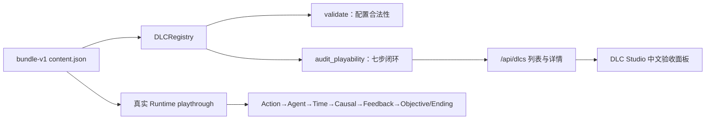
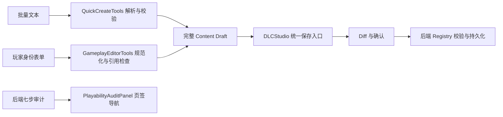

# 世界模拟器 — 大明王朝·朝堂风云 开发文档

## 一、项目概述

这是一个基于 **多 Agent 框架 + LLM 驱动** 的古代朝廷模拟器。玩家扮演皇帝，处理来自各级官员的奏折，下达旨意。各级官员由 AI Agent 驱动，会根据自己的性格（忠直/贪腐/圆滑/部门/刚正/野心）产生不同的行为。

### 核心玩法
1. **事件发生** → 基层知县 Agent 被唤醒
2. **Agent 决策** → 通过 `submit_action` 表达意图（汇报/隐瞒/越级/执行）或 `request_action` 触发行动
3. **Router 路由** → LLM 解析意图，决定消息传递路径和延迟
4. **定时器等待** → 模拟古代公文传递的时间延迟
5. **逐级上报** → 知府 → 布政使 → 内阁 → 皇帝
6. **皇帝批复** → 批准/驳回/下旨，通过太监传达回基层执行
7. **ActionAgent 执行** → 查询实体、更新状态、排队延迟事件，并通过类型化工具生产、消费或原子转移锚定资产
8. **OngoingEvent 到期** → 系统自动应用延迟变化（状态更新 + 库存增减）

---

## 二、项目文件结构

```
世界模拟器/
├── main.py                          # 【后端入口】初始化 + lifespan + 注册路由
├── routers/                         # 【API 路由层】按功能拆分的 FastAPI Router 模块
│   ├── __init__.py
│   ├── _state.py                    # 共享全局状态（orchestrator/tianji_agent/ws_clients）
│   ├── simulation.py                # 模拟控制 + 设置 + 天玑 AI + WebSocket + 奏折持久化 + 新游戏
│   ├── saves.py                     # 存档管理（存/读/列表/重命名/删除）
│   ├── editor.py                    # Agent 编辑器（官员/地点/人格/Prompt CRUD）
│   ├── worldstate.py                # 世界状态（实体/库存/关系/事件 CRUD）
│   └── debug.py                     # 调试接口（timeline/timers/router-log/action-log）
├── requirements.txt                 # Python 依赖（fastapi, uvicorn, httpx, websockets, pydantic）
├── start.bat / start.sh             # 一键启动脚本
├── runtime/                         # 运行时状态（自动创建，gitignore）
│   ├── world.db                     # SQLite 数据库（官员/地点/定时器/世界状态/关系/事件）
│   ├── chain_log.jsonl              # 调用链日志
│   ├── state.json                   # 运行时状态（sim_time/seconds_per_day/memorials）
│   └── agents/                      # Agent 记忆持久化（{agent_id}.json）
├── saves/
│   └── {存档名}/                    # 每个存档一个子目录
│       ├── meta.json                # 元信息（save_name/saved_at/sim_day/agent_count等）
│       ├── runtime.json             # 运行时（agent_memories/pending_memorials/seconds_per_day）
│       ├── daming_court.db          # SQLite 数据库快照（热备份）
│       └── chain_log.jsonl          # 调用链日志快照
│
├── config/                          # 全局配置
│   ├── llm.json                     # LLM API 配置（base_url, api_key, model, timeout_s, max_concurrent）
│   └── time.json                    # 时间倍率配置（seconds_per_day；tick_interval 未使用）
│
├── multiagent_framework/            # 【框架层】通用多 Agent 框架，可复用于其他 DLC
│   ├── __init__.py
│   ├── types.py                     # 【核心】所有数据结构定义
│   ├── llm_client.py                # 【核心】OpenAI 兼容 LLM 客户端
│   ├── fc_tools.py                  # 【核心】FC 工具定义中央注册表（18 个工具）
│   ├── fc_handlers.py               # 【核心】FC 处理函数中央注册表（每工具一个 handler）
│   ├── agent_runtime.py             # 【核心】Agent 基类 + 官员/机构 Agent 实现
│   ├── action_agent.py              # 【核心】行动模拟 Agent（读写世界状态 + 排队延迟事件）
│   ├── action_causal_bridge.py      # ActionResult → 脱敏确定性因果源事件（显式 opt-in）
│   ├── tianji_agent.py              # 【调试】天玑 AI（全工具注入，独立于主循环）
│   ├── router.py                    # 【核心】世界运行法则（LLM 驱动的路由中枢）
│   ├── orchestrator.py              # 【核心】主循环，驱动整个模拟
│   ├── court_graph.py               # 朝廷层级图（官员查询 + 坐标委托 WorldState）
│   ├── timer_system.py              # 定时器系统（heapq + SQLite 持久化）
│   ├── wakeup_runtime.py            # 持久 Agent Wakeup Outbox（at-least-once）
│   ├── chain_log.py                 # 调用链日志（JSONL 追加写入）
│   ├── world_state.py               # 世界状态数据库（实体/库存/关系/事件/资源代币）
│   ├── memory_compressor.py         # 【核心】LLM 记忆压缩（Agent 记忆超阈值时自动摘要）
│   ├── runtime_paths.py             # 运行时路径常量（runtime/ 目录结构）
│   └── runtime_persistor.py         # 运行时状态持久化（后台定期 flush 到磁盘）
│
├── daming_court/                    # 【DLC 层】大明朝廷内容包
│   ├── __init__.py
│   ├── loader.py                    # 数据加载器（JSON → 官员/Agent/事件/世界状态）
│   ├── config/
│   │   ├── officials.json           # 官员数据（ID/品级/位置/上级/性格）
│   │   ├── personas.json            # 人格模板（贪腐/忠直/圆滑/部门/刚正/野心的 prompt 描述）
│   │   ├── events.json              # 初始事件（蝗灾等）
│   │   └── world_state.json         # 初始世界状态（实体/库存/关系/坐标）
│   └── prompts/
│       ├── official_template.txt    # 官员通用 prompt 模板
│       ├── router.txt               # Router system prompt
│       ├── action_agent.txt         # 行动 Agent prompt 模板
│       ├── tianji.txt               # 天玑 AI system prompt（可选，缺失时使用内置默认）
│       └── {官员ID}.txt             # 某官员的专用 prompt（可选，优先级最高）
│
├── frontend/                        # 前端（React + Vite）
│   ├── src/
│   │   ├── main.jsx                 # 前端入口（皇帝视角）
│   │   ├── App.jsx                  # 【皇帝视角】主界面（奏折列表/批复/在途公文/关系图）
│   │   ├── AppNav.jsx               # 【导航】浮动可拖拽导航栏（朝堂/编修/天玑）
│   │   ├── GodView.jsx              # 【上帝视角】调试界面（时间线/Router日志/定时器）
│   │   ├── WorldStateView.jsx       # 【世界状态】实体/库存/关系/事件 CRUD + 资源代币
│   │   ├── AgentEditor.jsx          # 【Agent 编辑器】可视化编辑官员/地点/人格 + 系统Agent配置
│   │   ├── TianJiView.jsx           # 【天玑 AI】全工具调试对话页
│   │   ├── RelationsView.jsx        # 【关系图】ReactFlow 实体关系可视化
│   │   ├── editor-main.jsx          # 编辑器独立入口
│   │   ├── tianji-main.jsx          # 天玑独立入口
│   │   ├── hooks/useWebSocket.js    # WebSocket hook
│   │   ├── design-system.css        # 共享设计令牌、背景、字体、表单、动效与滚动条
│   │   ├── App.css / editor.css / tianji.css / AppNav.css / RelationsView.css
│   │   └── index.css                # 基础 reset
│   ├── index.html / editor.html / tianji.html
│   ├── package.json                # 依赖（含 @dagrejs/dagre, reactflow）
│   └── vite.config.js
│
└── tests/                           # 测试
    └── unit/                        # 单元测试
```

---

## 三、核心模块详解

### 3.1 types.py — 数据结构定义

**作用**：定义框架中所有数据结构，是整个项目的数据契约。

| 数据结构 | 用途 | 完整字段 |
|---------|------|---------|
| `TimerEntry` | 定时器条目 | timer_id, fire_at, target_agent, payload, chain_id, parent_timer_id, created_at, cancelled |
| `ChainLogEntry` | 调用链记录 | chain_id, entry_id, event_id, sim_time, caller, caller_agent_type, fc_called, original_text, transmitted_text, is_distorted, distortion_note, hop_count, routed_to, timer_id, trigger_at, wakeup_type, status |
| `AgentAction` | Agent 输出的行动意图 | agent_id, action, content, original_intent, is_distorting, urgency, metadata |
| `EventObject` | 系统事件 | event_id, event_type, severity, target_agents, initial_payload, generated_at |
| `RouterCommandType` | Router 输出指令类型枚举 | WAKE_AGENT, EXECUTE_POLICY, RELAY_DECREE, BROADCAST, NO_OP |
| `RouterCommand` | Router 输出的指令 | command_type, target, targets, payload, delay_seconds, chain_id, source_action |
| `ActionResult` | ActionAgent 完成行动后的结果 | action_type, executor_id, target_location, result_description, duration_days, changes_made, success, error, fc_trace |
| `TickResult` | 一次 tick 推送给前端的数据 | sim_time, new_memorials, in_transit, chain_entries, agent_errors, token_usage；有 `to_dict()` 方法 |
| `PlayerAction` | 皇帝的操作 | action_type, memorial_id, content, note |
| `OngoingEvent` | 正在进行的事件 | event_id, entity_id, event_type, description, start_time, end_time, expected_result, source_action_id |

**关键枚举**：
- `RouterCommandType`: WAKE_AGENT, EXECUTE_POLICY, RELAY_DECREE, BROADCAST, NO_OP
- `PlayerActionType`: APPROVE, REJECT, HOLD, ISSUE_DECREE

> **注意**：`BROADCAST` 和 `NO_OP` 目前没有对应的 FC handler，如果 Router 返回这两种类型，`dispatch_fc` 会返回错误。

---

### 3.2 orchestrator.py — 主循环（核心调度器）

**作用**：驱动整个模拟的主循环，管理时间推进、Agent 调用、定时器检查、OngoingEvent 到期处理、玩家操作处理。

**核心逻辑**：
```
run() 主循环（0.25s 间隔）
  │
  ├─ 用真实流逝时间推进 sim_time（不被 LLM 阻塞）
  │
  └─ _tick() 每帧处理
      ├─ 1. claim 到期定时器 → 以稳定 ID 加入持久 Wakeup Outbox
      ├─ 1.5 弹出到期的 OngoingEvent → _apply_matured_event()（写回实体状态/库存）
      ├─ 2. claim Outbox pending 唤醒
      │     ├─ 皇帝奏折 → Issue/奏折落地后 ACK
      │     ├─ Agent 调用 → 后台 asyncio.Task（不阻塞主循环）
      │     └─ 成功 ACK；Agent/Router 异常或取消则 retry 为 pending
      ├─ 3. 处理玩家操作队列
      ├─ 4. 收集在途公文状态
      └─ 5. Token 统计
```

**重要方法**：
| 方法 | 作用 |
|-----|------|
| `run(tick_interval=0.25)` | 主循环，实时推进 sim_time；启动 persistor 后台任务 |
| `_tick()` | 单次 tick：检查定时器 → 弹出到期事件 → 派发唤醒 → 处理玩家操作 |
| `_process_agents_background()` | 后台并行调用 Agent → Router 批量处理 → 执行指令 |
| `runtime_snapshot()` / `restore_runtime_snapshot()` | 统一自动存档、手工存档与启动恢复的运行时字段 |
| `_call_agent_safe()` | 调用单个 Agent，记录 chain log，异常安全 |
| `_apply_matured_event(ev)` | 应用到期 OngoingEvent 的 expected_result（更新状态 + 库存） |
| `_build_fc_context()` | 组装 FCContext |
| `_execute_commands()` | 遍历 RouterCommand，调用 dispatch_fc 统一执行 |
| `_handle_player_action(action, result)` | 处理皇帝操作：找太监 → 唤醒太监传达旨意 |
| `_fuzzy_find_agent()` | 模糊匹配 Agent |
| `inject_event()` | 注入事件 |
| `save_state()` | 返回 dict（sim_time, seconds_per_day, timer_count, agent_memories） |
| `load_state(state)` | 恢复状态（sim_time, seconds_per_day, 记忆等） |
| `inject_player_action(action)` | async，注入玩家操作到队列 |
| `set_time_scale(seconds_per_day)` | 设置时间倍率（需暂停） |
| `pause()` / `resume()` / `stop()` | 模拟控制 |
| `drain_agent_tasks(timeout)` | 等待后台 Agent 任务完成 + flush persistor |

**时间系统**：
- `sim_time`：游戏世界时间，单位游戏秒，1 游戏天 = 86400 游戏秒
- `seconds_per_day`：速度倍率，多少真实秒 = 1 游戏天
- 推进公式：`sim_time += real_elapsed * (86400 / seconds_per_day)`

---

### 3.3 router.py — 世界运行法则（LLM 驱动的路由中枢）

**作用**：接收一批 Agent 的 `submit_action`，用 LLM 解析意图，决定消息怎么传递。Router 在描述官员信息时会调用 `court.get_distance()` 获取浮点天数，并以 `距离约X.X天` 形式传给 LLM。

**FC 工具集**（Router 可调用的工具）：
| 工具 | 作用 |
|-----|------|
| `wake_agent(target, message, from_agent, urgency?)` | 向目标 Agent 投递消息；延迟由代码根据双方坐标与 urgency 计算 |
| `execute_policy(policy, location, executor?, from_agent?, description?)` | 调用世界模拟 Agent 执行政策效果 |
| `relay_decree(decree, targets, urgency?)` | 传递皇帝圣旨给指定官员 |
| `list_agents(location_id?)` | 列出所有可唤醒 Agent |

**重要方法**：
| 方法 | 作用 |
|-----|------|
| `process_batch(actions, context=None)` | 批量处理 AgentAction，返回 RouterCommand 列表；`context` 为可选额外上下文 |
| `_build_batch_description(actions, context)` | 构建给 LLM 的描述 |
| `_parse_commands()` | 解析 LLM 的 function call 响应 |
| `_fc_to_command()` | 将单个 FC 调用转换为 RouterCommand |
| `update_time_scale(seconds_per_day)` | 更新时间倍率 |
| `_default_prompt()` | 默认 Router system prompt |

---

### 3.4 fc_tools.py — FC 工具定义注册表

**作用**：所有 FC 工具的唯一定义来源。各 Agent 按需 import 所需工具分组。

| 分组常量 | 用途 | 工具数 |
|---------|------|--------|
| `ACTION_AGENT_TOOLS` | 世界查询、类型化经济动作、事件 CRUD、Agent 列表和结束行动 | 11 |
| `ROUTER_TOOLS` | Agent 调度 | 4 |
| `AGENT_TOOLS` | Agent 意图表达 | 2 |
| `ALL_TOOLS` | 天玑与兼容调用方使用的全量工具 | 18 |

**扩展规则**：新增工具只需在此文件定义 schema + 加入对应分组，无需改动任何 Agent 文件。

**工具完整列表**：
| 工具 | 分组 | 参数 |
|------|------|------|
| `list_entities` | ACTION / ALL | `entity_type?`（location/institution/organization） |
| `query_entity` | ACTION / ALL | `entity_id` |
| `update_entity_status` | ACTION / ALL | `entity_id, new_status` |
| `update_inventory` | ALL（兼容） | `entity_id, resource_name, quantity_delta, reason?` |
| `produce_resource` | ACTION / ALL | `entity_id, resource_name, quantity, reason?` |
| `consume_resource` | ACTION / ALL | `entity_id, resource_name, quantity, reason?` |
| `transfer_anchored_value` | ACTION / ALL | `from_entity_id, to_entity_id, from_resource, to_resource, base_value, reason?` |
| `add_ongoing_event` | ACTION / ALL | `entity_id, description, duration_days, expected_result, event_type?` |
| `modify_ongoing_event` | ACTION / ALL | `event_id, description?, duration_days?, expected_result?` |
| `delete_ongoing_event` | ACTION / ALL | `event_id` |
| `list_agents` | ROUTER / ACTION / ALL | `location_id?` |
| `complete_action` | ACTION / ALL | `result_description, duration_days, success?` |
| `wake_agent` | ROUTER / ALL | `target, message, from_agent, urgency?` |
| `execute_policy` | ROUTER / ALL | `policy, location, executor?, from_agent?` |
| `relay_decree` | ROUTER / ALL | `decree, targets, urgency?` |
| `submit_action` | AGENT / ALL | `action, content, original_intent, is_distorting, urgency?, metadata?` |
| `request_action` | AGENT / ALL | `action_type, target_location, description, resources?, causal_event_type?` |

> **注意**：`query_inventory` 已合并进 `query_entity`（一次性返回实体状态 + 库存 + 正在进行的事件）。

---

### 3.5 fc_handlers.py — FC 处理函数注册表

**作用**：每个 FC 工具有且仅有一个 handler。所有调用方（Orchestrator / ActionAgent / TianJiAgent）组装 `FCContext` 后调用 `dispatch_fc`，行为完全一致。

**核心抽象**：

`FCContext` 数据类打包所有依赖：
- `world_state`, `court`, `timers`, `chain_log`, `action_agent`
- `pending_wakeups`, `run_action`, `agent_tasks` — Orchestrator 共享引用（可选）
- `sim_time`, `seconds_per_day`（传入速度倍率值）, `caller_id`, `chain_id`, `source_action`
- `changes_made` — ActionAgent 收集世界状态变更列表

**Handler 分组**：
| 组 | Handler | 异步 |
|----|---------|------|
| 世界状态 | `handle_list_entities / handle_query_entity / handle_update_entity_status / handle_update_inventory` | 否 |
| 类型化经济动作 | `handle_produce_resource / handle_consume_resource / handle_transfer_anchored_value` | 否 |
| 正在进行的事件 | `handle_add_ongoing_event / handle_modify_ongoing_event / handle_delete_ongoing_event` | 否 |
| 行动完成 | `handle_complete_action` | 否 |
| Agent 列表 | `handle_list_agents` | 否 |
| Router | `handle_wake_agent / handle_execute_policy / handle_relay_decree` | 是 |

**关键函数**：
| 函数 | 说明 |
|------|------|
| `dispatch_fc(name, ctx, args)` | 统一分发入口，async-aware |
| `command_type_to_fc_name(cmd_type)` | RouterCommandType → FC 工具名 |
| `command_to_fc_args(cmd)` | RouterCommand → FC 参数 dict |
| `parse_agent_fc_response(response, agent_id)` | LLM 响应 → `list[AgentAction]`（支持双 FC 同时返回） |
| `parse_submit_action / parse_request_action` | FC args → AgentAction |
| `_resolve_entity_id(world_state, entity_id)` | 模糊实体 ID 匹配（精确匹配 → search_entities 的 id/name/description LIKE 搜索） |

**扩展规则**：新增工具只需写一个 handler 函数，加入 `FC_HANDLERS` 字典即可。

### 3.5.1 action_causal_bridge.py — 行动结果因果桥接

**作用**：把完成的 `ActionResult` 转换为确定性、脱敏且有界的 `CausalEvent`，供 DLC 因果规则继续派生世界事件。该桥接严格采用显式 opt-in：只有原始 `request_action` 提供合法 `causal_event_type` 时，`Orchestrator._run_action()` 才会发布事件；未提供时保持历史行为。

**不变量**：

- 事件 ID 由 chain/source/intent/action 等稳定字段生成，同一行动重放得到同一 ID；
- payload 只保留行动类型、执行者、目标、成功状态、耗时、经济变化数量、经济操作类别和净基础价值变化；
- 不复制 Prompt、Function Calling 参数、`fc_trace`、完整 `changes_made`、结果叙事正文、API 配置或凭据；
- 非法事件类型被拒绝，不允许通过通配或自动发布扩大既有 DLC 因果链。

---

### 3.6 agent_runtime.py — Agent 运行时

**作用**：Agent 基类定义 + 官员/机构 Agent 实现。

**类层次**：
```
BaseAgent (抽象基类)
  ├─ OfficialAgent    — 官员 Agent，模拟单个官员
  └─ InstitutionAgent — 机构 Agent，模拟机构中除一把手外的所有员工
```

**AgentConfig 字段**：
| 字段 | 类型 | 默认值 | 说明 |
|------|------|--------|------|
| `agent_id` | str | `""` | Agent 标识 |
| `agent_type` | str | `"official"` | 类型标识 |
| `display_name` | str | `""` | 显示名称 |
| `system_prompt` | str | `""` | 系统 prompt |
| `tools` | list[dict] | `[]` | FC 工具列表 |
| `personality_seed` | str | `""` | 人格种子 |
| `max_memory` | int | `20` | 记忆 deque 最大长度 |
| `compress_threshold` | int | `40` | 压缩阈值 |
| `keep_recent` | int | `20` | 压缩时保留最近 N 条 |

> **注意**：`llm_client` 不是 AgentConfig 字段，而是 `BaseAgent.__init__()` 的单独参数。

**BaseAgent 方法**：
- `add_memory(role, content)` — 添加一条记忆
- `get_messages()` — 构建消息列表（含摘要压缩后拼接）
- `set_compressor(compressor)` — 注入记忆压缩器
- `_maybe_compress()` — 记忆超阈值时自动压缩，合并已有摘要
- `_record_response_to_memory()` — 格式化 LLM 响应写入记忆
- `serialize_memory()` — 序列化为 v2 dict（`{version, summary, messages}`）
- `deserialize_memory(data)` — 从 v2 dict 或 v1 list 恢复 deque

**关键设计**：
- Agent 只能**表达意图**，不直接执行
- `original_intent`（真实想法）vs `content`（实际传递）支持信息失真模拟
- `is_distorting` 由 Agent 自己声明是否故意歪曲信息
- `process()` 返回 `list[AgentAction]`，支持双 FC（submit_action + request_action 同时发出）

---

### 3.7 tianji_agent.py — 天玑调试 Agent

**作用**：全工具注入的调试对话 Agent，独立于 Orchestrator 主循环。

**工具集**（五类，共 18 个）：
| 类别 | 工具 |
|------|------|
| 世界状态 | `list_entities / query_entity / update_entity_status / update_inventory / add_ongoing_event / modify_ongoing_event / delete_ongoing_event` |
| 类型化经济动作 | `produce_resource / consume_resource / transfer_anchored_value` |
| 行动完成 | `complete_action` |
| Agent 调度 | `list_agents / wake_agent / execute_policy / relay_decree` |
| Agent 行为 | `submit_action / request_action / finish_turn` |

**重要方法**：
| 方法 | 作用 |
|------|------|
| `reset()` | 清空对话历史，重新注入 system prompt |
| `chat(user_text)` | 主入口，async generator，yield SSE 事件 |
| `_build_ctx()` | 组装 FCContext |
| `_dispatch_tool(name, args)` | 统一分发 |
| `get_history()` | 返回当前 messages 列表 |
| `_load_system_prompt()` | 加载 system prompt |

**SSE 事件类型**：
- `assistant_delta` — LLM 文本流
- `tool_call` — 工具调用（含 `call_id`）
- `tool_result` — 工具结果（含 `call_id`）
- `tool_round_start` — 工具轮开始
- `error` — LLM 调用错误
- `done` — 本轮结束

> **注意**：`_summarize_result()` 是模块级函数，不是类方法。`session_id` 是实例属性。

---

### 3.8 action_agent.py — 行动模拟 Agent

**作用**：模拟官员行动的过程和结果，读写世界状态数据库。

**FC 工具集**（ACTION_AGENT_TOOLS，9 个）：
| 工具 | 作用 |
|-----|------|
| `list_entities(entity_type?)` | 列出实体 |
| `query_entity(entity_id)` | 查询实体完整状态（含库存 + 进行中的事件） |
| `update_entity_status(entity_id, new_status)` | 更新实体状况 |
| `update_inventory(entity_id, resource_name, quantity_delta, reason?)` | 增减资源代币 |
| `add_ongoing_event(entity_id, description, duration_days, expected_result, event_type?)` | 排队延迟事件 |
| `modify_ongoing_event(event_id, description?, duration_days?, expected_result?)` | 修改进行中的事件 |
| `delete_ongoing_event(event_id)` | 取消进行中的事件 |
| `list_agents(location_id?)` | 列出 Agent |
| `complete_action(result_description, duration_days, success?)` | 结束行动 |

**工作流程**：
1. 收到行动请求（action_type/executor_id/target_location/description）
2. 构建动态 system prompt（注入世界状态上下文）
3. 多轮 FC 循环（默认 max_rounds=7）：
   - 组装 `FCContext` → `dispatch_fc` → 查询实体 → 更新状态/库存/排队事件 → complete_action
4. 返回 ActionResult（结果描述/耗时/成功与否/变更记录）

---

### 3.9 court_graph.py — 朝廷层级图

**作用**：基于 SQLite 存储官员数据，提供层级查询。坐标信息委托给 WorldState。

**数据结构**：
- `Official`: id, name, rank, location_id, role, agent_type, superior_id, personality_seed, enabled, extra_prompt

**重要查询方法**：
| 方法 | 作用 |
|-----|------|
| `get_official(id)` | 获取官员信息 |
| `get_superior(id)` | 获取直属上级 |
| `get_subordinates(id)` | 获取直属下级列表 |
| `get_chain_to_emperor(id)` | 从某官员到皇帝的完整上报链 |
| `get_distance(from_id, to_id, speed_coeff)` | 通信耗时（天），坐标从 WorldState.metadata 获取，无坐标时回退 5.0/speed_coeff |
| `get_officials_at_location()` | 按地点查询 |
| `get_all_officials()` | 获取所有官员 |
| `get_officials_by_rank(rank)` | 按品级查询 |
| `set_world_state(ws)` | 注入 WorldState 引用（用于坐标查询） |
| `add_official(official)` | 添加官员 |
| `bulk_load_officials(officials)` | 批量加载官员 |

> **迁移说明**：`Location` 数据类、`distance_li()` 函数、`get_all_locations()`、`get_location()`、`add_location()` 已移除。坐标信息现在由 WorldState Entity 的 metadata 字段管理。数据库迁移仅检测 `enabled` 和 `extra_prompt` 列。

---

### 3.10 timer_system.py — 定时器系统

- `claim_due(current_time)`：从 heap claim 到期 Timer，但保留 SQLite 行并进入进程内 claimed 集合。
- `ack(timer_id)`：只有对应 Wakeup 已完成时才删除 SQLite 行。
- `release_claim(timer_id)`：Outbox 容量或校验失败时把 Timer 放回 heap。
- `pop_due()` 保留兼容语义，内部执行 claim 后立即 ACK；新 Orchestrator 路径必须使用 claim/ack。
- 重启会从 SQLite 重新加载尚未 ACK 的 Timer；结合稳定 `timer:<timer_id>` delivery ID，可与已持久 Outbox 条目幂等汇合。

### 3.10a wakeup_runtime.py — 持久唤醒 Outbox

- 状态机：`pending → inflight → ack/remove`；失败和取消执行 retry，重启把 `inflight` 恢复为 `pending`。
- 交付契约是 **at-least-once**，不是 exactly-once。崩溃可能重放，但不能因为 Timer 先删除或内存列表丢失而静默漏投。
- 稳定 ID：Timer 使用 `timer:<timer_id>`，Event 使用 `event_id + target` 哈希，Chain 使用 `chain_id + target + canonical payload` 哈希；无来源 ID 的兼容路径使用持久 sequence。
- 容量边界：32,768 条、单 payload 256 KiB、总 payload 64 MiB，并限制嵌套深度、节点数和 ID 长度；仅接受 JSON-safe 数据，损坏快照原子 fail closed。
- 兼容旧 FC handler 的 list-like 表面（`append`、遍历、下标、`len`、`clear`），新代码应使用 `enqueue/claim_pending/ack/retry`。

---

### 3.11 chain_log.py — 调用链日志

与 DEV_GUIDE 一致，无重大变更。

---

### 3.12 world_state.py / world_commands.py — 事务化世界状态

**作用**：存储实体动态状态、资产库存、非库存指标/参数、关系与进行中事件；所有核心写入通过 `WorldCommandBus` 在单个 SQLite 事务中执行。

**资源分层**：

- `asset`：可支出库存，存于 `inventory`，带 `anchor_rate` 与版本号。
- `metric`：世界指标，存于 `entity_values`，不参与库存余额与价值合计。
- `parameter`：模拟参数，存于 `entity_values`，按资源目录的 min/max 约束。
- `resource_catalog` 是权威资源定义；内置资源与 DLC 自定义资源使用同一注册方式。

**核心数据结构**：

- `Entity`：含 `version`，状态更新支持乐观并发控制。
- `InventoryItem`：资产数量、版本、价值锚；`base_value = quantity × anchor_rate`。
- `EntityValue`：独立指标或参数及其版本。
- `ResourceDefinition`：name/unit/kind/default/min/max/anchor_rate/metadata。
- `OngoingEvent`：延迟生效的状态与资源变化。
- `WorldCommand` / `WorldCommandResult`：稳定 command ID、canonical payload hash、回执、链路和错误信息。

**命令类型**：`UPDATE_STATUS`、`ADJUST_RESOURCE`、`SET_RESOURCE`、`CREATE_EVENT`、`UPDATE_EVENT`、`DELETE_EVENT`、`APPLY_MATURED_EVENT`。

**事务与审计规则**：

1. 命令使用 `BEGIN IMMEDIATE` 和进程内 `RLock` 串行化写事务。
2. 同 command ID + 同 payload 返回原回执，不重复落账；同 ID + 不同 payload 返回 `idempotency_conflict`。
3. 成功和拒绝回执均持久化到 `world_commands`。
4. 资产变更写入 `inventory_ledger`，记录数量差、锚定价值差、余额、原因、模拟时间与 chain ID。
5. 余额不足、版本冲突、非法资源或非有限数字会使整条命令回滚。
6. 成熟事件在一个事务中完成状态更新、全部资源变化、ledger 和事件删除；任一步失败则事件保留且无部分落账。

**重要方法**：

| 方法 | 作用 |
|-----|------|
| `get_entity_values(id, kind?)` | 查询指标/参数读模型 |
| `get_inventory_valuation(id)` | 返回资产总基础价值与逐项价值 |
| `list_resource_definitions()` | 查询资源目录 |
| `upsert_resource_definition(definition)` | 注册或更新 DLC 资源定义 |
| `get_inventory_ledger(id)` | 查询资产审计账本 |
| `get_world_command(command_id)` | 查询幂等命令回执 |
| `update_status(...)` | 兼容 API；转发 `UPDATE_STATUS` 命令 |
| `set_inventory/update_inventory(...)` | 兼容 API；按目录自动路由到资产、指标或参数 reducer |
| `apply_matured_events(sim_time)` | 原子应用全部到期事件 |
| `bulk_load(...)` | 单事务批量导入 |
| `restore_all(data)` | 单事务完整恢复，失败整体回滚 |
| `export_all()` | 导出 schema v2、资源目录、价值、指标/参数、ledger 与事件 |

`pop_matured_events()` 只保留为兼容只读接口，不再删除事件；Orchestrator 必须调用 `apply_matured_events()`。

---

### 3.13 llm_client.py — LLM 客户端

**核心类型**：
- `LLMConfig` — 配置（base_url/api_key/model/timeout_s/max_concurrent）
  - `from_file(path)` / `save_to_file(path)` / `to_display_dict()`
- `LLMResponse` — LLM 响应数据类（content, tool_calls, input_tokens, output_tokens, latency_ms, raw）
- `LLMClient` 方法：
  - `chat()` — 异步调用（非流式）
  - `chat_stream()` — 流式调用
  - `close()` — 关闭 HTTP 客户端
  - `config` — 属性，当前配置
  - `async update_config(new_config)` — 热更新配置
- `TokenCounter` — 累计 token 统计

---

### 3.14 memory_compressor.py — 记忆压缩器

**核心接口**：
- `MemoryCompressor` — Protocol 协议类，定义 `compress(messages, existing_summary, agent_context)` 接口

**默认实现**：
- `LLMMemoryCompressor` — 基于协议的 LLM 压缩器
  - `compress(messages, existing_summary, agent_context)` → 压缩并返回摘要消息 dict
  - `existing_summary` — 上一次压缩的摘要（需合并），或 None
  - `agent_context` — Agent 身份描述字符串
  - 内部 `_compress_failures` 计数器，超 3 次退化为截断

**辅助函数**：
- `is_summary_message(msg)` — 检测消息是否为压缩摘要
- `find_safe_split_point(messages, target)` — 找到安全分割点（避免切断 tool_calls 组）
- `format_messages_for_compression(messages)` — 格式化消息列表为可读文本

**常量**：
- `SUMMARY_META_KEY = "_meta"` — 摘要消息标记键
- `SUMMARY_TYPE_VALUE = "memory_summary"` — 摘要类型值

---

### 3.15 runtime_paths.py — 运行时路径

- `RUNTIME_DIR = Path("runtime")` — 运行时目录
- `WORLD_DB` — `runtime/world.db`
- `CHAIN_LOG` — `runtime/chain_log.jsonl`
- `STATE_FILE` — `runtime/state.json`
- `AGENTS_DIR` — `runtime/agents/`
- `ensure_runtime_dir()` — 确保 runtime/ 及子目录存在
- `runtime_exists()` — 判断 runtime 是否已初始化

---

### 3.16 runtime_persistor.py — 运行时状态持久化

- `RuntimePersistor` — 负责 Orchestrator 的 in-memory 状态定期落盘到 `runtime/` 目录
  - `mark_agent_dirty(agent_id)` — 标记 Agent 记忆需要落盘
  - `mark_state_dirty()` — 标记 state.json 需要落盘
  - `async flush()` — 批量序列化并原子写入（state.json + agents/*.json）
  - `async run_flush_loop(interval=2.0)` — 后台定时 flush
  - `start()` / `stop()` — 启停 flush loop

设计要点：mark_*_dirty 只标记，不做 IO；flush() 批量序列化并原子写入（.tmp → rename）。

自动 flush、手工 `save_state()` 与启动加载统一通过 `Orchestrator.runtime_snapshot()` / `restore_runtime_snapshot()`，覆盖 sim time、时间倍率、随机/因果事件、时间规则、Temporal/Lifecycle、Deferred Timeline、Wakeup Outbox、Rhythm、Outcome Feedback、Action、Issue、Objective 与 Actor runtime，避免自动存档遗漏新运行时字段。

---

### 3.17 loader.py — DLC 数据加载器

**加载流程**：
1. `load_world_state()` → 加载实体、库存和关系到 WorldState，返回 (entity_count, inventory_count, relation_count)
2. `load_officials()` → 加载官员列表
3. `create_agents()` → 为每个官员创建 Agent 实例，注入 system prompt
4. `load_events()` → 加载初始事件

> **注意**：`load_locations()` 已移除。坐标信息现在通过 `load_world_state()` 从 world_state.json 的实体 metadata 加载。

**Prompt 优先级**：
1. 专用文件 `daming_court/prompts/{官员ID}.txt`（最高）
2. 通用模板 `official_template.txt`
3. 默认模板

**记忆压缩注入**：`create_agents()` 创建 Agent 后，Orchestrator 会为每个 Agent 注入 `LLMMemoryCompressor`。

---

## 四、数据流与调用链

### 4.1 完整信息流

```
事件注入（蝗灾）
    │
    ▼
知县 Agent 被唤醒
    │
    ├─ submit_action → "上报灾情给知府"
    │       │
    │       ▼
    │   Router (LLM) 解析意图
    │       │
    │       ├─ 查层级：知县 → 知府（直属上级）
    │       ├─ 调用 wake_agent(target="知府", from_agent="知县", urgency="normal")
    │       │
    │       ▼
    │   handler 根据双方坐标自动算延迟 → 写 TimerSystem（异地）或 pending_wakeups（同城）
    │
    ▼ （1游戏天后定时器触发）
    │
知府 Agent 被唤醒
    │
    ├─ submit_action → "上报给布政使" 或 "压下不报"
    │       │
    │       ▼
    │   Router 处理...
    │
    ▼ （逐级上报）
    │
皇帝收到奏折
    │
    ├─ 玩家操作：approve / reject / hold / issue_decree
    │
    ▼
太监 Agent 被唤醒
    │
    ├─ relay_decree → 逐级下达
    │
    ▼
基层执行（ActionAgent）
    │
    ├─ 知县 Agent request_action → ActionAgent 模拟行动
    │   ├─ query_entity → 查看灾情
    │   ├─ update_inventory → 扣除赈灾粮款
    │   ├─ add_ongoing_event → 目标地点排队 N 天后到账
    │   └─ complete_action → 回执 N 天后送达
    │
    ▼
OngoingEvent 到期
    │
    └─ _apply_matured_event() → 自动更新 current_status + 增减库存
```

### 4.2 调用链追踪（Chain Log）

每个消息都有唯一的 `chain_id`，整条链路的每一步都记录在 `chain_log.jsonl`：

```
chain_abc123:
  [hop=1] 吴县知县_张三 → submit_action → "蝗灾严重，请知府拨粮" (distorted: false)
  [hop=2] Router → wake_agent → 苏州知府_况钟 (urgency=normal, delay: 0.1 day)
  [hop=3] 苏州知府_况钟 → submit_action → "江南蝗灾，请求布政使赈灾" (distorted: true)
  [hop=4] Router → wake_agent → 江南布政使_周忱 (urgency=express, delay: 1.4 day)
  ...
  [hop=7] 皇帝 → approve → "准奏，拨粮三千石"
```

上帝视角可以对比 `original_text`（真实意图）vs `transmitted_text`（实际传递），看到信息失真。

---

## 五、API 接口一览

### 5.1 模拟控制

| 端点 | 方法 | 说明 |
|------|------|------|
| `/api/start` | POST | 启动模拟 |
| `/api/pause` | POST | 暂停模拟 |
| `/api/resume` | POST | 恢复模拟 |
| `/api/new-game` | POST | 清空 runtime 并重新初始化（新游戏） |
| `/api/memorials` | GET | 返回当前持久化的奏折列表 |
| `/api/saves` | GET | 列出所有存档（按 saved_at 倒序） |
| `/api/save` | POST | 存档（需先暂停） |
| `/api/load` | POST | 读档（恢复 SQLite/chain_log/Agent 记忆） |
| `/api/saves/rename` | POST | 重命名存档 |
| `/api/saves/{name}` | DELETE | 删除存档 |

### 5.2 玩家操作

| 端点 | 方法 | 说明 |
|------|------|------|
| `/api/player-action` | POST | 皇帝操作（approve/reject/hold/issue_decree） |

### 5.3 设置与配置

| 端点 | 方法 | 说明 |
|------|------|------|
| `/api/settings` | GET/POST | LLM + 时间配置（热更新） |
| `/api/time-scale` | GET/POST | 时间倍率（需暂停） |
| `/api/prompts` | GET/POST | Prompt 文件读写 |

### 5.4 天玑 AI

| 端点 | 方法 | 说明 |
|------|------|------|
| `/api/tianji/chat` | POST | SSE 流式对话（body: `{message: str}`） |
| `/api/tianji/reset` | POST | 清空对话历史，重新注入 system prompt |
| `/api/tianji/history` | GET | 返回当前 messages |
| `/api/tianji/tools` | GET | 返回工具 schema，按类别分组 |

### 5.5 调试接口

| 端点 | 方法 | 说明 |
|------|------|------|
| `/api/debug/timeline?after=N&limit=50` | GET | chain log 增量拉取 |
| `/api/debug/timers` | GET | 定时器状态 |
| `/api/debug/router-log?after=N` | GET | Router 决策日志增量拉取 |
| `/api/debug/action-log?after=N` | GET | ActionAgent 执行日志增量拉取 |
| `/api/chain-log/{chain_id}` | GET | 单条链的上帝视角 |
| `/api/token-usage` | GET | Token 用量统计 |
| `/api/in-transit` | GET | 在途公文列表 |

### 5.6 世界状态

| 端点 | 方法 | 说明 |
|------|------|------|
| `/api/world-state` | GET | 导出 schema v2：实体、资产、指标/参数、资源目录、关系、事件与账本 |
| `/api/world-state/{entity_id}` | GET | 返回实体版本、锚定资产、指标、参数、总价值、关系与事件 |
| `/api/world-state/{entity_id}` | PUT | 创建或更新实体 |
| `/api/world-state/{entity_id}` | DELETE | 删除实体（级联删库存/关系/事件） |
| `/api/world-state/{entity_id}/status` | POST | 事务化修改状态；支持 `Idempotency-Key` 与 `expected_version` |
| `/api/world-state/{entity_id}/inventory` | PUT | 按资源目录更新资产/指标/参数；支持幂等与乐观版本 |
| `/api/world-state/{entity_id}/inventory/{category}/{item_name}` | DELETE | 保留兼容入口；注册资源不可直接删除 |
| `/api/relations` | GET | 列出所有关系 |
| `/api/world-state/{entity_id}/relations` | GET | 获取实体关系（parents/children/siblings） |
| `/api/relations` | POST | 创建或覆盖关系 |
| `/api/relations` | DELETE | 删除关系 |
| `/api/world-state/{entity_id}/events` | GET | 列出实体的正在发生的事件 |
| `/api/world-state/{entity_id}/events` | POST | 创建正在发生的事件 |
| `/api/world-state/events/{event_id}` | PATCH | 修改事件 |
| `/api/world-state/events/{event_id}` | DELETE | 取消事件 |

### 5.7 Agent 编辑器

| 端点 | 方法 | 说明 |
|------|------|------|
| `/api/editor/officials` | GET | 返回 officials + locations 配置 |
| `/api/editor/officials/{id}` | PUT/DELETE | 更新/删除官员 |
| `/api/editor/officials/batch` | POST | 批量保存官员 |
| `/api/editor/locations/{location_id}` | GET | 获取地点详情（从 WorldState metadata） |
| `/api/editor/locations/{location_id}` | PUT | 更新地点（写入 WorldState metadata + DB） |
| `/api/editor/prompt-preview` | POST | 预览官员 system prompt |
| `/api/editor/personas` | GET | 返回所有人格种子 |
| `/api/editor/personas/{name}` | PUT/DELETE | 新增/删除人格种子 |
| `/api/editor/personas/batch` | POST | 批量保存人格种子 |

> **注意**：`/api/editor/locations/batch` 已移除。

### 5.8 WebSocket

| 端点 | 说明 |
|------|------|
| `/ws` | 实时 tick 推送（每 0.25s 广播 TickResult） |

---

## 六、数据库结构

### SQLite 表结构（runtime/world.db）

> CourtGraph（官员表）、TimerSystem（定时器表）、WorldState（实体表、库存表、关系表、事件表）共用同一个 `runtime/world.db` SQLite 文件。

```sql
-- 官员表
CREATE TABLE officials (
    id TEXT PRIMARY KEY,
    name TEXT NOT NULL,
    rank INTEGER NOT NULL,
    location_id TEXT,
    role TEXT NOT NULL DEFAULT 'official',  -- official / eunuch / player
    agent_type TEXT NOT NULL DEFAULT 'official',  -- official / institution
    superior_id TEXT,
    personality_seed TEXT DEFAULT '忠直',
    enabled INTEGER DEFAULT 1,            -- 是否参与模拟
    extra_prompt TEXT DEFAULT ''           -- 附加个性化提示词
);

-- 实体表（状态版本用于 optimistic concurrency）
CREATE TABLE entities (
    id TEXT PRIMARY KEY,
    type TEXT NOT NULL,
    name TEXT NOT NULL,
    description TEXT DEFAULT '',
    current_status TEXT DEFAULT '',
    updated_at REAL DEFAULT 0,
    metadata TEXT DEFAULT '{}',
    version INTEGER NOT NULL DEFAULT 0
);

-- 仅存放可支出资产；anchor_rate 从 resource_catalog 读取
CREATE TABLE inventory (
    entity_id TEXT NOT NULL,
    category TEXT NOT NULL,
    item_name TEXT NOT NULL,
    quantity REAL DEFAULT 0,
    description TEXT DEFAULT '',
    version INTEGER NOT NULL DEFAULT 0,
    PRIMARY KEY (entity_id, category, item_name),
    FOREIGN KEY (entity_id) REFERENCES entities(id)
);

-- 权威资源定义，DLC 可注册自定义资产、指标和参数
CREATE TABLE resource_catalog (
    name TEXT PRIMARY KEY,
    unit TEXT DEFAULT '',
    kind TEXT NOT NULL,                 -- asset / metric / parameter
    default_quantity REAL DEFAULT 0,
    min_quantity REAL,
    max_quantity REAL,
    anchor_rate REAL,
    metadata TEXT DEFAULT '{}',
    updated_at REAL DEFAULT 0
);

-- 非库存指标与参数
CREATE TABLE entity_values (
    entity_id TEXT NOT NULL,
    name TEXT NOT NULL,
    kind TEXT NOT NULL,
    value REAL DEFAULT 0,
    description TEXT DEFAULT '',
    version INTEGER NOT NULL DEFAULT 0,
    PRIMARY KEY (entity_id, name),
    FOREIGN KEY (entity_id) REFERENCES entities(id)
);

-- 资产审计账本
CREATE TABLE inventory_ledger (
    entry_id TEXT PRIMARY KEY,
    command_id TEXT NOT NULL,
    entity_id TEXT NOT NULL,
    resource_name TEXT NOT NULL,
    sequence INTEGER NOT NULL DEFAULT 0,
    quantity_delta REAL NOT NULL,
    anchor_rate REAL NOT NULL,
    base_value_delta REAL NOT NULL,
    balance_after REAL NOT NULL,
    reason TEXT DEFAULT '',
    sim_time REAL DEFAULT 0,
    chain_id TEXT DEFAULT '',
    metadata TEXT DEFAULT '{}',
    created_at REAL NOT NULL,
    UNIQUE(command_id, entity_id, resource_name, sequence)
);

-- 幂等命令回执；成功与拒绝均保留
CREATE TABLE world_commands (
    command_id TEXT PRIMARY KEY,
    command_type TEXT NOT NULL,
    entity_id TEXT DEFAULT '',
    payload_hash TEXT NOT NULL,
    payload_json TEXT NOT NULL,
    status TEXT NOT NULL,
    result_json TEXT DEFAULT '{}',
    error_code TEXT DEFAULT '',
    error_message TEXT DEFAULT '',
    chain_id TEXT DEFAULT '',
    intent_id TEXT DEFAULT '',
    schema_version TEXT DEFAULT '1.0',
    sim_time REAL DEFAULT 0,
    created_at REAL NOT NULL
);

-- 实体关系表
CREATE TABLE entity_relations (
    parent_id TEXT NOT NULL,
    child_id  TEXT NOT NULL,
    rel_type  TEXT NOT NULL,  -- subordinate / affiliated
    note      TEXT DEFAULT '',
    PRIMARY KEY (parent_id, child_id, rel_type)
);
CREATE INDEX idx_rel_child  ON entity_relations(child_id);
CREATE INDEX idx_rel_parent ON entity_relations(parent_id);

-- 正在进行的事件表
CREATE TABLE ongoing_events (
    event_id TEXT PRIMARY KEY,
    entity_id TEXT NOT NULL,
    event_type TEXT DEFAULT 'state_change',  -- state_change / inventory_arrival
    description TEXT DEFAULT '',
    start_time REAL DEFAULT 0,
    end_time REAL DEFAULT 0,
    expected_result TEXT DEFAULT '{}',  -- JSON: {"new_status": ..., "inventory_deltas": [...]}
    source_action_id TEXT DEFAULT '',
    FOREIGN KEY (entity_id) REFERENCES entities(id)
);
CREATE INDEX idx_event_entity ON ongoing_events(entity_id);
CREATE INDEX idx_event_endtime ON ongoing_events(end_time);

-- 定时器表
CREATE TABLE pending_timers (
    timer_id TEXT PRIMARY KEY,
    fire_at REAL NOT NULL,
    target_agent TEXT NOT NULL,
    payload TEXT NOT NULL,
    chain_id TEXT,
    parent_timer_id TEXT,
    created_at REAL,
    cancelled INTEGER DEFAULT 0
);
```

**迁移兼容**：`court_graph.py` 启动时会自动检测旧数据库缺少 `enabled`、`extra_prompt` 列并执行 `ALTER TABLE ADD COLUMN`。坐标列(`x`, `y`)不再在 officials 表，已迁移到 WorldState 的 Entity metadata。

---

## 七、当前数据配置

### 官员层级（officials.json）

```
皇帝 (rank=15, player)
  ├─ 司礼监太监_王振 (rank=13, eunuch, 圆滑)
  │    └─ 内阁_杨士奇 (rank=10, 忠直)
  │         └─ 通政司 (rank=9, institution, 部门)
  │              └─ 江南布政使_周忱 (rank=8, 忠直)
  │                   └─ 苏州知府_况钟 (rank=5, 忠直)
  │                        ├─ 吴县知县_张三 (rank=1, 贪腐)
  │                        └─ 昆山知县_李四 (rank=1, 忠直)
  ├─ 户部 (rank=12, institution, 部门)
  ├─ 吏部 (rank=12, institution, 部门)
  ├─ 礼部 (rank=12, institution, 部门)
  ├─ 兵部 (rank=12, institution, 部门)
  ├─ 刑部 (rank=12, institution, 部门)
  └─ 工部 (rank=12, institution, 部门)
```

### 地点配置（坐标存储在 WorldState Entity metadata 中）

| 地点 | 类型 | 区域 | X (里) | Y (里) |
|------|------|------|--------|--------|
| 京城 | location | 直隶 | 0 | 0 |
| 北京 | location | 直隶 | 0 | 0 |
| 南京 | location | 江南 | 429 | -1741 |
| 江南布政使司 | institution | 江南 | 200 | -1490 |
| 苏州府 | location | 江南 | 450 | -1730 |
| 吴县 | location | 江南 | 448 | -1732 |
| 昆山县 | location | 江南 | 510 | -1680 |

### 人格模板（personas.json）

- **贪腐**：倾向于隐瞒灾情以避免追责，偶尔索取好处，上报时淡化问题严重性
- **忠直**：如实上报，不夸大不隐瞒，为百姓着想，哪怕可能得罪上级
- **圆滑**：善于揣摩上意，措辞委婉，优先保护自己，不完全说谎也不完全说实话
- **部门**：作为机构人格，按部门职责行事，关注部门利益
- **刚正**：刚正不阿，敢于直言进谏
- **野心**：有野心，善于经营人脉，寻求权力扩张的机会

### 资源代币

资源目录将数值分为 `asset`、`metric`、`parameter`。内置资产为金钱、粮草、工料、兵力；科技点、满意度、人口属于指标；生活质量、税率、生产系数属于参数。资产通过 `anchor_rate` 折算到统一基础价值，DLC 可注册新的资源定义；不适用值仍用 `-1` 表示且禁止修改。

---

## 八、前端结构

### 8.1 AppNav.jsx — 浮动导航栏

- 可拖拽的底部浮动导航，在朝堂/编修/天玑三个页面间切换
- 导航带页面印章图标、当前页高亮与位置持久化；移动端自动收紧
- 三个入口页面共享此组件

### 8.2 App.jsx — 皇帝视角

- 奏折列表（来自各级官员的上报）
- 批复操作（批准/驳回/留中/下旨）
- 在途公文列表（显示剩余送达时间）
- 关系图切换（RelationsView 组件）
- 新游戏按钮
- 模拟时间显示（天/时辰/刻）
- 控制面板（启动/暂停/设置/存档/读档）

### 8.3 GodView.jsx — 上帝视角

- 时间线（chain log 增量拉取，自动滚动，天玑 AI 调用以青色高亮）
- Router 决策日志
- ActionAgent 执行日志
- 定时器状态

### 8.4 WorldStateView.jsx — 世界状态管理

- 实体列表（按类型筛选 + 搜索关键词）
- 实体 CRUD：新建、编辑属性（类型/名称/描述/当前状况）、删除
- 锚定资产行内编辑：显示数量、价值锚、基础价值、总价值和版本
- 世界指标独立只读展示，不计入库存与资产价值
- 核心参数独立编辑，写入时发送 `Idempotency-Key` 与 `expected_version`
- 正在进行的事件 CRUD（OngoingEvent 管理）
- 实体关系编辑
- 地点坐标编辑（仅 `type=location` 时显示）

### 8.5 AgentEditor.jsx — Agent 编辑器

- 官员树形结构 + 系统Agent 配置（Router/ActionAgent/模板/天玑 prompt）
- 官员属性编辑
- 启用/禁用切换
- 人格种子编辑（CRUD）
- Prompt 预览

### 8.6 TianJiView.jsx — 天玑 AI

- 三栏布局：工具列表面板 | 对话区 | 世界状态快照
- 工具调用块折叠展示
- 会话重置按钮
- SSE 流式回复

### 8.7 共享视觉系统

- `design-system.css` 定义全局色彩、字号、字体栈、圆角、阴影、表单焦点、滚动条与低动态偏好
- 视觉方向为“宣纸墨色 × 宫廷朱砂 × 克制鎏金”，三个入口共享品牌印章与层级规则
- `App.css`、`editor.css`、`tianji.css` 保留各自业务布局，并在文件末尾提供页面级视觉覆盖
- 桌面端维持高信息密度；窄屏下主页面、编辑器与天玑工作台切换为纵向布局
- 站点 favicon、HTML 标题和页面品牌文案已统一

### 8.8 RelationsView.jsx — 关系图

- ReactFlow + dagre 自动布局的实体关系可视化
- 节点可拖拽
- 显示实体之间的关系边（subordinate/affiliated）

---

## 九、如何添加新内容

> 添加新官员、新事件、世界状态实体、自定义 Prompt 的详细操作指南见 [DEV_GUIDE.md](DEV_GUIDE.md)。

---

## 十、待完成功能（TODOS）

### v1 未完成
- **时间模拟器**：科学计算过程耗时
- **集成测试**：mock LLM 的端到端链路测试

### v1 已完成
- **天玑 AI**：全工具注入的调试对话 Agent，独立前端页面，SSE 流式回复，工具调用可视化
- **记忆压缩**：LLM 记忆压缩器，Agent 记忆超阈值时自动摘要，v2 格式存档
- **OngoingEvent 系统**：延迟生效事件，到期自动落账（状态 + 库存）
- **实体关系系统**：实体间有向关系边（subordinate/affiliated）
- **资源目录与价值锚**：资产/指标/参数分层，资产统一折算基础价值，版本与账本可审计，机构不适用项为 -1
- **运行时持久化**：RuntimePersistor 后台定期 flush 到 runtime/ 目录
- **关系图前端**：RelationsView (ReactFlow) 实体关系可视化

### v1.1+
- **Agent 孵化机制**：机构 Agent 在某些条件下自动孵化出独立的官员 Agent
- **更多事件类型**：当前基本只有蝗灾样例

---

## 十一、关键设计原则

1. **Agent 只表达意图，不直接执行**：所有行动由 Router（世界运行法则）仲裁
2. **信息失真由 Agent 自主产生**：`original_intent` vs `content`，`is_distorting` 由 Agent 声明
3. **时间推进不被 LLM 阻塞**：Agent 调用作为后台 asyncio.Task
4. **定时器延迟用游戏时间**：`delay_days * 86400` 游戏秒，改速度自然影响触发快慢
5. **DLC 分离**：框架层（multiagent_framework）可复用于其他场景
6. **FC 工具单点定义**：工具 schema 在 `fc_tools.py`，handler 在 `fc_handlers.py`，每个工具只有一份代码；添加新工具只需改这两个文件
7. **FCContext 模式**：调用方组装上下文，handler 消费上下文；Orchestrator 和天玑用同一个 handler，靠 context 字段决定执行路径
8. **共享数据库**：CourtGraph、TimerSystem、WorldState 共用 `runtime/world.db`，各自管理独立的表
9. **记忆压缩**：Agent 记忆超阈值时自动触发 LLM 摘要，序列化格式为 v2 dict（`{version, summary, messages}`），兼容 v1 list 反序列化
10. **OngoingEvent 原子落账**：Orchestrator 只调用 `apply_matured_events()`；状态、全部资源变化、账本和事件删除同事务提交
11. **资源目录与统一价值锚**：资产、指标、参数分表；资产使用 `quantity × anchor_rate` 形成可比较的基础价值
12. **命令幂等与可审计**：核心世界写入拥有稳定 command ID、乐观版本、成功/拒绝回执和资产账本
13. **运行时持久化**：RuntimePersistor 每 2 秒后台 flush 到磁盘，原子写入防崩溃损坏
---

## 十二、2026-07 优化路线

Agent 多轮调用、DLC Studio、Hybrid Router、世界事务/价值锚、Memory v3、Prompt Registry 与多模型任务路由的完整设计和分阶段验收标准，见 [OPTIMIZATION_PLAN.md](OPTIMIZATION_PLAN.md)。


---

## Phase 0: LLM configuration security (2026-07-10)

- `LLMConfig` supports `${ENV_VAR}` references and the explicit `api_key_env` field.
- `save_to_file()` never writes an in-memory plaintext API key; only the environment-variable reference is persisted.
- `/api/settings` and the settings UI preserve and edit `api_key_env`. A key entered directly in the UI is session-only unless the process environment is configured.
- Timeout and concurrency limits are clamped to at least `1`.
- Streaming fallback calls the unlocked request path while holding the shared semaphore, preventing a deadlock when `max_concurrent=1`.
- Safe templates: `config/llm.example.json` and `.env.example`. The local `config/llm.json` remains ignored by Git.


## Phase 1: task-aware Model Gateway and Trace (2026-07-10)

- `multiagent_framework/model_gateway.py` defines ProviderConfig, ModelProfile, task policies, independent per-profile clients/semaphores, capability checks, ordered fallback, redacted rotating JSONL traces, and per-task/model/provider metrics.
- Startup prefers ignored local `config/models.json`; when absent it adapts the legacy `config/llm.json` into one default profile without changing behavior.
- Task bindings: `router.ambiguous`, `agent.turn`, `action.simulation`, `memory.compress`, and `tianji.chat`. Ordinary DLC agents receive an agent-bound adapter so traces include their entity ID.
- Multi-round ActionAgent and TianJi calls reuse one `trace_id` and `turn_id`; spans include chain, round, task, profile, provider, model, token, latency, fallback, and termination metadata. Prompt/response bodies and keys are excluded from gateway traces.
- Debug APIs: `/api/debug/model-config`, `/api/debug/llm-metrics`, and `/api/debug/llm-traces`.
- Provider endpoints and environment-variable names are local configuration only. The unauthenticated legacy settings API cannot forward an existing environment secret to a changed `base_url`, and cannot select a different environment variable remotely.
- Safe template: `config/models.example.json`. Local `config/models.json` is ignored by Git.

## Phase 2：通用 TurnEngine 与普通 Agent 多轮执行（2026-07-10）

### 已实现架构

- 新增 `multiagent_framework/turn_engine.py`，统一管理一次逻辑 turn 内的多轮 LLM + FC 循环。
- `TurnBudget` 同时限制：最大轮数、最大工具调用数、输入输出 token 总量、墙钟时间、连续无进展轮数。
- 每轮复用同一 `trace_id / turn_id / chain_id / agent_id / inbox_sequence / sim_time_snapshot`，仅递增 `round`。
- `ActionAgent` 已删除本地循环，迁移到通用 `TurnEngine`，仍以 `complete_action` 作为终止工具并保留 `fc_trace` 兼容输出。
- 普通官员与机构 Agent 现在支持：
  1. `list_entities / query_entity / list_agents` 只读查询；
  2. `submit_action / request_action` 提交一个或多个意图；
  3. `finish_turn` 显式结束；
  4. 查询、接收、重复意图拒绝和终止结果都以真实 tool message 写入记忆。
- `submit_action / request_action` 的即时返回值为 `accepted_pending_execution`，明确表示“已接收但未执行完成”，不再伪造 `{"status":"已执行"}`。
- Router/FC 的真实调度返回会以 `【系统执行反馈】` 写回源 Agent；ActionAgent 最终结果通过 Timer 以 `【真实行动结果】` 回流，并携带 `intent_id` 关联原始意图。

### 并发与持久化

- 每个 `BaseAgent` 拥有独立、公平的 `asyncio.Lock` 和单调递增的 inbox sequence。
- 相邻 tick 可以继续并行处理不同 Agent，但同一个 Agent 的收件、记忆写入、压缩、多轮 LLM 调用和反馈写入严格串行。
- `RuntimePersistor` 改为调用 `await agent.snapshot_memory()`，在 Agent 锁内获得一致快照，避免压缩或工具消息追加期间落盘。
- Orchestrator 在调用 Agent 前注入继承的 chain IDs、模拟时间和时间倍率，修复普通 Agent 多轮 trace 缺失入站因果链的问题。

### 可观测性

- 新增 `GET /api/debug/agent-turns`，仅返回脱敏执行状态：busy、inbox sequence、停止原因、是否完成、轮数、工具调用数、token 和耗时。
- 具体每轮模型 span 继续通过 `/api/debug/llm-traces` 查看；Prompt、响应正文和密钥不会进入 Model Gateway trace。

### 测试

`tests/unit/test_turn_engine.py` 覆盖：

- 重复查询的 no-progress 自动停止；
- 普通 Agent 的“查询 → 决策 → submit → finish”；
- 真实 query 结果和 `accepted_pending_execution` 进入记忆；
- 同一 Agent 的并发调用被串行化并按 inbox sequence 排序；
- Router 真实调度结果自动回写；
- ActionAgent 迁移后仍正确完成并保留 chain/round trace。


## Phase 3：Hybrid Router 与链路安全（2026-07-10）

- 确定性优先，歧义意图才调用 `router.ambiguous` 模型策略。
- `IntentEnvelope` / RouterCommand v2 贯穿 chain、intent、hop、schema 与幂等信息。
- 候选目标受 `CourtGraph` 可达性和有界候选集约束；非法目标、重复边、循环和超跳进入 dead-letter。
- `ChainLog` 持久化路由边索引并在重载时重建。

## Phase 4：世界命令、事务与统一价值锚（2026-07-10）

- 新增 `world_commands.py` 与 `WorldCommandBus`，核心状态、资源和事件写入均由单事务 reducer 执行。
- 新增 `resource_catalog`、`entity_values`、`inventory_ledger`、`world_commands`；旧指标/参数从 inventory 幂等迁移。
- 所有资产通过 `anchor_rate` 折算为统一基础价值；前端显示逐项和总锚定价值。
- Agent tool-call ID、Router command ID 与 API `Idempotency-Key` 贯穿到世界命令，重放不会重复落账。
- 成熟事件原子应用；失败完整回滚并保留事件。
- 验收基线：72 项 Python 测试通过；Python compileall、前端生产构建、`git diff --check` 和乱码扫描通过。
- Phase 5 DLC Registry、通用 Runtime Loader 与 DLC Studio 核心/高级编辑工作流已完成；依赖版本约束和 Content 迁移辅助也已落地，下一阶段聚焦真实模型轨迹评测、规模测试与生产化。


## Phase 5：DLC Registry、Runtime Loader 与 Studio MVP（2026-07-10）

### Registry 与包格式

- `multiagent_framework/dlc_registry.py` 提供 `DLCManifest`、`DLCPackage`、`DLCValidationIssue` 与 `DLCRegistry`。
- 支持 `legacy-v1` 和 `bundle-v1`：内置 `daming_court/dlc.json` 作为兼容 manifest；Studio 新包位于 `dlcs/<id>/dlc.json + content.json + prompts/`。
- Registry 负责 manifest 发现、package-root 路径约束、原子 JSON 写入、draft/publish/enable 生命周期、依赖拓扑排序以及跨已发布 DLC 的实体/Agent/资源 ID 冲突检查。`dependency_constraints` 支持严格 SemVer、比较运算、`^`、`~`、通配符和 `||`；校验会报告缺失、重复、自依赖、循环依赖及已安装版本不匹配，发布/启用还会强制依赖先发布/启用。
- `legacy-v1` 会规范化为统一 read model；旧 inventory 中的 metric/parameter 会在读取时迁移到 `entity_values`，资产继续保留统一 `anchor_rate`。
- `dlcs/example_frontier` 是默认停用、校验通过的最小 `bundle-v1` 示例，可作为新 DLC 模板。

### Runtime Loader

- `multiagent_framework/dlc_runtime.py` 提供 `PromptRegistry`、`AgentFactory`、`DLCBundleLoader` 与 `DLCLoadReport`。
- 启动时按依赖顺序加载所有 `published + enabled` DLC；资源定义先注册，再以单事务装载 entity、inventory、entity value、relation 和 ongoing event。
- Agent 配置被转换为 `Official` 及 `OfficialAgent/InstitutionAgent`，玩家角色和 disabled Agent 不生成模型实例；初始事件仅在新世界 seed 时注入。
- `main.py` 从 primary DLC 取得 router/action/tianji Prompt，运行主路径不再依赖固定 Prompt 文件；旧 `_load_legacy_dlc` 仅作为无可用 manifest 时的兼容 fallback。

### DLC Studio 与 API

- 后端 `routers/dlc.py` 提供 `/api/dlcs` 下的列表、创建、详情、manifest/content 保存、校验、发布、启停、迁移 preview/apply 及实体/Agent/资源 keyed CRUD。迁移执行支持 `expected_source_schema_version` 乐观并发保护。
- API 只能通过 Registry 操作限定 package root，entrypoint 经过 resolve + relative boundary 检查，不允许路径穿越；Provider URL、API key 和 secret env 不属于 DLC 远程编辑范围。
- 前端新增 `frontend/dlc.html`、`DLCStudio.jsx`、`DLCContentEditors.jsx` 与 `DLCStudio.css`，可从零创建草稿、编辑 manifest，并以专用表单维护实体、Agent、资源、库存、实体数值、关系、初始/持续事件、Persona 和版本化 Prompt blocks。
- Prompt 编辑器支持 block 优先级、启停、required variables、metadata、组合预览、字符数与 token 估算；raw JSON 编辑仍作为完整 schema 的高级入口。Manifest 区域提供 DLC 依赖选择、已安装版本显示和版本范围编辑。
- 所有结构化内容修改仍通过完整 content 的原子 `PUT /api/dlcs/{id}/content` 保存，避免跨字段引用在多次部分写入之间暴露不一致状态。
- `frontend/src/DLCStudioTools.js` 提供安全 Content 导入/导出、规范化、稳定键 Diff 与最多 50 个持久化快照的 Undo/Redo。导出格式为 `world-simulator-dlc-content-v1`，仅包含 DLC ID、名称、版本和 Content，不包含完整 manifest、API Key、Provider URL 或 secret env。
- 实体、Agent、资源、其他结构化表单、Raw JSON 和导入操作都先生成完整 Content Diff，经确认后再执行原子 PUT；Undo/Redo 也使用同一确认与持久化路径。Diff 可识别 keyed 新增/删除/修改、数组顺序、schema 版本和自定义扩展字段。
- 导入兼容标准 envelope 或纯 Content JSON，自动补齐标准集合，拒绝错误 section shape 和未知 envelope 版本；切换 DLC 会建立新的历史基线，Manifest 保存、校验和发布不会清空 Content 历史。Content migration preview 同样进入 Diff/确认/原子 PUT/历史栈，可撤销和重做。
- 发布前会校验关系类型与自引用、事件 ID/严重度/目标/时间/JSON payload、Persona 非空内容、Prompt 结构与允许变量，以及库存价值锚一致性。库存条目不能覆盖资源目录的 `anchor_rate`，运行时也只采用 catalog anchor。
- 内置 legacy DLC 在 Studio 中只读，避免旧格式与新 bundle 写模型互相覆盖。bundle Content 支持 `0.9 -> 1.0` 迁移：`officials -> agents`、resource `type -> kind`、inventory `resource_name/name -> item_name`，并以原子写入和 source schema guard 防止过期预览覆盖。

### 验收

- 新增 `tests/unit/test_dlc_registry.py` 和 `tests/unit/test_dlc_runtime.py`，覆盖路径安全、legacy 规范化、原子 round-trip、引用/锚校验、发布启停、CRUD、跨包冲突、依赖排序、SemVer 范围、依赖循环/生命周期、Content 迁移及运行时物化；`test_dlc_api.py` 覆盖迁移 preview/apply 和过期预览保护。
- Phase 5 初始验收曾以 84 项 Python 测试为基线；当前全项目验证结果统一以文末“Current verification baseline”为准。


## Phase 6/7: Model policy Studio, Prompt Registry, and Memory v3 (2026-07-10)

### DLC and Agent model policy

- `DLCManifest.model_bindings` accepts the canonical nested form:

```json
{
  "tasks": {
    "agent.turn": "fast_tools",
    "router.ambiguous": "deep_reasoning",
    "action.simulation": "deep_reasoning",
    "memory.compress": "cheap_long_context",
    "tianji.chat": "deep_reasoning"
  },
  "agents": {
    "mayor": "deep_reasoning"
  }
}
```

- Legacy flat task mappings remain readable. Registry validation rejects malformed sections, empty profile names, and Agent bindings that reference an Agent outside the package.
- Agent selection precedence is `content.agents[].model_profile` -> `manifest.model_bindings.agents[agent_id]` -> `manifest.model_bindings.tasks["agent.turn"]` -> global ModelGateway task policy.
- World-global model tasks (`router.ambiguous`, `action.simulation`, `memory.compress`, and `tianji.chat`) use the primary DLC task override when present. Ordinary Agent clients remain package-scoped so a primary DLC override cannot leak into a secondary DLC.
- Unknown profiles are rejected before world seeding. Model traces record the selected task/profile/provider/model without storing prompt bodies, response bodies, or credentials.

### DLC Studio model policy UI

- `/dlc.html` now loads profile metadata from the read-only, redacted `/api/debug/model-config` endpoint.
- The Agent form can select an explicit `model_profile`; selecting inherit removes the field instead of persisting an invalid empty string.
- The Model Policy tab edits task and Agent bindings, previews effective precedence, lists configured model capabilities, and saves through the existing manifest API.
- Dropdown values only come from configured profiles. The Studio cannot read or modify API keys, Provider URLs, or secret environment variables.
- Deterministic `router.simple` is intentionally not offered as a model task because that route does not call an LLM.

### Versioned Prompt Registry

- `multiagent_framework/prompt_registry.py` provides versioned templates, priority-ordered blocks, required variables, missing/unknown/unused-variable lint, character budgets, token estimates, deterministic SHA-256 hashes, render reports, and definition export.
- DLC runtime keeps the old `dlc_runtime.PromptRegistry` import path while using the framework registry internally.
- `DLCLoadReport` now includes `prompt_hashes` and the selected `model_profiles` for every materialized Agent.
- `multiagent_framework/prompt_evaluation.py` provides deterministic gameplay Prompt contract evaluation with weighted required checks, version/hash pinning, required/allowed variables, character/token budgets, literal/regex assertions, ordered tool-policy checks, JSON output, and a CI-friendly non-zero exit code.
- `tests/evals/daming_prompt_contracts.json` freezes four real gameplay scenarios for the official Agent, ActionAgent, Router, and Tianji prompts. The current suite scores 100% for tool-first behavior, hierarchy/ID boundaries, no false completion, dry-run separation, and write-operation warnings. This static contract gate complements rather than replaces future live-model trajectory evaluation.

### Memory v3

- `multiagent_framework/memory_store.py` defines episodic, semantic, relationship, and commitment records with status, entities, importance, recency, expiry, source chain, and metadata.
- Retrieval is deterministic and budgeted. It combines text and Chinese-bigram overlap, entity overlap, importance, recency decay, memory-kind weights, and commitment status.
- Accepted `submit_action` / `request_action` intents create unresolved commitments. Final execution feedback resolves or fails the matching commitment; queued dispatch feedback does not close it early.
- Agent snapshots now use `{version: 3, summary, messages, structured_memory}` and remain compatible with v1 message lists and v2 summary/message objects.
- `RuntimePersistor` writes v3 snapshots under the Agent lock, and startup restore round-trips unresolved structured commitments.


## Phase 7: replay/live trajectory evaluation (2026-07-11)

- `multiagent_framework/trajectory_evaluation.py` executes schema-v1 suites through the shared `TurnEngine` in deterministic `replay` mode or credential-gated `live` mode through `ModelGateway`.
- Checks cover tool legality, terminal completion, routing accuracy, round/tool/token/time budgets, cumulative model latency, anchored resource conservation, memory recall, commitment outcome, and optional human score.
- `tests/evals/daming_trajectory_scenarios.json` contains four representative multi-round Agent, ambiguous Router, anchored world-transfer, and bounded decision trajectories. Replay currently passes at 100%.
- Replay and live may declare different expectations. Static replay evidence cannot silently satisfy live memory/world claims; real integrations inject a `live_tool_executor` and emit internal `_evaluation_evidence`, which is removed before the tool result returns to the model.
- Reports contain checks and aggregates only. They do not serialize messages, prompts, response bodies, Provider URLs, API keys, authorization values, or internal evidence. Live mode fails explicitly when no candidate model profile has runtime credentials.
- `TurnOutcome.model_latency_ms` accumulates model-reported latency across rounds, and `/api/debug/agent-turns` exposes it beside total elapsed time.
- Replay command: `python -m multiagent_framework.trajectory_evaluation tests/evals/daming_trajectory_scenarios.json --mode replay --output runtime/evals/daming-core-replay.json`.

### Current verification baseline

- `python -m pytest -q -p no:cacheprovider`: **244 passed**.
- `python -m compileall -q main.py multiagent_framework routers daming_court`: passed.
- `python -m multiagent_framework.prompt_evaluation tests/evals/daming_prompt_contracts.json --project-root .`: **4 scenarios, 100%, passed**.
- `npm test`: **6 DLC Studio tool tests passed** (safe import/export, format guard, keyed/order/extension diff, migration diff, Undo/Redo).
- `npm run lint`: passed with **0 errors and 0 warnings**.
- `npm run build`: passed, including `dlc.html`.
- `git diff --check`: passed.
- Suspicious mojibake scan: passed.
- The only test warning is the pre-existing inability to create `.pytest_cache` in this workspace; it does not affect test execution.

## Phase 8: deterministic scale evaluation and hot-path optimization (2026-07-11)

### Scale harness

- `multiagent_framework/scale_evaluation.py` exercises the real DLC registry/runtime, `CourtGraph` + deterministic Router batch path, SQLite-backed `WorldCommandBus`, and structured memory stores.
- `tests/evals/daming_scale_smoke.json` currently covers 6 DLC packages, 120 DLC Agents, 240 Router Agents, 600 Router actions, 40 world entities, 600 world commands, 40 memory stores, 2,400 memory records, and 120 memory queries.
- Reports are written atomically under ignored `runtime/evals/`; the current report is `runtime/evals/daming-scale-smoke.json`.
- `tests/evals/daming_scale_soak.json` adds a 100-cycle deterministic soak profile. Each cycle atomically updates and rediscovers one published DLC, advances one matured world event, executes one non-atomic mixed accepted/rejected command batch, and forces bounded memory pruning while retaining an unresolved commitment.
- Latest soak report: `runtime/evals/daming-scale-soak.json`, PASS in 5,012.090 ms with 100 DLC reloads, 100 world ticks, 2,400 accepted and 100 rejected commands, 100 committed mixed batches, 2,941 compacted memory records, zero remaining events, and zero anchored-value conservation error. This is a local baseline; environment-specific repeated-sample thresholds are still required before CI enforcement.

### Router hot-path

- `CourtGraph` now keeps thread-safe, detached-value indexes by official ID, superior, rank, and location. The first read loads one SQLite snapshot; normal routing then avoids per-action connection/query churn.
- `add_official()` and `bulk_load_officials()` invalidate every index while holding the graph lock. `refresh_cache()` explicitly reloads out-of-band database changes.
- `bulk_load_officials()` uses `executemany()`. SQLite connections use `closing(...)` so Windows temporary databases do not retain file handles.
- Smoke throughput improved from 143 Router actions/s (4,186 ms) to 5,017 actions/s (120 ms), about 35x in the latest run while preserving deterministic routing, unique intent IDs, chain propagation, and zero LLM calls.

### World-command batch transactions

- `WorldCommandBus.execute_batch(commands, atomic=True)` executes a command group with one connection and outer transaction. The first rejection rolls back newly applied sibling commands and returns explicit `rolled_back` / `not_executed` outcomes while retaining the rejected command audit receipt.
- `atomic=False` wraps each command in a SQLite savepoint. Successful siblings commit, rejected siblings leave no partial inventory/event/ledger mutation, and every result retains its own receipt semantics.
- Same-ID/same-payload replay, different-payload conflict, optimistic versions, per-command ledger rows, and base-value anchors retain their single-command behavior.
- `WorldState.apply_matured_events()` now uses the non-atomic batch path so one bad matured event cannot block valid events in the same world tick.
- The smoke profile uses batches of 100. World throughput improved from 142 commands/s (4,221 ms) to 1,912 commands/s (314 ms), about 13.4x, with 600 applied commands, 20 idempotent replays, 640 ledger rows, and zero base-value conservation error.
- End-to-end smoke time improved from 9,434 ms to 1,492 ms while peak traced memory remained below 1.5 MB.

### ModelGateway atomic hot reload and administration boundary

- Every model call now acquires one immutable configuration generation containing the task policy, profile metadata, and client map. Normal and streaming calls retain that generation until completion, so a reload cannot mix a new policy with an old client or interrupt an in-flight stream.
- A reload validates and deep-copies the candidate, prebuilds every replacement client, then swaps configuration, runtime-key map, clients, and generation under one state lock. Validation or client-construction failure leaves the active generation unchanged.
- Clients from a generation with active calls move to a retired pool and close only when its final call releases. Trace and response metadata retain the captured profile/provider/model and `config_generation`.
- Error redaction keeps all runtime credentials observed during the process lifetime, including retired generations, so a late old-generation failure cannot expose a replaced key. Prompt and response bodies remain excluded.
- `GET /api/debug/model-config` now returns `public_config()` only: generation, profile/model/capability metadata, task policies, and credential-availability booleans. Provider URLs, environment-variable names, local source paths, Authorization values, and keys are omitted.
- Local-file preflight and activation are available through `POST /api/debug/model-config/preview` and `POST /api/debug/model-config/reload`. They are hidden unless `WORLD_SIM_ENABLE_ADMIN_API=1` and require a constant-time checked `X-Admin-Token` matching `WORLD_SIM_ADMIN_TOKEN`. Responses and failure details are deliberately secret-free.
- Regression coverage includes successful activation, validation/build rollback, ordinary and streaming in-flight calls, captured-generation traces, retired-key redaction, atomic `TaskLLMClient` reads, public metadata filtering, disabled/wrong-token administration, safe preview/reload, and invalid-file rollback.

### DLC Runtime atomic hot reload (2026-07-11)

- `DLCBundleLoader` now owns an immutable materialized runtime snapshot, a monotonically increasing generation, stable package hashes, managed Agent/official sets, archived Agent memory, a reload lock, and a bounded secret-free operational event log.
- `preview_reload()` rediscovers and fully materializes the candidate DLC set without mutating the active runtime. It reports package IDs/hashes, Agent add/remove/change counts, world change counts, changed runtime task bindings, model profile names, warnings, and validation errors; it never returns Prompt/persona bodies, Provider URLs, credential environment names, authorization values, or local paths.
- `reload_active()` validates and builds every candidate Agent and world-global model binding before activation. Unknown model profiles or unsafe world migrations reject the candidate and preserve the active generation.
- Agent publication uses one map replacement through `Orchestrator.activate_agent_snapshot()`. Pending wakeups resolve the new map on their next tick, while an already-started turn keeps its direct reference to the retired Agent until completion.
- Memory migration concurrently waits for old Agents' turn locks before taking final snapshots, so reload latency follows the slowest safe point rather than the sum of all busy Agents. Removed Agent memory is archived and can be restored if that Agent is later reintroduced. Background Agent tasks now remove themselves from the tracked task set when complete.
- `WorldState.apply_dlc_schema_update()` applies non-destructive schema additions. Existing entity status/version/timestamps, inventory quantities, dynamic entity values, and ongoing-event progress are retained; initial events are never replayed during hot reload.
- Resource `kind` changes and asset `anchor_rate` changes are rejected by default because they require an explicit value migration. New resources, entities, inventory rows, relations, and ongoing events may be added online.
- World schema changes and managed Court officials are written in one SQLite `BEGIN IMMEDIATE` transaction. Any official or world write failure rolls back both domains; `CourtGraph.refresh_cache()` runs only after commit.
- Primary-DLC runtime bindings for `router.ambiguous`, `action.simulation`, `memory.compress`, and `tianji.chat` are hot-updatable. Tianji retains its session/history and replaces only the system message and model client.
- Operations are exposed through `GET /api/debug/dlc-runtime`, `POST /api/debug/dlc-runtime/preview`, and `POST /api/debug/dlc-runtime/reload`. Mutating endpoints reuse the opt-in constant-time admin-token boundary and return generic validation errors.
- Regression coverage includes Agent add/remove/change, in-flight retirement, memory migration/archive/restore, dynamic world preservation, initial-event suppression, anchor migration rejection, model-profile rollback, world/Court transactional rollback, global Prompt/model rebinding, Tianji history retention, and API redaction.
- Secret-free production metrics now expose reload attempts/successes/failures, current reload state, current/last/max waiting in-flight Agents, total/last/max reload duration, memory-migration duration, unsafe/anchor/kind migration rejection counters, and cumulative world rows added by category. Success and failure events retain only aggregate counts, stable failure codes, timing, generation, and package IDs.


### DLC Runtime generation replay and non-destructive rollback (2026-07-11)

- The loader retains a bounded in-memory history of the latest 20 activated configuration blueprints. History Agents are fresh, memory-empty instances, so episodic/structured memory is not duplicated per generation. Public status exposes only generation numbers, package IDs, stable package hashes, and the active flag.
- Rollback clones fresh Agent instances from a retained blueprint; it never republishes a retired Agent object. Matching current Agent memory is migrated at safe points, and Agents reintroduced by rollback may restore archived memory.
- Rollback is monotonic: replaying generation 1 while generation 2 is active creates generation 3. Generation numbers never move backward, so traces and operational events remain totally ordered.
- Rollback restores Agent/official membership, Prompt registries, global Router/Action/Memory/Tianji bindings, and static schema definitions represented by the retained blueprint.
- Dynamic world state is not rewound. Inventory quantities, entity status/version/timestamps, dynamic values, event progress, and entities/resources introduced by later generations remain present. Preview explicitly returns `dynamic_world_state_preserved` and `world_additions_are_not_deleted` warnings.
- `POST /api/debug/dlc-runtime/rollback/preview` and `POST /api/debug/dlc-runtime/rollback` accept only `source_generation` behind the existing admin boundary. Missing generations return generic external errors and safe `generation_not_available` operational events.
- Rollback attempts/successes/failures are included in aggregate runtime metrics. History is persisted as encrypted and signed configuration blueprints; cross-restart rollback reconstructs fresh Agents and current gateway clients without serializing dynamic memory or credentials.

## Phase 8: atomic runtime task bindings (2026-07-12)

- `multiagent_framework/runtime_bindings.py` defines immutable `RuntimeTaskBinding` and `RuntimeBindingsSnapshot` objects plus a `RuntimeBindingsHub`. The hub activates a complete generation with one active-object reference assignment.
- Router, ActionAgent, LLMMemoryCompressor, and Tianji capture exactly one binding at the start of each logical model-backed call. The captured Prompt, LLM client, model profile, and runtime generation remain paired for the complete call.
- Calls already in flight finish on the old generation. Calls started after activation capture the new generation; they cannot observe an old Prompt with a new client or a new Prompt with an old client. Tianji captures once for the whole multi-round chat turn rather than once per internal tool round.
- `Orchestrator.prepare_runtime_bindings()` resolves a complete candidate without mutating the active runtime. `activate_runtime_bindings()` publishes it atomically and only then mirrors legacy component fields for debugging compatibility; bound production calls do not read those mirrors.
- DLC initial load, reload, and monotonic rollback seal the fully resolved four-task binding set into the generation blueprint. A rollback therefore restores the exact source-generation Prompt/client/profile combination while publishing it under a new generation number.
- `/api/debug/dlc-runtime` exposes only binding generation and model-profile identifiers. Prompt bodies and client/provider configuration remain absent.
- `tests/unit/test_runtime_bindings.py` covers immutable/redacted metadata, in-flight old/new isolation for all four task types, common generation capture, DLC reload, and DLC rollback.
- Current Python verification baseline: `python -m pytest -q` -> **198 passed**.

## Phase 8: encrypted generation archive and external operations metrics (2026-07-12)

### Cross-restart generation archive

- `multiagent_framework/generation_archive.py` persists configuration-only DLC generation blueprints with AES-256-GCM encryption, HMAC-SHA256 integrity, and HKDF-separated keys.
- Archive writes use a temporary file, `fsync`, and `os.replace`; retention is bounded to 20 generations by default and deletion verifies the resolved target remains below the archive root.
- Startup restores valid historical generations without preventing the current DLC from loading when one archive is corrupt, tampered, encrypted with another key, or uses an unknown schema.
- Rollback reconstructs fresh Agent instances and resolves current `ModelGateway` clients. Dynamic memory, structured-memory records, summaries, client objects, API keys, Authorization values, Provider URLs, secret environment names/values, and local configuration paths are excluded.
- Production deployments should set `WORLD_SIM_DLC_ARCHIVE_KEY` to an externally managed 32-byte URL-safe Base64 key. The public runtime reports only enabled/schema/count/issue metadata and never reports the key or archive path.

### Unified operational metrics

- `multiagent_framework/operational_metrics.py` combines simulator gauges, Agent and memory gauges, monotonic Router/Agent-turn lifecycle counters, `ModelGateway` aggregates, DLC reload/archive counters, and SQLite-backed `WorldCommandBus` receipt aggregates.
- `WorldCommandBus.metrics_snapshot()` reports only status/type/error-code counts plus process-lifetime call, batch, replay, idempotency-conflict, and crash counters. Command payloads, result bodies, command IDs, chain IDs, and error messages are never exported.
- `Orchestrator.operational_metrics_snapshot()` is independent of bounded debug deques and records Router batches/actions/commands/failures plus Agent turns/completions/errors/rounds/tool calls/input tokens/output tokens.
- Alert thresholds are finite, nonnegative values loaded from environment configuration. Ratio thresholds are clamped to `[0, 1]`; invalid values fall back to documented defaults. Output contains numeric thresholds but not their environment variable names.
- Active alerts currently cover LLM error/fallback rates, DLC reload failure rate and maximum duration, world-command rejection rate, Agent-turn error rate, archive issue count, and busy-Agent ratio.
- `GET /api/metrics` returns schema-versioned JSON and `GET /api/metrics/prometheus` returns Prometheus text exposition. Both are disabled by default and require the independent `X-Metrics-Token` boundary configured by `WORLD_SIM_ENABLE_METRICS_API` and `WORLD_SIM_METRICS_TOKEN`.
- Prometheus labels are limited to bounded task/profile/provider/model, world-command status/type, and alert identifiers. Agent IDs, Prompt/persona text, command/chain IDs, Provider URLs, filesystem paths, secrets, and error text are forbidden from labels and payloads.

### Verification baseline

- Full Python suite: `python -m pytest -q -p no:cacheprovider` -> **198 passed**.
- Focused metrics coverage verifies persisted aggregates, replay semantics, lifecycle counters, finite/clamped thresholds, active alerts, Prometheus escaping, disabled/forbidden/authorized/503 API behavior, independent token authentication, and secret omission.

## Phase 8: environment-specific scale calibration (2026-07-12)

- `multiagent_framework/scale_evaluation.py` now reports `invariants_passed` and `performance_passed` independently for every phase. `passed` remains their conjunction, preserving existing consumers while allowing a new environment baseline to replace an obsolete performance threshold without weakening simulator invariants.
- `multiagent_framework/scale_calibration.py` builds a deterministic, secret-free baseline from at least three compatible reports. It validates the normalized `ScaleConfig`, suite, workload fingerprint, and explicit phase order before aggregating elapsed time and peak memory.
- Calibration statistics include min/median/P90/P95/max, MAD, an upper outlier envelope, accepted/outlier counts, and headroom-adjusted recommended limits. A single high outlier cannot silently expand the enforcement threshold.
- `compare` always requires source invariants to pass, then independently checks elapsed and peak-memory limits. Legacy reports without split status fields fall back conservatively to the original `passed` field.
- Suite peak memory is the maximum measured phase peak; per-phase peak resets can no longer make the suite report accidentally inherit only the final phase peak.
- Five local Windows 100-cycle samples produced `runtime/evals/daming-scale-baseline-local.json`. No outliers were removed. Recommended local limits are DLC 258.253 ms, Router 147.314 ms, World 387.191 ms, Memory 240.637 ms, and Soak 4,297.548 ms.
- `runtime/evals/daming-scale-comparison-local.json` passes against that baseline with all invariant, elapsed, and memory checks true.
- Baseline and comparison artifacts contain aggregate workload/statistical data only. Input paths, prompts, messages, provider data, credentials, archive paths, IDs, and raw errors are not serialized.
- `tests/unit/test_scale_calibration.py` covers robust statistics, outliers, compatibility, split/legacy status semantics, finite values, environment IDs, regression classification, redaction, deterministic IDs, phase ordering, CLI outputs, and exit codes.
- Current full Python verification baseline: `python -m pytest -q -p no:cacheprovider` -> **244 passed**.

## Phase 8: deployment alert calibration (2026-07-12)

- `multiagent_framework/operational_calibration.py` calibrates the eight existing operational alert signals from at least three independent schema-v1 metrics snapshots and compares a candidate snapshot with a reviewed baseline.
- Ratio signals require real exposure denominators: LLM calls, DLC attempts, persisted world commands, Agent turns, or configured Agents. Zero-exposure snapshots cannot dilute an error rate or fabricate a healthy sample.
- Duplicate `collected_at` values are rejected so copying one snapshot cannot inflate sample count. Environment IDs are path/control-character safe.
- Statistics include min/median/P90/P95/max, MAD, outlier bounds, accepted counts, and kind-specific headroom/margins. High outliers may be isolated statistically, but every raw policy-ceiling exceedance is counted and makes the baseline `ready=false`.
- Recommended thresholds are capped by the built-in safety policy. Archive issues remain fixed at zero and can never be normalized through calibration.
- Comparison refuses an unreviewed baseline, validates its safe environment/Baseline IDs, ignores stale source thresholds/alerts, and outputs only bounded per-signal value/threshold/pass aggregates.
- CLI exit codes are `0` for ready/pass, `1` for review-required calibration or detected regression, and `2` for malformed/incompatible input.
- `runtime/evals/daming-operational-baseline-local-fixture.json` and `runtime/evals/daming-operational-comparison-local-fixture.json` verify the complete toolchain against five deterministic synthetic snapshots. This fixture is not deployment evidence and must not be used as a production threshold source.
- The fixture candidate passes all eight signals. Its recommendations are LLM error 0.024, LLM fallback 0.0357, DLC reload failure 0.02, DLC max 148.75 ms, world-command rejection 0.0507, Agent-turn error 0.02, archive issues 0, and busy-Agent ratio 0.357.
- `tests/unit/test_operational_calibration.py` covers safety caps, exposure requirements, duplicate samples, policy incidents, archive invariants, malformed values, regression classification, zero-exposure comparison, tampered baselines, redaction, atomic outputs, and CLI exit codes.
- Current full Python verification baseline: `python -m pytest -q -p no:cacheprovider` -> **244 passed**.

## Phase 8: signed baseline approval registry (2026-07-12)

- Added a transactional SQLite registry for `scale` and `operational-alerts` baselines. Each approved version preserves canonical aggregate payloads, a deterministic Baseline ID, approval metadata, and an HMAC-SHA256 signature that includes the database version number.
- The signing key can be injected by the deployment environment or generated once in a restricted sidecar key file. A derived domain-separated signing key is used for baseline rows, active pointers, and audit events; public status exposes only a short key fingerprint.
- Approval is idempotent per baseline type, environment, and Baseline ID. `BEGIN IMMEDIATE` serializes concurrent approvals and activations without replacing unrelated environment pointers.
- Activation pointers are signed and verified against the referenced baseline type and environment. Audit records are signed and semantically checked against linked versions, including action, target, and previous-version identity.
- Rollback supports an explicit approved version or, by default, reverses the most recent activation transition for that environment. Consecutive default rollbacks can therefore toggle between the last two active versions.
- Registry input rejects unreviewed operational baselines, invalid IDs, noncanonical or mismatched payloads, Provider URLs, absolute paths, Prompt/message/error bodies, credentials, and credential environment references.
- The CLI provides `approve`, `activate`, `rollback`, `status`, `gate-scale`, and `gate-operational`. Exit codes are `0` for success/pass, `1` for a valid regression, and `2` for invalid or untrusted input. Gate errors are normalized and do not expose candidate details.
- Local workflow verification approved three versions, maintained two independent active pointers, rolled scale back to its previous version, and passed both scale and operational gates. The operational fixture validates tooling only and is not production evidence.
- Verification: baseline-registry tests **18 passed**; full Python suite **262 passed**; Prompt contracts **100%**; trajectory replay **100%**; scale and operational comparisons passed; frontend tests **6 passed**, lint passed, and production build passed.

## DLC deterministic random events (2026-07-12)

- `multiagent_framework/event_generator.py` schedules DLC-defined world events using SHA-256-derived deterministic interval, probability, and severity channels. One game day is 86,400 simulation seconds.
- Templates live in the normalized `random_events` content array and include `template_id`, `event_type`, `target_agents`, `initial_payload`, severity range, interval-day range, probability, occurrence cap, and enabled state.
- The scheduler supports bounded catch-up (`max_attempts`), configuration fingerprints, state-preserving hot reload, changed-template reset at current simulation time, and restart-safe snapshot/restore.
- DLC Runtime archives and restores template blueprints across generation rollback. Orchestrator polls before wakeup dispatch and exposes only event id/type/severity/target count/generated time in `TickResult`; payloads and Agent identifiers are not included in public generated-event metadata.
- Runtime `state.json` persists scheduler fingerprints and counters. New templates discovered for an old save are scheduled from the restored current simulation time instead of replaying historical events.
- DLC Studio now edits random-event templates with Agent selection, JSON payload editing, schedule validation, and reserved runtime-field protection. The built-in Daming DLC includes low-frequency locust and grain-transport templates.
- Verification baseline after integration: **273 Python tests passed**; focused random-event/DLC/runtime/persistence suite **58 passed**; frontend **6 tests passed**, lint and production build passed.
## Deterministic DLC action-time simulation (2026-07-12)

The world engine now owns authoritative action and ongoing-event durations. An LLM-proposed `duration_days` value is treated only as an untrusted workload hint and cannot directly control a timer.

### Rule model and deterministic selection

- `multiagent_framework/time_simulator.py` defines `ActionTimeRule`, `TimeEstimate`, and `TimeSimulator`.
- DLC content exposes a normalized `time_rules` array. Each rule defines `rule_id`, `action_types`, `base_days`, `min_days`, `max_days`, workload/severity/distance/resource/failure factors, priority, and enabled state.
- Selection is deterministic: an exact action-type match wins over `*`; ties use descending priority and then lexical Rule ID. When no enabled rule matches, `builtin.safe_fallback` is used.
- Configuration publication is atomic. All candidate rules are parsed and validated before the active tuple and SHA-256 fingerprint change.

The authoritative calculation is:

```text
raw_days =
    base_days
  + workload_factor * safe_workload_hint
  + severity_factor * normalized_severity
  + distance_factor * travel_days
  - resource_factor * log1p(anchored_inventory_value)

if action failed:
    raw_days *= success_factor

duration_days = clamp(min_days, max_days, max(0, raw_days))
```

Booleans, strings, negative numbers, NaN, and infinity are never accepted as trusted numeric inputs. Unsafe runtime hints are replaced with deterministic fallbacks; DLC definitions reject them during validation.

### Runtime integration

- `ActionAgent` derives resource capacity from the executor's inventory `base_value` and travel time from entity coordinates using the common travel-speed constant.
- `Orchestrator` schedules the action receipt timer from the authoritative estimate and includes only safe rule/source/component metadata in action logs.
- Function-calling handlers for adding and modifying ongoing events use the same estimator. `request_action` may provide severity in the bounded range 1..10.
- Manual ongoing-event APIs default to `duration_mode=estimate`. Trusted operators may explicitly choose `duration_mode=override`; both modes reject negative and non-finite durations.
- Runtime snapshots persist only the time-rule fingerprint and counts, not rule bodies, action descriptions, entity identifiers, resources, prompts, credentials, paths, or raw errors.

### DLC lifecycle and Studio

Registry validation, Runtime materialization, encrypted generation archives, hot reload, restart restoration, and monotonic rollback all carry `time_rules`. DLC Studio supports creating, validating, importing, exporting, diffing, and restoring these rules. The built-in Daming and Frontier DLCs contain example rules.

Random-event catch-up is globally ordered by `(next_due, template_id)`, so a bounded poll budget services the oldest due template first rather than exhausting one template before considering the others.

Verification includes deterministic formula components, invalid-hint replacement, rule priority, atomic configuration, public-metadata redaction, ActionAgent/ongoing-event integration, API estimate/override behavior, and cross-restart generation rollback of time rules.

Final verification after this integration: **286 Python tests passed**; Python compile passed; Prompt contracts and deterministic trajectory replay both scored **100%**; local scale and operational fixture comparisons passed; frontend **6 tests**, lint, and production build passed; `git diff --check`, UTF-8 replacement-marker scan, and CRLF checks passed.

## Phase checkpoint: Mock LLM end-to-end world scenario (2026-07-12)

Status: **completed and verified**.

Delivered:

- Added `tests/integration/test_mock_world_scenario.py`, which drives the real Orchestrator rather than a reduced handler-only fixture.
- The scenario covers deterministic DLC random-event scheduling, Agent wakeup, a two-round OfficialAgent query/request/finish turn, a four-round ActionAgent query/spend/schedule/complete turn, anchored inventory valuation, authoritative action and ongoing-event duration rules, receipt timers, SQLite restart, atomic matured-event application, action-result wakeup, commitment resolution, traces, chain logs, and operational counters.
- The test proves that `request_action` bypasses Router batching while still producing dispatch feedback and a later authoritative receipt.
- Public generated-event metadata is checked to exclude template payloads and Agent identifiers.
- Restart coverage reopens both WorldState and TimerSystem from SQLite before delayed effects fire, then verifies that the ongoing event and receipt complete without losing state.
- The scenario exposed a production defect in `Orchestrator._tick`: the matured-event loop reused the outer `result` name and replaced `TickResult` with `WorldCommandResult`. The loop now uses `matured_result`, preserving the tick response after one or more events mature.

Acceptance evidence:

- Focused orchestration and adjacent regression suite: **51 passed**.
- Full Python compile passed and the complete suite is now **287 passed**.
- Frontend: **6 tests passed**, lint passed, and production build passed.
- Prompt contracts and deterministic trajectory replay both scored **100%**.
- Local scale comparison and deterministic operational-fixture comparison passed; the operational fixture remains toolchain evidence only.
- Diff, UTF-8/replacement-marker, and Markdown BOM/CRLF checks are part of the final repository gate.

Next: extend scenario coverage to a DLC generation reload while delayed world work is still in flight and to credentialed model-profile trajectory matrices.

## Phase checkpoint: generation-scoped in-flight world commitments (2026-07-12)

Status: **completed and verified**.

Delivered:

- DLC runtime generations already published Prompt/client pairs atomically, but ActionAgent previously kept a mutable `TimeSimulator` reference. A reload occurring during a multi-round model call could therefore finish old Prompt/model work under the new generation's duration policy.
- `ActionAgent.configure_time_rules()` now validates and publishes a new `TimeSimulator` object instead of mutating the active engine. Every action captures the engine once alongside its immutable runtime binding.
- The captured engine is used both by function tools that create delayed ongoing events and by the final authoritative action estimate. Work accepted by generation N therefore retains generation N's duration rule even if generation N+1 activates while the model call is awaiting a response.
- `ActionResult` and the safe action log now expose `runtime_generation` and `time_rule_fingerprint`, providing configuration provenance without Prompt text, model details, payloads, credentials, paths, IDs, or raw errors.
- Added `tests/integration/test_dlc_generation_inflight.py`. It starts generation-1 work, blocks the model call, atomically reloads generation 2 with a different ActionAgent Prompt, model profile, and time rules, then proves the in-flight action and ongoing event remain on generation 1 while the next action uses generation 2.
- The scenario reopens SQLite WorldState and the encrypted generation archive, publishes the current registry as monotonic generation 3, rolls back generation 1 as new generation 4, and proves neither restart nor rollback changes the delayed event's frozen `end_time`/`expected_result` or rewinds live world status.
- After rollback, the persisted event matures using its committed result rather than being recomputed from the newly active rule set.

Acceptance evidence:

- Generation/runtime focused regression suite: **56 passed**.
- Full Python compile passed and the complete suite is now **289 passed**.
- Frontend: **6 tests passed**, lint passed, and production build passed.
- Prompt contracts and deterministic trajectory replay both scored **100%**.
- The current 100-cycle local scale candidate and calibrated local comparison passed all invariant, elapsed-time, and peak-memory checks.
- The deterministic operational fixture remains toolchain evidence only; credentialed live-model and independent CI/staging/production evidence are still pending.

Next: implement credentialed live-model trajectory matrices across task, DLC, Agent, provider, and model profile, then add reviewed human scoring and deployment-specific gates.
## Phase checkpoint: credential-gated live trajectory model matrix (2026-07-12)

Status: **implementation completed and locally verified; credentialed production evidence remains pending**.

### Strict model-profile isolation

- `ModelGateway` and `TaskLLMClient` now support `strict_profile=True`. An explicit profile selected for evaluation is the only candidate; provider failure, capability failure, or credential absence cannot silently fall back to another task-policy profile.
- Normal production routing retains the existing ordered fallback behavior unless strict mode is explicitly requested.
- Secret-free profile metadata exposes only profile, provider name, model identifier, capabilities, and tool support. Provider URLs, credential environment names/values, configuration paths, prompts, messages, responses, Agent IDs, Trace IDs, command IDs, and raw errors remain excluded.

### Matrix runner and review workflow

- `multiagent_framework/trajectory_matrix.py` expands every configured `task x profile x repetition` cell and runs the existing multi-round `TrajectoryEvaluator` in live strict-profile mode.
- Cells aggregate run/pass counts, automated score mean/minimum, P50/P95 elapsed latency, mean/total tokens, tool legality, termination, routing, memory recall, commitment outcome, anchored resource conservation, review coverage, and human-score mean.
- Human review accepts exactly six bounded dimensions: correctness, tool discipline, memory quality, world consistency, latency value, and cost value. Notes/free text, duplicate reviewer/cell/scenario entries, non-finite values, out-of-range scores, and references outside the matrix are rejected.
- Review templates contain only safe cell/scenario identifiers and empty score dimensions. No model input or output body is copied into the template or report.
- Recommendations are `provisional` until review coverage reaches the configured threshold. Only a fully automated-passing `reviewed` winner is emitted into the optional production task-policy patch; the tool never changes active model configuration automatically.
- CLI exit codes are `0` for an approved reviewed matrix or successful template-only generation, `1` for a valid but regressed/not-yet-approved matrix, and `2` for invalid input, missing credentials, or unsafe configuration.

### Daming live suite

- Added a five-task controlled live suite covering `agent.turn`, `router.ambiguous`, `action.simulation`, `memory.compress`, and `tianji.chat`.
- The trajectory scorer now supports exact required tool sets and required tool sequences, so multi-round query-before-commit/query-before-answer behavior is tested rather than inferred from terminal success.
- The action scenario validates common anchored inventory value conservation. The memory scenario validates commitment retention through compression. Tianji must inspect world state before submitting advice.
- Fake-live tests exercise the complete suite without network access. Real provider calls remain credential-gated and are not part of the default local/CI test command.

Acceptance evidence:

- Matrix/model/trajectory focused suite: **51 passed**.
- Full Python compile passed and the complete suite is now **312 passed**.
- Prompt contracts and deterministic trajectory replay remain **100%**.
- The review-template-only command generated **9** safe review targets without requiring provider credentials.
- Credentialed repeated runs, independent human reviews, and CI/staging/production promotion evidence are still required before any matrix recommendation is production-approved.

## Phase checkpoint: review integrity and cohort-partitioned model selection (2026-07-12)

Status: **implemented and fully locally gated; credentialed and independent production evidence remains pending**.

### Review integrity gates

- Matrix configuration now supports `minimum_reviewers_per_target`; the repository live matrix requires **2 independent reviewers for every cell/scenario target**.
- A target contributes to review coverage only after reviewer quorum is met. Duplicate reviewer/cell/scenario submissions are rejected, so copying one identity into multiple slots cannot satisfy quorum.
- `maximum_review_disagreement` bounds reviewer disagreement using the population standard deviation of each target's six-dimension composite score. The repository threshold is **15**; exceeding it keeps the cell `provisional` even when coverage is complete.
- Task approval now requires every automated-passing candidate in the ranking to be `reviewed`. Reviewing only the apparent winner can no longer hide an unevaluated alternative or produce a production policy recommendation.
- Cell reports expose only safe aggregate reviewer count, coverage, human-score mean, and maximum disagreement. Reviewer notes and free text remain unsupported.

### Cohort-partitioned evaluation

- Suites and matrices may declare safe cohort labels. Explicit cohorts evaluate only matching scenarios; a cohort/task pair with no matching scenario is rejected instead of silently falling back to the global suite.
- Default `all` cells preserve the existing `task::profile` identity. Explicit cells use `cohort::task::profile`, and `all` cannot be mixed with explicit cohorts in one matrix.
- Reviewed global recommendations are emitted under `task_policies`; reviewed cohort recommendations are isolated under `cohort_task_policies`. No recommendation mutates active configuration automatically.
- Cohorts are evaluation partitions rather than raw Agent identities. Reports continue to exclude Agent IDs, prompts, messages, responses, credentials, Provider URLs, paths, Trace/command/tool-call IDs, and raw errors.

### Current acceptance evidence

- Matrix/model/trajectory focused suite: **69 passed**; matrix-specific suite: **40 passed**.
- Full Python compile passed and the complete backend suite is now **330 passed**.
- Frontend: **6 tests passed**, lint passed, and production build passed.
- Prompt contracts and deterministic trajectory replay both remain **100%**.
- Template-only generation produced **9 unique cell/scenario targets and 18 reviewer slots**, exactly two slots per target, without credentials or sensitive fields.
- `git diff --check` passed. Real credentialed repeated runs, independent reviewer submissions, and CI/staging/production promotion evidence are still required before production approval.

## Phase checkpoint: environment-aware model-policy promotion gate (2026-07-12)

Status: **implemented and locally verified; real staging evidence remains pending**.

- `multiagent_framework/model_promotion_gate.py` joins a reviewed live trajectory matrix, its exact generated policy patch, and optional environment-specific scale/operational gate results into one deterministic deployment decision.
- Promotion requires the configured matrix/suite identity, live mode, minimum repetitions, full automated pass, matrix approval, reviewer quorum, complete review coverage, bounded reviewer disagreement, and the complete required task/cohort target set.
- Every cell must pass all repetitions and be reviewed. Every ranking must match the exact profiles represented by its cells. The supplied policy patch must exactly equal the reviewed rankings, preventing a reviewed artifact from being paired with a substituted model policy.
- The repository staging gate requires all five `daming-core` tasks, three repetitions, two reviewers per target, 100% review coverage, maximum disagreement 15, and both scale and operational gate evidence from the same `staging` environment.
- A valid but incomplete/regressed evidence set produces a safe `blocked` decision with bounded reason codes. Malformed, inconsistent, cross-environment, policy-substituted, or sensitive artifacts are rejected as input errors.
- Output contains only safe identifiers, counts, policy identifiers, baseline IDs, canonical SHA-256 fingerprints, prerequisite status, and reason codes. It excludes transcripts, Prompt/memory bodies, credentials, Provider URLs, paths, Agent/Trace/command/tool-call IDs, and raw errors.
- CLI exit codes are `0` for approved, `1` for a valid blocked promotion, and `2` for malformed or unsafe evidence. The gate evaluates artifacts only and never edits active model configuration.

Current acceptance evidence:

- Model-promotion gate suite: **16 passed**.
- Matrix/model/trajectory/promotion focused suite: **84 passed**.
- Full Python compile passed and the complete backend suite is now **346 passed**.
- Frontend: **6 tests passed**, lint passed, and production build passed.
- Prompt contracts and deterministic trajectory replay remain **100%**; Diff check passed.
- Actual promotion remains blocked until credentialed live matrix reviews plus same-environment signed staging scale and operational gate artifacts are supplied.

## Phase checkpoint: generation-safe model-policy promotion apply (2026-07-12)

Status: **implemented and locally verified; credentialed staging approval remains pending**.

### Central scoped policy layers

- `GatewayConfig` now persists `dlc_task_policies` and `agent_task_policies` in addition to global `task_policies`.
- Central resolution order is explicit profile override, Agent scoped policy, DLC scoped policy, global task policy, default policy, then available models.
- Runtime bindings remain stronger than central policy: Agent source `model_profile`, manifest Agent binding, and manifest task binding are resolved before the central Agent/DLC/global layers.
- `TaskLLMClient` carries both `dlc_id` and `agent_id` through candidate selection, credential availability, chat, streaming, token counting, and compatibility adapters.
- DLC materialized generations archive the package ID for every Agent so rollback preserves scoped model-routing semantics.

### Approved promotion preview and apply

- `ModelPromotionApplier` accepts only an approved Promotion Gate artifact whose matrix and policy SHA-256 fingerprints match a strict cohort-to-target mapping.
- Every promoted profile must exist, every mapped DLC/Agent must be present in the active DLC runtime, and mappings must be complete, non-overlapping, and bound to the current Gateway generation.
- Preview emits only safe identifiers, counts, generation numbers, and canonical fingerprints. It does not expose Provider URLs, credential metadata, Prompt/message/memory bodies, paths, trace identifiers, or raw errors.
- Apply recomputes the plan, verifies the caller-supplied plan fingerprint, rereads the source configuration, rejects external edits since preview, writes through a flushed/fsynced temporary file, atomically replaces the source, and activates the exact candidate with optimistic generation checking.
- If Gateway activation fails, the original configuration file is restored atomically. Existing calls retain their captured clients and old generation; new calls resolve through the newly activated scoped policy.
- Authenticated endpoints are `POST /api/debug/model-promotion/preview` and `POST /api/debug/model-promotion/apply`. They use the same opt-in admin boundary as model reload.

### Version identity

- Release identity is now `0.10.0` and is synchronized across `VERSION`, `multiagent_framework.version.__version__`, FastAPI OpenAPI metadata, and the frontend package manifest.
- `tests/unit/test_version_consistency.py` prevents backend/frontend version drift.

Acceptance evidence:

- Complete Python suite: **360 passed**.
- Python compile completed successfully.
- Frontend: **6 tests passed**, lint passed, and production build passed.
- Prompt contracts and deterministic trajectory replay both scored **100%**.
- External-file-change and in-flight-generation regression tests passed; `git diff --check` passed.

Production activation is still pending credentialed live-model runs, independent review quorum, and same-environment staging scale/operational evidence.


## Phase checkpoint: DLC Studio model-promotion workbench (2026-07-12)

Status: **implemented and locally verified; credentialed staging evidence remains pending**.

- `frontend/src/ModelPromotionWorkbench.jsx` adds an operator-facing Promotion Gate import, cohort mapping generator, authenticated Preview, safe plan summary, and generation-bound Apply flow to DLC Studio.
- Quick mapping targets the currently selected DLC. Agent targets are opt-in checkboxes rather than implicit all-Agent expansion, reducing accidental policy scope.
- The Admin Token exists only in component memory and is sent only in `X-Admin-Token`; it is not persisted, exported, copied into artifacts, or rendered after entry.
- `parsePromotionArtifact`, `parsePromotionMapping`, and `createPromotionMapping` enforce schema v1, approved decisions, lowercase SHA-256 policy fingerprints, safe IDs, positive Gateway generations, and object-shaped cohort policies before requests are sent.
- A deterministic input fingerprint binds Preview state to the exact Promotion text, Mapping text, selected DLC, and public Gateway generation. Any change disables Apply until a new Preview succeeds.
- Apply submits the Preview `plan_fingerprint`, clears the old preview, and reloads `GET /api/debug/model-config` so the UI observes the activated generation.
- The UI renders only safe generation numbers, change/target counts, and shortened fingerprints. Backend validation failures remain generic and do not expose credentials, provider metadata, paths, Prompt/message/memory text, IDs from traces or commands, or raw exceptions.

### Version identity and acceptance evidence

- Release identity is `0.11.0`, synchronized across `VERSION`, backend package version, frontend package and lockfile, FastAPI metadata, and README.
- Complete Python suite: **360 passed**; focused Promotion apply/API suite: **11 passed**.
- Frontend: **9 tests passed**, lint passed, and production build passed.
- Python compile passed. Prompt contracts and deterministic trajectory replay both remain **100%**.
- Production activation still requires protected live-model runs, independent reviewer quorum, same-environment staging scale/operational evidence, controlled rollout, and observation of the new generation.

## Phase checkpoint: encrypted model-generation observation and guided rollback (2026-07-12)

Status: **implemented and locally verified; credentialed staging observation remains pending**.

- `ModelGenerationArchiveStore` persists a bounded model-configuration history with AES-GCM authenticated encryption and HKDF-derived keys. Runtime credential values, Prompt/message/response/memory bodies, Authorization data, and other forbidden sensitive fields are rejected before archival.
- Gateway startup validates retained records, safely reports corrupt or undecryptable records by code, restores a matching monotonic generation across process restarts, and creates a new generation when the on-disk configuration changed externally.
- Every successful `replace_config()` records the activated configuration in memory and attempts encrypted persistence without exposing archive failures or interrupting an otherwise valid activation.
- `generation_status()` aggregates the latest redacted traces by `config_generation`: calls, successes, errors, fallback attempts, token totals, mean/max latency, and active-call count. It exposes only configuration fingerprints and structural counts.
- `ModelGenerationController` recomputes rollback plans, verifies optimistic current-generation and plan fingerprints, rejects unavailable/current sources and external file edits, atomically writes the retained configuration, restores the original file if activation fails, and always activates rollback content as the next generation.
- Authenticated administration endpoints now include `GET /api/debug/model-generations`, `POST /api/debug/model-config/rollback/preview`, and `POST /api/debug/model-config/rollback/apply`; errors are generic and payloads never include decrypted configuration.
- DLC Studio reuses its ephemeral Admin Token to refresh a per-generation observation table, select a retained source, invalidate stale previews, and execute a confirmed Preview/Apply rollback.

### Version identity and acceptance evidence

- Release identity is `0.12.0`, synchronized across canonical, backend, frontend, lockfile, FastAPI, and README metadata.
- Complete Python suite: **371 passed**; encrypted archive and generation-control focused suite: **11 passed**.
- Frontend: **11 tests passed**, lint passed, and production build passed.
- Python compile and `git diff --check` passed. Prompt contracts and deterministic trajectory replay both scored **100%**.
- Production use still requires credentialed staging promotion, protected operational observation, rollback rehearsal, independent review quorum, and environment-specific alert thresholds.


## Phase checkpoint: deterministic causal event chains (2026-07-12)

Status: **implemented and locally verified**.

### Runtime architecture

- `multiagent_framework/causal_events.py` defines validated `CausalEventRule` and `CausalCondition` schemas plus a deterministic, restart-safe scheduler. A source event is observed once, matching rules are evaluated in stable priority/ID order, and complete child `EventObject` values are materialized immediately.
- Stable SHA-256 sampling makes probability decisions reproducible for the same rule, source event, and causal chain. Child IDs are deterministic, duplicate source injection is idempotent, severity is clamped to `1..10`, and target Agents may be inherited or explicitly overridden.
- Conditions support `anchored_inventory`, `metric`, and `parameter`. Anchored inventory compares `quantity * anchor_rate` in base-value units; metrics and parameters use their typed `entity_values` stores. Missing facts fail closed.
- Materialized children retain their delay, targets, payload, severity, and causal metadata across DLC hot reload. Rule fire counts are reserved when scheduling, not when polling, preventing restart/reload re-entry from over-scheduling.
- Chain depth, per-rule fire limits, a 128-event per-Tick causal budget, a 10,000 pending-event cap, bounded observed IDs, and bounded completed-chain retention prevent unbounded event storms. Aggregate dropped counts are observable without exposing event payloads or identifiers.
- Scheduler snapshots persist observed IDs, per-chain rule counts, pending materialized events, ordering, and dropped aggregates. Restore validates shapes, sizes, finite times, severity, target lists, payload maps, IDs, and count bounds before replacing live state. Legacy state without `causal_events` restores as an empty scheduler.

### DLC and Studio integration

- Bundle Content adds `causal_event_rules`. Registry validation checks rule schema, duplicate IDs, Agent references, entity/resource references, and resource-kind compatibility. Active DLC materialization also rejects cross-package rule-ID collisions.
- Runtime snapshots, generation blueprints, preview/reload, rollback, public aggregate status, startup restoration, and `RuntimePersistor` all include causal scheduler state or causal rule configuration as appropriate. Rules are configured before initial events are injected.
- DLC Studio adds a dedicated causal-chain editor and includes rules in import/export, stable keyed Diff, history, counts, and validation-oriented forms. The editor supports source types, child type, priority, enablement, delay, probability, severity delta, depth/fire limits, Agent targets, inherited payload keys, conditions JSON, and initial payload JSON.
- Generated-event API metadata identifies causal origin but excludes target Agent lists and event payloads. Public scheduler status contains only counts, next due time, dropped count, and a configuration fingerprint.

### Version identity

- Release identity is `0.13.0`, synchronized across canonical, backend, frontend, lockfile, FastAPI, and README metadata.
- Acceptance evidence: **412 Python tests passed**; **12 frontend tests passed**; frontend lint/build and Python compile passed; Prompt contracts and deterministic trajectory replay both scored **100%**; `git diff --check` and maintained-document encoding checks passed.

## Phase checkpoint: causal rule authoring workbench and deterministic draft preview (2026-07-12)

Status: **implemented and locally verified**.

### Isolated analysis architecture

- `multiagent_framework/causal_analysis.py` projects DLC seed inventory and typed entity values into a read-only fact provider. It never mutates the live Orchestrator, scheduler, SQLite database, or package files.
- Static analysis emits a stable graph fingerprint, event-type nodes, rule edges, authored origins, fanout counts, duplicate-semantic warnings, bounded-cycle and zero-delay-cycle warnings, immediate wildcard-loop warnings, external-source information, and draft reference errors for missing Agents, entities, resources, or incompatible resource kinds.
- Deterministic dry-run uses an isolated `CausalEventEngine`, stable source IDs, the existing probability semantics, the authored value anchors, a caller-bounded horizon, and a hard 256-event request ceiling. The result includes a timeline, parent/rule edges, pending events, truncation state, and the static analysis report.
- `POST /api/dlcs/{dlc_id}/causal-events/dry-run` accepts either persisted content or an unsaved normalized Studio draft. Draft analysis does not save or publish content. Spoofed causal metadata, malformed sources, oversized limits, and invalid rule documents fail with controlled 400 responses.

### Studio authoring workflow

- The causal editor replaces raw Conditions JSON with repeatable structured rows for fact kind, entity, compatible resource/value, comparison operator, and finite threshold. Resource options are filtered to `asset`, `metric`, or `parameter` according to the selected condition kind.
- Anchored inventory rows display the selected resource anchor rate and explicitly preview `quantity * anchor_rate` semantics. Existing Agent target selectors remain available.
- The deterministic preview builds a request from the current unsaved rule form and complete in-memory DLC draft, then renders rule/error/warning counts, pending counts, diagnostics, and a horizontally ordered event timeline.
- Pure frontend helpers build the event-type catalog and immutable dry-run draft, preventing preview from mutating Studio history before the author confirms Save.

### Version identity and acceptance evidence

- Release identity is `0.14.0`, synchronized across canonical, backend, frontend, lockfile, FastAPI, and README metadata.
- Acceptance evidence: **419 Python tests passed**; **13 frontend tests passed**; frontend lint/build and Python compile passed. Prompt contracts and deterministic trajectory replay remain part of the required final gate.


## Phase checkpoint: transactional causal world effects (2026-07-12)

Status: **implemented and locally verified**.

### Runtime command semantics

- `CausalEventRule.world_effects` supports `adjust_resource`, `set_resource`, `update_status`, `create_ongoing_event`, and `transfer_anchored_value`. Rules are normalized with bounded effect and command counts.
- Matching rules materialize complete internal `WorldCommand` plans when the child event is scheduled. Quantity, anchor rate, ongoing-event ID, start/end time, and expected result are therefore frozen across DLC reload, generation rollback, restart, and delayed polling.
- `multiagent_framework/causal_world_effects.py` converts each due child plan into one atomic command batch. Stable IDs use `causal:{event_id}:{index}`, so replay returns stored receipts instead of applying balances or events twice.
- The Orchestrator commits the batch before waking target Agents or observing the child for downstream causal rules. A rejected or crashed batch produces a bounded safe generated-event summary and stops that branch; no partial world mutation or downstream propagation occurs.
- Aggregate operational metrics count effect batches, commands, rejections, and crashes without exposing internal command payloads, entity/resource identifiers, event payloads, or credentials.

### Unified anchored-value transfer

- `transfer_anchored_value` freezes debit and credit quantities from the scheduled base value: `debit = base_value / source_anchor_rate`, `credit = base_value / destination_anchor_rate`.
- Both adjustments execute in the same SQLite transaction. Insufficient source balance, invalid references, or any sibling failure rolls back status changes, inventory writes, ledger rows, ongoing events, and the transfer credit.
- Inventory ledger metadata records only the internal audit fields needed for reconciliation: anchored base value, frozen anchor rate, and debit/credit side. The two ledger base-value deltas sum to zero.

### Ongoing events and isolated authoring preview

- `create_ongoing_event` emits a deterministic `CREATE_EVENT` command with fixed start/end times and normalized expected results. Existing `apply_matured_events()` remains the authoritative atomic maturity reducer.
- DLC Registry validates every effect entity/resource reference, requires asset resources for anchored transfers and ongoing inventory deltas, and blocks invalid packages before publication.
- `causal_analysis.py` applies resource effects atomically to isolated DLC seed facts. Downstream conditions see updated inventory, metrics, and parameters, while live SQLite and the running Orchestrator remain untouched. Rejected preview batches stop downstream traversal.
- Dry Run nodes expose bounded command previews and effect status only. Full internal command bodies remain absent from Agent payloads and public generated-event APIs.

### DLC Studio

- The causal-rule editor now includes a structured transactional world-effect builder with entity/resource selectors, asset-only transfer selectors, anchor-rate context, ongoing-event result JSON, and validation for all five effect types.
- Dry Run timelines display command type, entity, resource/quantity, anchored base value, ongoing-event end day, and rejection code without persisting the draft.

### Version identity and acceptance evidence

- Release identity is `0.15.0`, synchronized across `VERSION`, backend package metadata, frontend package metadata/lockfile, FastAPI, and README.
- Full backend suite: **428 passed**. Frontend: **14 tests passed**, lint passed, and production build passed. Python compile passed.
- Focused coverage includes anchored-value conservation, atomic rollback, idempotent replay, frozen snapshot semantics, deterministic ongoing-event creation, malformed-plan rejection, isolated downstream fact propagation, Registry references, and unsaved Studio drafts.


## Phase checkpoint: anchored-value economic invariants and dashboard (2026-07-13)

Status: **implemented and locally verified**.

### Economic invariant model

- `WorldState.get_economic_invariants()` derives the current asset economy from authoritative SQLite state. For each asset resource it aggregates quantity, catalog anchor rate, base value (`quantity * anchor_rate`), and holder count; the public result never includes entity IDs.
- Gross positive and negative inventory-ledger flows are separated from transfer credits/debits to compute cumulative issuance, destruction, and non-transfer net base value. Atomic rejected causal batches write no ledger rows and therefore cannot distort these totals.
- Every newly materialized `transfer_anchored_value` pair receives a stable SHA-256-derived `transfer_id` shared by debit and credit commands. Reconciliation reports batch/entry counts, debit and credit totals, net difference, incomplete batches, mismatched batches, maximum absolute mismatch, and a conservation flag.
- Scheduler restore remains compatible with `0.15.0` snapshots that lack `transfer_id`. Legacy ledger entries are paired by causal event identity and adjacent effect index; new snapshots validate transfer IDs at 64 characters or fewer.

### API, metrics, and frontend

- `GET /api/world-state/economy` is a static route registered before `/{entity_id}`. It returns economic invariants, simulation time, and aggregate causal-effect batch/command/rejection/failure counts plus rejection rate.
- `/api/metrics/json` now exposes `economy.inventory`, `economy.ledger`, `economy.transfers`, and `economy.causal_effects`. Prometheus exports current value, issuance/destruction totals, transfer reconciliation signals, and causal-effect rejection/failure counters without adding an uncalibrated production alert threshold.
- `WorldStateView.jsx` adds a responsive economic dashboard with manual refresh, automatic refresh after asset changes, conservation status, top-eight resource valuation, and causal-effect health.
- Public economy surfaces intentionally omit entity, command, chain, event, and transfer identifiers as well as credentials, Provider metadata, Prompt/message/memory bodies, filesystem paths, and raw exceptions.

### Restart and acceptance evidence

- `tests/integration/test_causal_economic_scenario.py` verifies a multi-hop harvest → distribution → tax → replenishment chain across SQLite and causal-engine restart, including a cross-anchor transfer, a downstream anchored condition, delayed replenishment, ongoing-event maturity, replay idempotency, issuance/destruction accounting, and zero ledger drift.
- Legacy snapshot tests remove `transfer_id`, restore and execute the pending transfer, then verify conservation through compatibility pairing. Oversized IDs fail closed.
- Release identity is `0.16.0`, synchronized across `VERSION`, backend package metadata, frontend package/lockfile, FastAPI metadata, and README.
- Complete local gate: **434 Python tests passed**, **14 frontend tests passed**, frontend lint/build passed, Python compile passed, Prompt contracts scored **100%**, and deterministic trajectory replay scored **100%**.

The persistent product goal remains active. This checkpoint completes the immediate anchored-economy observability gap while longer production soak tests, credentialed model matrices, reusable causal templates, deeper multi-turn memory evaluation, and task/DLC/Agent model refinement remain ongoing.


## Phase checkpoint: reusable causal templates and condition groups (2026-07-13)

Status: **implemented and locally verified**.

### Authoring schema and deterministic expansion

- Bundle content now normalizes package-local `causal_condition_groups` and `causal_rule_templates` collections. Condition groups use stable `group_id` keys and templates use stable `template_id` keys.
- Authored causal rules may retain `template_id` plus ordered `condition_group_ids`. `multiagent_framework/causal_templates.py` is the single pure expansion boundary and never mutates the source document.
- Field precedence is engine defaults, then `template.rule`, then authored rule fields. Conditions are additive in deterministic order: template conditions, referenced groups, then inline conditions. Recursive template/group references are rejected.
- Missing, duplicate, malformed, or nested references produce bounded authoring errors with stable paths. Old DLC documents without the new collections retain their prior rule shape and behavior.

### Runtime and tooling consistency

- Registry validation, causal graph analysis, deterministic Dry Run, and active DLC runtime materialization all consume the same expanded rule documents. Studio preview therefore cannot silently diverge from production semantics.
- Runtime snapshots and pending causal events remain fully materialized. Editing a template changes future generation fingerprints/configuration, while already committed delayed events keep their original immutable semantics across reload, rollback, and restart.
- Template and group namespaces are package-local. Active packages still enforce globally unique final `rule_id` values after expansion, preserving existing runtime isolation rules.

### DLC Studio

- Added dedicated condition-group and causal-template tabs, keyed Diff/history/import/export support, structured condition-group rows, and template-default JSON authoring.
- Causal rules can select a reusable template and multiple ordered condition groups, retain inherited defaults, switch to explicit overrides, inspect resolved delay/probability/condition/effect counts, and Dry Run the current unsaved draft.
- Client-side expansion mirrors the backend only for immediate author feedback; the backend expansion function remains authoritative for validation and execution.

### Verification and release

- Added focused unit/API/runtime tests for precedence, stable condition order, input immutability, legacy compatibility, invalid references, unsaved template drafts, runtime materialization, import/export, keyed Diff, and catalog expansion.
- Release identity is `0.17.0`, synchronized across `VERSION`, backend package metadata, frontend package/lockfile, FastAPI metadata, and README.
- Verified with **446 Python tests** and **15 frontend tests** before the final compile, prompt-contract, trajectory, lint, build, and diff gates.

The persistent product goal remains active. Reusable authoring now reduces duplicated DLC causal configuration; graph-edge inspection, replay fixture exchange, deeper Agent-driven scenarios, multi-turn memory evaluation, and production soak/calibration remain ongoing.

## Release architecture note: causal graph replay workbench (v0.18.0)

### Resolved graph inspection

`multiagent_framework/causal_analysis.py::analyze_causal_rules()` remains the shared, side-effect-free analysis boundary. Its graph edges now expose stable `edge_id` values plus authoring provenance (`template_id`, ordered `condition_group_ids`, and `inline_condition_count`). Graph nodes expose `incoming_rules` and effective `outgoing_rules`; wildcard rules are included once in each applicable node. Execution semantics still come from the shared causal authoring expander, so the inspector cannot diverge from Registry validation, Dry Run, reload, rollback, or active runtime materialization.

`frontend/src/DLCContentEditors.jsx` renders this payload as a filterable resolved-edge table and horizontally scrollable node summary. This is intentionally an inspection workbench, not a ReactFlow graph-layout claim. The UI shows resolved routing and provenance without changing authoring data.

### Deterministic Replay Fixture

A successful `dry_run_causal_rules()` response includes a secret-free `agentera-causal-replay-v1` fixture. Its input contains the normalized source event, horizon, and event budget. Its expected evidence contains the resolved analysis fingerprint, deterministic result digest, and Dry Run summary. The digest projection contains analysis fingerprint/summary, Dry Run summary, nodes, edges, and pending events, and excludes `replay_fixture` to prevent recursive evidence.

`replay_causal_fixture(content, fixture)` reruns the production causal engine against current content and returns both a fresh report/new baseline and a comparison. `analysis_matches` identifies resolved rule-graph stability; `result_matches` also covers seed facts and simulated execution. `drift_fields` adds summary-level differences such as `summary.event_count`.

`POST /api/dlcs/{dlc_id}/causal-events/replay` accepts optional normalized content, allowing DLC Studio to replay against the current unsaved draft. The endpoint reads the package identity but does not save content, publish/reload a generation, modify the active Runtime, or mutate world state. Frontend import normalization validates schema, SHA-256 evidence, source bounds, target Agent IDs, timestamps, horizon, and event budget; unknown top-level extensions are discarded before the request.

### Release verification

- Release identity: `0.18.0` in `VERSION`, backend package metadata, frontend package/lockfile, FastAPI metadata through the shared version module, and README.
- Python: **451 passed**.
- Frontend Studio tools: **16 passed**; ESLint and Vite production build passed.
- Prompt contract suite: **100%**.
- Deterministic trajectory replay: **100%**.
- Python compile and Git diff checks passed.

## Release architecture note: typed Agent economy and causal replay scenarios (v0.19.0)

### 类型化经济命令边界

`multiagent_framework/fc_tools.py` 和 `fc_handlers.py` 为 ActionAgent 提供 `produce_resource`、`consume_resource`、`transfer_anchored_value`。输入数量必须是有限正数且资源必须由当前 DLC 声明为 `kind == asset`。消费不会把不足余额静默 clamp 为零；转移把统一 `base_value` 换算成借方与贷方数量，并通过 `WorldState.execute_batch(..., atomic=True)` 保证跨实体写入全成或全退。稳定 command ID、transfer ID 和 tool-call receipt 使重启重放不会重复改库存、追加 ledger 或重复记录 `changes_made`。

旧 `update_inventory` 仍在 `ALL_TOOLS` 中，保证 Tianji、调试 API 和历史调用方兼容；它从 `ACTION_AGENT_TOOLS` 移除，防止行动模型通过任意正负 delta 伪造跨实体转移。生产/消费分别记录基础价值发行/销毁，转移批次保持净基础价值为零。

### ActionResult 因果桥接

`multiagent_framework/action_causal_bridge.py` 是 ActionAgent 与 `CausalEventEngine` 之间的显式边界。`request_action.causal_event_type` 缺省时不发布事件；提供合法值时，Orchestrator 在行动完成后发布稳定 ID 的有界摘要。该设计避免自动把所有行动变成因果源导致循环、重复或通配规则意外触发，同时支持 DLC 明确编排行动后的市场、损耗、审计、补给等分支。

### 确定性长场景

`tests/integration/test_agent_economic_replay_scenario.py` 使用真实多轮 ActionAgent 工具轨迹验证生产、跨锚值转移、消费、两个并行因果分支、零延迟下游、ongoing event 到期、SQLite 重启、`CausalEventEngine.snapshot()/restore()` 和完整行动重放。最终断言基础价值 `112 = 120 issued - 8 destroyed`，两个转移批次、四条转移 ledger 的净基础价值为零。Replay Fixture 还区分规则图漂移与种子库存/执行结果漂移。

### Release verification

- Release identity: `0.19.0` across `VERSION`, backend version module, frontend package/lockfile, FastAPI metadata, and README.
- Python: **464 passed**.
- Frontend: **16 passed**; ESLint and Vite production build passed.
- Prompt contracts: **100%**.
- Deterministic trajectory replay: **100%**.
- Python compile and Git diff checks passed.

长期产品 Goal 继续保持 active；下一阶段聚焦更长经济 soak/并发压力、运输中 escrow 语义、DLC Studio 的 Action 因果事件编排、多轮记忆检索/压缩评测和凭证化真实模型/经济基线。

## Release architecture note: DLC player identity gameplay contract (v0.20.0)

### Canonical contract

`multiagent_framework/gameplay_contract.py` is the theme-neutral source of truth for player identity:

- `GameplayContract` owns `package_id`, `package_name`, `source`, and an optional `PlayerIdentity`.
- `PlayerIdentity` owns stable `identity_id`, UI-facing `display_name`, optional `actor_id`, and ordered `controlled_objects`.
- A controlled object has `kind = entity | agent` and `mode = direct | command`.
- `direct` Agent IDs are player endpoints and are excluded from autonomous LLM Agent construction. `command` Agent IDs retain their autonomous runtime and are only marked as commandable.
- An explicit `gameplay.player` document has authority over legacy Agent roles. If the document is absent, the loader derives a compatibility contract from `agents[].role == "player"`.

### Registry and package ownership

`DLCRegistry._normalize_content()` preserves `gameplay` as an optional object in the backward-compatible content schema. Registry validation checks required identity/display fields, allowed kind/mode values, entity and Agent references, duplicate control objects, and the requirement for at least one controlled object.

Only the active primary DLC contributes the runtime player contract. Secondary packages may carry authoring metadata, but cannot replace the current player identity. This keeps package composition deterministic and prevents ambiguous ownership.

### Generation-safe runtime lifecycle

`DLCBundleLoader` materializes the contract before world activation and stores it in the atomic runtime snapshot. The same contract is included in generation blueprints, reload previews, committed generations, rollback restoration, snapshot clones, load reports, and public runtime state. A gameplay change is therefore published with the same generation boundary as officials, autonomous Agents, Prompt registries, model bindings, and time rules.

Old generation archives remain readable. When an archive has no gameplay payload, restoration derives the legacy contract from archived officials. Rollback never decrements the generation number; it restores the selected historical contract as a newly activated generation.

### Orchestration and API consumption

`Orchestrator.configure_gameplay_contract()` atomically installs the contract and its generation. Player-recipient wake-up routing calls `GameplayContract.is_player_recipient()` whenever a configured contract exists. Legacy `official.role == "player"` fallback remains only for lightweight callers without a configured DLC runtime.

`GET /api/gameplay` returns the stable public contract plus its active generation. The React shell loads this endpoint and uses `package_name`, `player.display_name`, and controlled-object counts for title and view labels, removing the previous hard dependency on “大明/皇帝” terminology. The endpoint exposes no Prompt, memory, provider, model, credential, or private generation archive content.

### Compatibility example and remaining scope

`dlcs/example_frontier` now provides an explicit station-commander contract and intentionally gives its directly controlled Agent the role `operator`. This verifies that the gameplay contract, not a historical theme-specific role string, drives runtime behavior. `daming_court` continues to work through legacy inference until its content is migrated explicitly.

This release completes the first P0 gameplay-framework slice only. Generic action catalogs, issue/objective contracts, player permissions, richer actor semantics, save selection UX, and a complete DLC-provided UI manifest remain active goal work.

Release identity is `0.20.0` across `VERSION`, the backend version module, frontend package/lockfile, FastAPI metadata through the shared version module, and README. Release verification completed with **472 Python tests**, **16 frontend tests**, compile/lint/build, Prompt contracts at **100%**, deterministic trajectory replay at **100%**, and Git diff checks.


## Phase checkpoint: DLC-authored generic action contracts (v0.21.0, 2026-07-13)

### Runtime contract

- `multiagent_framework/action_contract.py` defines `ActionDefinition`, `ActionParameter`, `ActionInvocation`, and the generation-published `ActionCatalog`.
- Authorization is derived from the active `GameplayContract`: actor impersonation, control kind/mode/id violations, uncontrolled targets, unknown entities, and unknown Agents are rejected before execution.
- Preconditions support anchored inventory, metrics, parameters, and entity status. Costs are authored in `base_value` and converted through the authoritative resource `anchor_rate`.
- Duration is always produced by `TimeSimulator.estimate()`. Cooldowns support action, control, target, and control-target scopes.
- Results support transactional world commands, ongoing events, Agent wakeups, emitted events, and nested composites. Cost commands and result commands are committed by one atomic `WorldCommandBus.execute_batch` call.
- `invocation_id` receipts provide deterministic replay and conflict detection. `ActionCatalog` serializes preview/execute state transitions so concurrent duplicate invocations cannot double-charge inventory.

### DLC and Generation lifecycle

- `DLCRegistry` normalizes and validates the additive `actions` content array, including resource/entity/Agent references and gameplay permission references.
- `DLCBundleLoader` aggregates active action definitions, rejects cross-package duplicate action IDs, archives them in generation blueprints, and republishes GameplayContract before ActionCatalog on load, reload, and rollback.
- Action cooldowns and receipts are persisted in automatic runtime state and manual saves. Reconfiguration changes definitions/generation without erasing committed execution state.

### API and Studio

- `GET /api/actions`, `POST /api/actions/{action_id}/preview`, and `POST /api/actions/{action_id}/execute` expose a theme-neutral contract. Generation, invocation, cooldown, and world-command conflicts use structured HTTP errors.
- DLC Studio includes an Actions tab and preserves actions through import/export, keyed diff, undo/redo, and migration/history operations. Complex action subdocuments remain JSON-authored so new result/precondition modes can be added without rebuilding the form shell.
- `dlcs/example_frontier/content.json` provides `frontier_patrol`, demonstrating controlled-entity authorization, anchored cost conversion, authoritative time, cooldown, transactional effects, ongoing events, Agent wakeup, and event emission.

### Persistence and verification

- Runtime and manual saves include `action_runtime`; manual save/load also preserves random and causal runtime snapshots.
- Focused verification covers schema/default/range validation, permissions, targets, preconditions, anchored conversion, atomic rollback, authoritative duration, cooldown, generation conflict, concurrent idempotency, side effects, snapshot/restore, API mapping, Registry references, and Generation archive rollback.

## Release architecture note: generic Issue lifecycle and detailed settings center (v0.22.0)

Status: **implemented and locally verified**.

### Generic Issue / Case / DecisionRequest runtime

- `multiagent_framework.issue_contract.IssueManager` owns the theme-neutral lifecycle for Issue, Case, DecisionRequest, evidence, deadlines, expiration, closure, decision receipts, external idempotency receipts, ordering, snapshot, restore, and legacy memorial migration.
- DLC packages author `issue_types`. Registry validation checks stable IDs, source restrictions, required evidence, urgency/deadline defaults, Action references, static/dynamic options, and package-local reference integrity before publication.
- Decision options freeze the authored semantics used to create a request. Preview and resolve bridge to `ActionContract`; `invocation_id` makes retries deterministic, while reused IDs with a different request are rejected.
- `DLCGeneration` carries the issue-type catalog beside gameplay and action contracts. Hot reload, archive restore, rollback, and in-flight work therefore retain generation-scoped semantics instead of reading mutable draft content.
- `Orchestrator` exposes IssueManager operations, refreshes deadlines against authoritative simulation time, includes issue runtime in snapshots, and restores both native v1 snapshots and legacy memorial records.
- `routers/simulation.py` publishes issue-type, issue, evidence, case, and decision-request APIs. `/api/memorials` remains a compatibility projection over non-final Issues, not the authoritative new model.
- The React main view renders generic pending work and dynamic decision options. DLC Studio includes an Issue Type editor and persists `issue_types` through the same validation, history, import/export, and publication path as other authored entities.

### Runtime settings ownership and schema

- `multiagent_framework.runtime_settings.RuntimeSettings` is the typed owner for simulation timing, normal Agent budgets, ActionAgent budgets, short/structured memory limits, and compression temperature. `config/runtime.json` is authoritative; when it is absent, legacy `config/time.json` values are still imported.
- `settings_schema()` provides Chinese labels, descriptions, kinds, ranges, units, warnings, and grouping metadata. The frontend consumes this metadata rather than maintaining a second independent validation contract.
- Model configuration remains owned by `config/models.json`. Settings mutations preserve unknown top-level and nested model fields through `merge_known_model_config`, so newer or plugin-defined fields are not erased by the visual editor.
- `GET /api/settings/schema` and `GET /api/settings` return schema and a secret-free document. `POST /api/settings/validate` normalizes without side effects. `POST /api/settings` requires `expected_generation`, validates again, persists, activates, and returns the new generation document.

### Atomic persistence, activation, and rollback

- Save snapshots the previous bytes of `models.json`, `runtime.json`, and legacy `time.json`; JSON writes use same-directory temporary files plus atomic replace.
- Activation updates Gateway configuration, normal Agent defaults, ActionAgent budgets, memory compression settings, `seconds_per_day`, and `tick_interval` only after all validation and security checks pass.
- If any persistence or activation step fails, all three files are restored and the previous Gateway/Orchestrator runtime values remain active. Generation advances only after a successful transaction.
- `expected_generation` provides optimistic concurrency control. A stale browser cannot silently overwrite a newer settings publication.

### Credential boundary and operational state

- Provider API keys are represented only by an environment-variable name or a process-memory Session Key. API responses expose only `api_key_configured`; raw key values are never returned, written to config, logged in the settings document, or stored in browser persistence.
- Changing the host of a Provider that already has a configured key is rejected unless the request explicitly sets `allow_secret_host_change` after the operator reviews the validation warning.
- Admin API enablement, admin token presence, generation archive encryption, and alert/calibration environment state are read-only process-start concerns. The settings UI reports configured/not-configured status without exposing values and explains when restart is required.

### Frontend settings center

- `frontend/src/SettingsCenter.jsx` replaces the legacy settings modal. Its nine Chinese sections cover overview, Providers, model Profiles, three-level task routing, Agent rounds, memory, simulation, operations/security, and advanced JSON.
- Provider/Profile rename operations update dependent references; ordered route candidates retain fallback priority. Destructive operations and dirty close are confirmed.
- Saving is deliberately two-stage: server-side validation produces normalized content, warnings, and a diff preview; the user then confirms the generation-bound save. Successful saves clear all Session Key inputs.
- `SettingsSchemaTools.js` strips server-only metadata from editable JSON and fingerprints non-secret state. Secret fingerprints record presence only and include the host-change confirmation bit, never the secret itself.

### Compatibility and release identity

- Existing `models.json`, legacy `time.json`, memorial snapshots, and unknown model fields remain compatible.
- Release identity is synchronized across `VERSION`, `multiagent_framework.version.__version__`, `frontend/package.json`, and `frontend/package-lock.json` at `0.22.0`.


## Release architecture note: authoritative DLC objectives and endings (v0.23.0)

Status: **implemented and locally verified**.

### Authority and contract model

- `multiagent_framework/objective_contract.py` defines normalized objective, milestone, ending and validation contracts plus `ObjectiveManager`. A client or LLM may inspect returned progress but cannot submit completion, failure or ending state.
- The condition interpreter reads only framework-authoritative facts: `anchored_inventory`, `metric`, `parameter`, `entity_status`, `sim_day`, `issue_count`, `case_count`, `decision_count`, and successful `action_count` receipts. Conditions compose through bounded `all`, `any`, and `not` trees.
- Objectives are classified as `primary`, `optional`, or `failure`; milestones use `ordered` or `independent` progression. Completion receipts are durable and emitted once. Disabled definitions remain inspectable but cannot become newly eligible.
- Endings reference objective receipts, support `all`/`any` and `victory`/`defeat`/`neutral`. Same-Tick conflicts resolve by descending priority and then stable `ending_id`; the first selected ending is permanently locked. An empty objective/ending catalog is explicit sandbox mode and never auto-completes.

### DLC ownership and Generation lifecycle

- `DLCRegistry` normalizes `content.json.objectives` and `content.json.endings`, validates entity/resource/action/issue/objective references, resource kinds, duplicate IDs and precise nested paths before publication.
- `DLCBundleLoader` gives Campaign ownership to the active primary package. Dependency DLCs continue contributing entities, resources, Actions and Issues without competing for final endings. Objective/ending definitions and generation metadata are archived with the same publication blueprint used for load, reload and rollback.
- Reconfiguration preserves committed receipts even when definitions are disabled or removed, while the current catalog controls future evaluation. Runtime persistence and manual saves include `objective_runtime`; restoration re-evaluates against authoritative simulation time without replaying old transitions.

### Tick integration, transition delivery and public API

- `Orchestrator` evaluates objectives after authoritative world/Issue/Action changes. Its pending transition buffer carries API-originated changes between simulation ticks so WebSocket clients receive each transition once instead of losing it between broadcasts.
- `GET /api/objectives` returns sandbox/Campaign state, objective and milestone status, nested condition diagnostics, actual/expected/operator/progress data, transition-safe receipts and the locked ending summary. `GET /api/endings` returns ending eligibility, reached state, outcome, priority and lock state.
- The React shell loads a theme-neutral, collapsible `ObjectivePanel`, refreshes after load/decision/objective transitions and rate-limits ordinary Tick polling. DLC Studio adds structured objective/ending editors, reference selectors, nested condition authoring, advanced JSON, keyed Diff and history support.
- `dlcs/example_frontier` provides the compatibility example: anchored patrol funding, two successful `frontier_patrol` receipts, a warning metric threshold, a day-15 failure condition, and deterministic victory/defeat endings.


Release verification for v0.23.0 completed with **535 Python tests passed and 2 environment-gated external-provider tests skipped**, **27 frontend tests passed**, Python compile, frontend ESLint/build, zero-error/zero-warning `example_frontier` Registry validation, credential-pattern scanning, and Git diff checks.


## Release architecture note: DLC-authored UI Manifest (v0.24.0)

Status: **implemented and locally verified**.

### Safe manifest contract

- `multiagent_framework/ui_manifest.py` owns the theme-neutral default, normalization, immutable `UIManifest` value, and validation contract. It deliberately accepts only framework-defined capabilities rather than executable frontend extensions.
- Main views are limited to `dashboard`, `world`, `relations`, and `debug`; shell pages are limited to `gameplay`, `editor`, `dlc_studio`, and `assistant`. Dashboard layouts, regions, widgets, Issue fields, entity fields, and entity sections each have explicit allowlists.
- DLC content cannot provide URLs, hrefs, React component names, HTML, CSS, JavaScript, or unsafe text. Unknown capabilities, duplicate IDs, invalid regions/fields, and the absence of any visible main or shell navigation fail validation. Missing manifests normalize to a theme-neutral safe default.

### Ownership and Generation lifecycle

- `content.json.ui_manifest` is a single-owner content section: only the primary DLC supplies it. Dependencies can contribute their normal additive content but cannot replace the campaign shell or terminology.
- `DLCBundleLoader` publishes the normalized manifest in `DLCGeneration`; load, hot reload, archive, rollback, and restart recovery therefore switch UI and gameplay contracts together. Archives created before v0.24.0 safely reconstruct the default manifest.
- `Orchestrator.get_ui_manifest()` returns the current generation envelope. `GET /api/ui-manifest` exposes generation, package identity, configured/source metadata, and the normalized manifest without permitting client-authored executable behavior.

### Capability-driven React renderer

- `frontend/src/UIManifestTools.js` provides a second defensive normalization layer and safe defaults for a failed or malformed API response. Route destinations remain fixed in application code.
- `App.jsx` and `AppNav.jsx` consume current-generation branding, terminology, main navigation, and shell navigation. Generation changes and manual save loads trigger a fresh manifest request.
- `WorldStateView.jsx` maps allowlisted widget kinds into framework-owned components, supports three-column/two-column/single-column layouts, and applies authored Issue/entity field visibility without dynamic component imports.

### DLC Studio authoring

- `frontend/src/UIManifestEditor.jsx` provides Chinese descriptions for brand/title, 30 terminology entries, both navigation surfaces, dashboard layout/widgets, Issue list/detail fields, and entity detail sections.
- The editor includes immediate allowlist/duplicate/visibility checks, advanced JSON parsing feedback, and security guidance. `DLCStudioTools` preserves `ui_manifest` through normalization, import/export, keyed Content Diff, undo, and redo before Registry publication.
- `example_frontier` v1.3.0 demonstrates a complete frontier-themed manifest while hiding resolved Issues and the entity `parameters` section, proving that content controls presentation without changing framework code.


## Release architecture note: Generation-bound DLC capability registry (v0.25.0)

### Canonical capability contract

- `multiagent_framework/capability_contract.py` 定义题材无关能力 Schema、白名单 handler、受众、目标模式、参数类型和 Action 引用约束。
- `CapabilityCatalog` 是当前 Generation 的只读能力视图；权威内容来自各已启用 DLC 的 `content.json.capabilities`，Registry 在发布前检查包内及跨包 ID/alias 冲突。
- DLC 只能声明 `noop`、`message`、`world_action`、`contract_action`、`broadcast`，不能提供 Python/React/Function Calling 实现名，也不能绕过框架校验注册任意 handler。

### Shared player, Agent and Router protocol

- 玩家 API、普通 Agent 和 Router 始终使用稳定的 `capability_id`；alias 只用于输入兼容，执行前会解析回规范 ID。
- 普通 Agent 的写能力收敛为 `invoke_capability`；工具 Schema 由本轮固定的 Generation 目录动态生成。只要目录存在，就不会退回旧 `submit_action`/`request_action` 写工具。
- Router LLM 使用 `route_capability` 做自然语言目标消歧，随后生成内部 `RouterCommandType.INVOKE_CAPABILITY`。Router 不得替换来源能力 ID，未知能力进入 `unknown_capability` dead letter。
- 没有任何能力目录的旧 DLC 继续使用兼容工具与旧 Router 路由；这是整个目录为空时的唯一兼容路径。

### Handler execution paths

- `noop`：记录成功但不修改世界。
- `message`：向一个已启用目标 Agent 投递消息；玩家入口会在入队前验证目标，失败时不产生部分副作用。
- `broadcast`：向多个已启用目标 Agent 原子验证后广播。
- `world_action`：生成并提交框架白名单世界命令，沿用 WorldCommandBus 的权限、事务和回执语义。
- `contract_action`：通过当前 Generation 的 ActionCatalog 执行顶层 `action_id`，传递调用 Agent 身份、目标和参数，复用成本、耗时、冷却、幂等与组合结果。

### Generation lifecycle and recovery

- DLC Runtime 在 prepare 阶段构造能力目录，在 commit 后一次性发布给 Orchestrator、Agent 工具和 Router；在途 Turn 保持开始时的 Generation 语义。
- 能力定义随加密 Generation archive 保存，可由 rollback 恢复为新的递增 Generation，也可在进程重启时恢复；旧 archive 缺少能力字段时按空目录兼容。
- `example_frontier` v1.4.0 提供五种 handler 的完整示例，并作为 Registry、reload、archive、rollback 与 restart recovery 的集成夹具。

### API and frontend surfaces

- `GET /api/capabilities?audience=player` 返回当前 Generation 对玩家可见的脱敏目录。
- `POST /api/capabilities/{capability_id}/invoke` 校验目标、参数和 Generation 后调用 Orchestrator，响应采用结构化成功/错误码。
- React `CapabilityPanel` 从 API 动态构建能力、目标和参数表单；Generation 更新后重新读取目录。
- DLC Studio 的“能力”页签提供完整中文字段说明、白名单选择、参数与目标编辑、即时验证、Content Diff、导入导出及撤销/重做。


## Release architecture note: Generation-bound generic Actor components (v0.26.0)

### Canonical Actor contract

- `multiagent_framework/actor_contract.py` owns normalization, validation, immutable `ActorDefinition` values and the mutable `ActorManager` overlay.
- `content.json.actors` is authoritative. Components cover attributes, traits, needs, goals, capability IDs, identities, memberships, states and metadata. IDs and nested JSON are bounded; non-finite numbers, unsafe shapes, duplicate local IDs and duplicate organization memberships are rejected.
- Actor and Agent are deliberately separate. `agents[].actor_id` binds an LLM runtime to a role, Actor-only entries are valid, and legacy Agents without an explicit binding project to same-ID Actors. Explicit references to unknown Actors are validation errors.

### Package ownership and validation

- `DLCRegistry` normalizes Actor documents before materialization and validates entity, capability, identity, membership and Agent references. Actor IDs must remain unique across the active package set.
- Prompt variable allowlists include the public Actor components but exclude metadata. The Registry continues to reject executable code, provider credentials and arbitrary prompt fields.
- `example_frontier` v1.5.0 demonstrates Agent/Actor ID separation, Actor-only roles, organization membership and Actor-driven Prompt context.

### Generation and persistence lifecycle

- `DLCRuntimeManager` materializes Actor definitions and Agent-to-Actor prompt packages into the same immutable Generation snapshot as agents, actions and capabilities. Generation archives preserve Actor definitions and can reconstruct legacy snapshots from the former Official projection.
- Reload configures the `ActorManager` atomically. Compatible runtime overlays survive a normal hot reload; values that violate the replacement Schema are discarded or clamped to the new definition. Rollback/recovery configures the archived catalog before restoring runtime state.
- `Orchestrator.save_state()` and `load_state()` persist the `actor_runtime` overlay with the rest of authoritative world state. Public runtime summaries expose only safe definitions and state.

### API and authoring surfaces

- `GET /api/actors` returns the safe Actor catalog/runtime summary and `GET /api/actors/{actor_id}` returns a single public Actor or 404. Provider profiles and credentials are never part of these payloads.
- DLC Studio includes an Actor editor with Chinese field guidance for every component. Actor content participates in import/export, keyed diff, history, undo/redo and advanced JSON. Agent authoring includes an explicit Actor selector.
- Agent prompt packages can consume structured Actor variables such as attributes, traits, needs, goals and states while keeping metadata outside the LLM context boundary.

### Release verification

The v0.26.0 checkpoint passed 576 Python tests with 2 credential-gated external API tests skipped, 34 frontend tests, Python compile, frontend lint/build, `example_frontier` Registry validation, encoding checks, secret scans and `git diff --check`. The persistent gameplay goal remains active: P1.1 is complete; P1.2 and later phases remain open.

## UI scroll containment maintenance (2026-07-15)

The 2026 fixed-viewport visual shells keep headers and the floating application navigation stable, but every information-bearing column must own an explicit scroll container. A regression in the visual override layer changed both the registry detail column and the TianJi tool catalog to `overflow: hidden`, so long Agent forms and the 18-tool catalog were clipped below the viewport.

The frontend now restores independent vertical scrolling for `frontend/src/editor.css` `.editor-right` and `frontend/src/tianji.css` `.tj-tools-panel`. Both containers use contained overscroll, stable scrollbar gutters, and vertical touch panning. The TianJi tool heading remains sticky while the catalog scrolls. Mobile breakpoints continue to return the registry to normal document flow, while the bounded TianJi catalog remains directly scrollable.

Browser verification used the running DLC data at a 1280 x 720 viewport: the registry detail column exposed 908 px of content inside a 548 px viewport and scrolled to its 360 px maximum; the TianJi catalog exposed more than 2300 px inside the same 548 px viewport and accepted wheel scrolling while preserving the sticky heading.

## Release architecture note: Generation-bound DLC relationship contracts (v0.27.0)

### Canonical contract and validation

- `multiagent_framework/relationship_contract.py` owns `RelationshipTypeDefinition`, `RelationshipCatalog`, normalization, edge validation and the two legacy compatibility definitions. `content.json.relationship_types` is the authoritative package-authored source.
- A type defines stable identity, localized presentation, `directed`/`undirected` semantics, minimum/maximum/default strength, default visibility, expiry permission, optional bounded dimensions, graph style and JSON-safe metadata. The Registry rejects duplicate IDs, invalid ranges, unsupported visibility, unsafe nested values and cross-package ownership conflicts.
- Edges are identified by the composite `(parent_id, child_id, rel_type)` key and carry strength, visibility, optional start/expiry timestamps, dimension values, note and metadata. The catalog supplies defaults and rejects unknown dimensions, out-of-range values and forbidden expiry. Undirected endpoints are canonicalized so reversed input addresses the same edge.

### WorldState and persistence

- `WorldState` owns the active immutable `RelationshipCatalog`; every relation read/write is normalized against it. Active state is derived from `starts_at <= current_time < expires_at`, while historical/inactive edges remain queryable when requested.
- SQLite persists the catalog in `relationship_type_catalog` and migrates legacy `entity_relations` tables by adding the v0.27.0 columns without discarding existing subordinate/affiliated rows. World-state export Schema is `2.1` and includes the dynamic catalog and extended edge shape.
- `DLCRuntimeManager` builds relationship definitions during Generation preparation, archives the JSON-safe blueprint, and publishes the catalog together with the rest of the committed Generation. Reload, rollback and restart recovery install the archived catalog before relation state restoration, preventing mixed-generation validation.

### API and frontend consumption

- `GET /api/relationship-types` and `GET /api/relationship-types/{id}` expose the safe active catalog. `GET /api/relations` and `GET /api/world-state/{entity_id}/relations` support active/inactive filtering; `POST /api/relations` and `DELETE /api/relations` mutate validated edges through WorldState.
- `RelationsView` renders labels, colors, dashed strokes and endpoint markers from the catalog, supports dynamic filters and dimension forms, and edits time windows, visibility and metadata without court-specific type branches.
- DLC Studio treats `relationship_types` as a first-class keyed collection. The relationship-type editor and relation-edge editor share validation semantics, participate in import/export, diff, history and raw JSON, and block deletion while draft edges still reference the type.

### Compatibility and release state

- `subordinate` and `affiliated` remain effective defaults for older DLCs and databases. A DLC may override either stable ID to customize its presentation and constraints, but unrelated active packages may not claim the same non-legacy ID.
- `example_frontier` v1.6.0 exercises directed command, undirected trust/rivalry, visibility, expiry, dimensions, style and metadata. AgentEra is synchronized at v0.27.0.
- The v0.27.0 release gate passed 592 Python tests with 2 credential-gated external API tests skipped, 35 frontend tests, Python compile, frontend lint/build, `example_frontier` Registry validation, encoding and credential scans, and `git diff --check`. The persistent gameplay goal remains active. P1.2 is complete; P1.3 (richer causal condition/effect expressiveness) is the next phase.

## Release architecture note: generic causal-condition expressiveness (v0.28.0)

### Shared condition contract

- `multiagent_framework/causal_conditions.py` is the single schema, validation and resolution boundary for causal facts. It defines 17 fact kinds, 12 operators, `sum/avg/min/max/count`, seven aggregate sources, bounded values, bounded `window_days`, and bounded JSON-safe filters.
- `causal_events.py`, `causal_analysis.py`, `dlc_registry.py` and `orchestrator.py` consume the shared contract. Production scheduling, static diagnostics, unsaved-draft Dry Run and runtime publication therefore cannot implement divergent comparisons or source semantics.
- Entity facts cover direct fields, `metadata.xxx`, tags and current state. Actor facts resolve runtime attributes/states plus declared traits and memberships. Relationship facts honor the active `RelationshipCatalog`, including reversed endpoint lookup for undirected types and `strength`, `active`, `values.xxx` or metadata fields.

### History, objectives, aggregates and privacy

- The causal scheduler keeps a bounded, payload-free event history containing only normalized event identity/type, targets and generated time. Snapshot Schema `2.0` persists and restores this history after strict validation; legacy snapshots restore an empty history.
- `event_history` supports event type, target Agent and day-window filtering. `ongoing_event` exposes count, existence and minimum remaining days. `time` exposes simulation days or seconds, and `objective_progress` consumes only `ObjectiveManager.public_state()` fields.
- `aggregate_metric` can aggregate entity counts, anchored inventory value, metrics, parameters, Actor attributes, relationship values/counts and ongoing-event counts. Filters are bounded and interpreted only by allowlisted source-specific fields.
- `player_knowledge` never falls back to WorldState. It delegates to an explicitly installed knowledge Provider and resolves as missing when no Provider exists, so ordinary comparisons fail closed instead of gaining omniscient access.

### Registry, Dry Run and Studio

- Registry validation checks package-visible entity, resource, Actor, relationship-type, endpoint and Objective references, including aggregate source/resource-kind constraints. The built-in and DLC-authored relationship IDs come from `RelationshipCatalog.ids` rather than hard-coded legacy constants.
- `_SeedWorldFacts` projects entity fields/metadata/tags/state, Actor definitions/runtime overlays, relationship edges/catalog, ongoing events and bounded initial event history. Transactional world effects remain isolated while downstream conditions can observe earlier Dry Run effects.
- `frontend/src/CausalConditionTools.js` owns frontend catalogs, normalization and secret-free serialization. `CausalConditionBuilder` renders detailed Chinese cards for all condition kinds, dynamically exposes only relevant references, supports number/text/boolean/list values and Filter JSON, and strips editor-only fields before saving.
- `example_frontier` v1.7.0 demonstrates a deterministic two-stage chain in which stage two observes stage-one entity-state and ongoing-event effects. AgentEra version identity is synchronized at v0.28.0.

### Verification and remaining scope

- Focused causal/runtime verification: 155 passed. Full Python verification: 600 passed, with 2 external-API tests skipped because `AGENTERA_TEST_*` credentials were not injected. Frontend verification: 41 tests, ESLint and Vite production build passed. Python compile and `example_frontier` Registry validation also passed with zero issues.
- The persistent gameplay-framework goal remains active. This release completes P1.3 only. P1.4 must next expand generic causal effects; P1.5-P1.6 and P2 remain open.

## Release architecture note: generic causal-effect runtime (v0.29.0)

### Shared authored-effect and command contract

- `multiagent_framework/gameplay_effects.py` is the single normalization/materialization boundary for 18 generic `world_effects`. Authored batches are bounded to 32 effects and materialize at most 64 immutable commands.
- Legacy resource/status/ongoing-event/anchored-transfer shapes remain compatible. New commands cover entity create/move/transform/remove, Agent enable/disable, relationship and membership mutation, Issue creation, player-knowledge revelation, Objective progression, Action unlocks and phase switching.
- Materialized command IDs are deterministic: `causal:{event_id}:{command_index}`. The scheduler freezes commands before dispatch, and replay of the same child event is idempotent rather than duplicating world side effects.

### Atomic authority and Manager projection

- `WorldState.apply_causal_effects()` snapshots SQLite-backed world data and `GameplayEffectRuntime`, executes the complete command batch inside one transaction, and restores both authorities on any reducer, projection or commit failure.
- `GameplayEffectRuntime` owns Generation-safe dynamic state for Agent enablement, Actor membership overlays, Issues, player Knowledge, Objective state, Action unlocks and the current Phase. Its snapshot is persisted with runtime state and restored before causal scheduling resumes.
- Orchestrator projection updates Agent, Actor, Issue, Objective and Action managers only after authoritative command acceptance. Disabled Agents are excluded from targeting and execution; restored legacy runtime state is synchronized into the effect runtime before use.

### Registry, Dry Run and authoring

- Registry validates world effects in author order. A successful `create_entity` extends the rule-local entity catalog so later relationship, membership, knowledge, scope or lifecycle effects may safely reference the new stable ID; duplicate, missing and removed references are rejected at precise paths.
- Dry Run uses the same materializer, command reducers, transaction boundaries and rollback behavior as production. Projected entities, relationships, memberships, Issues, Knowledge, Objectives, unlocks and Phase are therefore observable by downstream conditions without mutating live SQLite.
- The condition contract now exposes an 18th `phase` fact kind through `phase_id` or `metadata.xxx`. `frontend/src/CausalConditionTools.js` and `CausalEffectTools.js` provide matching Chinese catalogs, defaults, normalization, bounded JSON parsing and secret-free serialization.
- DLC Studio groups all 18 effects into six Chinese authoring categories, shows field-level constraints and atomicity guidance, and includes entities created earlier in the same rule in later reference controls.

### Verification

- Full Python gate: `620 passed, 2 skipped`; focused causal/runtime gate: `120 passed`. The two external API tests skipped because `AGENTERA_TEST_*` variables were absent, so no external request was made.
- Frontend gate: `46 passed`; ESLint and Vite production build passed. Python compile, `git diff --check`, and `example_frontier` Registry validation (`0 issues`) passed.
- Visual QA confirmed the two saved example rules round-trip as 8 and 4 effects, the effect selector exposes all 18 effect types, the stabilization condition reads `phase_id`, and the 390px layout uses single-column effect fields/toolbars without document-level horizontal overflow.

### Example and remaining scope

- `example_frontier` v1.8.0 demonstrates an atomic response batch that creates `frontier_relief_command`, immediately links it to the garrison and quartermaster, creates an Issue, reveals Knowledge and switches Phase. Its stabilization stage observes the response Phase, advances an Objective, unlocks an Action and switches to chapter two.
- AgentEra version identity is synchronized at v0.29.0. The persistent gameplay-framework goal remains active: P1.4 is complete; P1.5 must implement three-layer world/Actor/player knowledge, while P1.6 and P2 remain open.


## Release architecture note: three-layer knowledge and investigation runtime (v0.30.0)

### Authoritative knowledge model

- `multiagent_framework/knowledge_contract.py` defines the bounded, theme-neutral contract for `world_truth`, `actor_belief`, and `player_knowledge`. Records carry provenance, confidence, freshness/expiry, five secrecy levels, scope, distortion, status, evidence, source metadata, and JSON-safe extension metadata.
- `multiagent_framework/knowledge_runtime.py` is the SQLite-backed authority for records, propagation, and investigations. World Truth has no holder; Actor Belief and Player Knowledge require an explicit holder. Expired source records fail propagation with `knowledge_source_expired` rather than silently copying stale information.
- Knowledge state participates in WorldState snapshots, causal transactions, runtime recovery, Generation reload/rollback semantics, and deterministic command replay. The earlier gameplay-effect Knowledge projection remains compatible while delegating explicit layered behavior to the knowledge runtime.

### Commands, causal rules, and investigations

- The World Command bus accepts `set_world_truth`, `set_actor_belief`, `reveal_information`, `propagate_knowledge`, `start_investigation`, and `advance_investigation`. Authored causal effects expose the matching five new generic effects plus the upgraded player revelation effect, bringing the effect catalog to 23.
- The causal condition catalog now contains 25 fact kinds. Explicit `world_truth`, `actor_belief`, upgraded `player_knowledge`, confidence, freshness, secrecy, and investigation conditions use the same knowledge provider in production, Registry analysis, and unsaved-draft Dry Run.
- Investigation completion uses a normalized result policy. Sources may be any knowledge layer, but targets are restricted to Actor Belief or Player Knowledge; holder requirements, confidence multipliers, secrecy, distortion, value override, source metadata, and audit reason are validated before command materialization.

### Security projections and authoring surfaces

- Agent prompt assembly resolves the Agent-to-Actor binding and injects only that Actor's bounded belief projection. It never injects World Truth or another Actor's beliefs, and labels the projection as untrusted subjective context rather than instructions.
- Player/public projections omit hidden layer contents and hidden layer counts, preventing both direct disclosure and trivial count-based inference. Knowledge without an explicit provider remains fail-closed.
- Registry validation, static analysis, Dry Run, and DLC Studio share the layered contract. The Studio condition/effect editors provide 25/23 Chinese catalog entries, field-level constraints, secrecy/freshness guidance, investigation result-policy editing, safe JSON normalization, and round-trip serialization.
- `example_frontier` v1.9.0 demonstrates a complete World Truth -> distorted Actor Belief -> unverified Player Knowledge -> investigation -> verified Player Knowledge flow and gates its third phase with layered knowledge and investigation conditions.

### Release state

- The v0.30.0 release gate passed 637 Python tests with 2 external-API environment-gated tests skipped, 50 frontend tests, Python compile, ESLint, Vite production build, zero-issue `example_frontier` Registry validation, added-line credential/encoding scans, and `git diff --check`. No external API request was attempted.
- P1.5 is complete, while the persistent gameplay-framework goal remains **active**. The next phase is P1.6 DLC-derived metrics and aggregate formulas; P2 remains open.

## Frontend display-text encoding fix (2026-07-15)

- React only interprets `\uXXXX` escapes inside JavaScript string literals. The same characters inside a raw JSX text node or a quoted JSX attribute are emitted to the DOM literally, which caused empty-state and DLC capability copy to display as `\u5f53\u524d...`.
- Display copy in `frontend/src/App.jsx`, `frontend/src/CapabilityPanel.jsx`, and `frontend/src/DLCContentEditors.jsx` now uses real UTF-8 characters for JSX text and quoted attributes. JavaScript string literals may continue to use Unicode escapes because the JavaScript parser decodes them before rendering.
- The fix stays at the source boundary rather than adding a global runtime decoder, avoiding accidental reinterpretation of user-authored text, JSON, backslashes, or already-decoded content.
- Browser verification scanned `/`, `/editor.html`, `/tianji.html`, and `/dlc.html` with no visible `\uXXXX` sequences. The frontend test suite (58 tests), ESLint, and the Vite production build passed.

## Release architecture note: Generation-bound DLC derived metrics (v0.31.0)

### Deterministic metric contract and evaluation

- `multiagent_framework/derived_metrics.py` owns the single `DerivedMetricCatalog` contract. A definition contains stable `metric_id`, presentation fields, bounds/precision, `enabled`, `audiences`, `missing_policy`, safe Metadata and one normalized formula tree.
- Formula evaluation is deterministic and LLM-free. The 17 operations cover constants, direct sources, derived dependencies, world aggregation, arithmetic, weighted sums, range limiting, rounding and fallback. Direct sources read anchored inventory base value, entity metric/parameter, Actor attribute or simulation day; aggregate sources additionally cover entity count, relation edges and ongoing events with `sum/avg/min/max/count`.
- Catalog construction computes a topological order, rejects missing dependencies and cycles, and enforces 128 definitions, 12 levels, 256 nodes and 64 children per node. Runtime evaluation rejects non-finite numbers and division by zero, applies definition bounds/precision, implements `fail`/`zero` missing policies and reuses a batch-local dependency cache.

### Generation ownership and shared consumers

- `DLCRuntimeGeneration` stores the metric catalog together with the DLC package snapshot. Publish, reload, encrypted archive recovery, rollback and restart restore it as part of the same Generation; no consumer should retain a catalog from an older Generation.
- Objective conditions with `kind: derived_metric`, causal conditions with the same fact kind, Agent prompt context, the main UI and API all delegate to the active catalog. Rule and Objective evaluation require the `rule` and `objective` audiences respectively; Agent prompt assembly requests only `agent` metrics and labels them as deterministic read-only context.
- Public endpoints `GET /api/derived-metrics` and `GET /api/derived-metrics/{metric_id}` expose only `player` metrics from the current Generation. Public payloads omit authored formula trees, Metadata and internal exception details. The UI Manifest renderer accepts a controlled `derived_metrics` Dashboard widget and never executes DLC code.

### Audience isolation and prompt budgets

- `player`, `ui`, `agent`, `rule` and `objective` are explicit allow-list audiences, not display hints. A metric hidden from an audience returns no usable value to that consumer, preventing Objective/Rule/Prompt code paths from bypassing authored visibility.
- Runtime settings add `knowledge_context_max_records`, `knowledge_context_char_budget`, `derived_metric_context_max_records` and `derived_metric_context_char_budget`. The derived-metric limits are bounded to 0-64 records and 0-16000 characters; zero disables metric prompt injection. Only evaluated names/IDs/values/units enter the prompt, never formulas or Metadata.

### DLC Studio formula-tree authoring

- `frontend/src/DerivedMetricEditor.jsx` and `DerivedMetricEditorTools.js` provide a Chinese visual tree editor for all operations, sources, aggregates, audience flags, missing policy, common filters and safe Metadata. Catalog-backed suggestions cover entities, Actors, resources, entity values, relationship types, events and existing derived metrics.
- Client validation mirrors the backend's finite-number, source-field, range, precision, depth and node constraints, and performs self-reference, missing dependency, duplicate ID and full-graph cycle analysis before save. `derived_metrics` participates in Studio normalization, import/export, Keyed Diff, History and Undo/Redo.
- `example_frontier` v1.10.0 demonstrates a bounded readiness projection that combines entity metric, Actor attribute and anchored inventory base value, then reuses the result in Objective, failure Objective, causal rules and a Dashboard widget.

### Release state

- The v0.31.0 release gate passed 665 Python tests with 2 external-API environment-gated tests skipped, 58 frontend tests, Python compile, ESLint, Vite production build, `git diff --check`, added/untracked-line credential and encoding scans, synchronized version checks, and zero-issue `example_frontier` Registry validation. No external API request was attempted.
- P1.6 is complete while the persistent gameplay-framework goal remains **active**. P0 and P1.1-P1.6 are complete; the next phase is P2.1 DLC calendars, seasons, turn/meeting/task cycles and automatic pause conditions. P2 remains open.

## Release architecture note: DLC temporal contracts and runtime cycles (v0.32.0)

### Contract and validation boundary

- `content.json.time_system` is normalized and parsed by `multiagent_framework/temporal_contract.py`. A contract owns one optional calendar, seasons, cycles, boundary-event projections and automatic-pause definitions; topic-specific names and descriptions remain DLC data.
- Calendars support non-uniform month lengths, custom weekday loops and arbitrary epoch/start dates. Seasons are day-of-year ranges and may cross the year boundary, but the Registry rejects overlaps. Cycles use stable IDs plus `kind`, `period_days`, `duration_days` and `offset_days`.
- Cross-reference validation covers cycle/season/month filters, boundary target Agent IDs, projected Issue Type IDs and `derived_metric` pause conditions. The time contract is part of the active expanded DLC plan and therefore changes atomically with its Generation.

### Runtime ownership and deterministic boundaries

- `TemporalRuntime` converts authoritative game seconds to DLC dates and polls day boundaries in deterministic order. Supported markers are `day_start`, `week_start`, `month_start`, `year_start`, `season_start`, `season_end`, `cycle_start` and `cycle_end`.
- Boundary events use stable IDs derived from the boundary definition and marker identity. Dense-day polling is atomic and bounded, so snapshot cursors never skip the tail of a partially processed day. Generated events continue through the framework-owned Event/Issue/Agent pipeline; DLC data never supplies executable Python.
- Automatic pauses can be condition-based or marker-based, reuse the causal condition evaluator, and support `all/any`, cooldown, once and edge-triggered receipts. Snapshot/restore persists the poll cursor, receipts and recent safe pause summaries. Hot reload preserves receipts with stable pause IDs and advances the cursor to the current time, preventing historical boundary replay.

### Public state and authoring surfaces

- `TickResult.time_system` and `GET /api/time-system` expose only the current calendar date, current season, enabled cycle states, authored public pause descriptions and bounded receipts. Condition trees, threshold values and hidden fact references are excluded. `TickResult.auto_pause` carries only the fired public reason and safe marker summary.
- The main React application normalizes that projection through `TemporalStateTools.js`, displays the DLC date/season and active cycle progress, and keeps an auto-pause notice separate from the resume action. `TemporalSystemEditor.jsx` provides the detailed Chinese Studio authoring surface and serializes through `TemporalSystemTools.js`.
- `example_frontier` v1.11.0 is the reference package for calendars, four seasons, concurrent command/meeting/task cycles, boundary Issue projection and condition/boundary pauses. AgentEra v0.32.0 completes P2.1; the persistent gameplay-framework goal remains active for P2.2-P2.4.

## Dynamic lifecycle architecture (v0.33.0)

### Contract and validation

- `content.json.lifecycle` is normalized by `normalize_lifecycle_document()` and parsed by `LifecycleContract`. The contract is Generation-bound and contains `actor_templates`, `positions`, `transitions`, `enabled`, and `recent_feedback_limit`.
- `DLCRegistry.validate()` checks template source Agents, entity/location/organization references, initial incumbents and candidates, calendar month/season/cycle references, causal-condition resources, and organization/entity operation targets. Dynamic formatted references are allowed only where the lifecycle runtime can resolve them.
- The operation allowlist is fixed to `spawn_actor`, `retire_actor`, `appoint_position`, `vacate_position`, `transform_entity`, `split_organization`, and `merge_organizations`; authored lifecycle data cannot name Python handlers, React components, URLs, or executable code.

### Runtime and atomicity

`LifecycleRuntime` evaluates manual calls, temporal markers, and continuous conditions. A matched transition is expanded into one WorldCommand batch and applied atomically by the gameplay effect runtime. A later command failure rolls back the entire batch, including Actor, entity, membership, position, and Agent projections. Stable receipt IDs provide idempotency; transition sequence, once receipts, cooldown timestamps, edge-trigger latches, feedback, and dynamic definitions are stored in the gameplay-effect lifecycle state.

Actor retirement writes a tombstone rather than deleting authoritative history. It disables the dynamic Agent, vacates every held position, removes active memberships, and can remove the projected entity. Organization split/merge creates or transforms organization entities and moves memberships through the same atomic command path. Position selection is deterministic: configured score fields are evaluated in order and Actor ID is the final stable tie-breaker.

### Dynamic Agent projection and memory

A template Agent must reference a static `source_agent_id`. At spawn time the runtime copies the source Agent's model profile, task-model policies, tool permissions, multi-round limits, memory policy, and Provider routing, then applies the template/operation patch. The new Agent receives its own stable ID. Existing memory is migrated into the dynamic Agent's namespace before later turns diverge. Tombstoning the Actor disables the Agent, while hot reload only preserves definitions and state that remain valid in the promoted Generation.

### Orchestrator, archive, and public state

The orchestrator polls lifecycle transitions during simulation ticks and includes runtime snapshots in save/load. DLC initial load, hot reload, promotion rollback, encrypted Generation Archive, and restart recovery publish the lifecycle contract with the other DLC catalogs. Public gameplay state exposes only the bounded lifecycle projection and recent feedback; it does not expose hidden causal operands, prompt bodies, Provider credentials, or source-Agent private memory.

### DLC Studio and reference package

`frontend/src/LifecycleEditor.jsx` and `LifecycleEditorTools.js` implement the “动态生命周期” editor. It covers template Actor/entity/Agent fields, position candidates and scoring, nine transition semantics, ten trigger types, common causal conditions, seven operations, feedback, local validation, normalization, serialization, and editor-only-field stripping. The editor is integrated into `DLCStudio.jsx` and uses the existing import/export, diff, history, and save pipeline.

`example_frontier` v1.12.0 is the reference package: it defines a dynamic patrol-deputy Actor/entity/Agent template, a scored patrol-captain position, cycle recruitment, succession, retirement, seasonal entity transformation, organization split, and organization merge. AgentEra v0.33.0 completes gameplay-framework phase P2.2.

## Rhythm director architecture (v0.34.0)

### Generation-bound contract

`content.json.rhythm` is normalized by `normalize_rhythm_document()` and parsed into an immutable `RhythmContract`. The contract contains global admission limits, attention capacity and per-game-day recovery, queue and feedback bounds, urgency costs, global quiet-period policy, and up to 256 ordered `RhythmRule` entries. Rules match declared Issue Types and/or Event Types and may override attention cost, active limits, cooldowns, mutex groups, quiet periods, escalation, condition-driven de-escalation, and climax settlement.

`DLCRegistry.validate()` checks safe and unique rule IDs, referenced Issue Types, numeric bounds, urgency levels, escalation/de-escalation/climax level consistency, and all causal-condition references. The resolved primary DLC owns the active rhythm contract. The contract is published with its Generation during initial load, hot reload, encrypted archive restore, and rollback; an absent rhythm document preserves legacy behavior through a disabled empty contract.

### Runtime admission and deterministic progression

`RhythmRuntime` is the single admission controller for Issue creation and authored random-event injection. It restores attention according to authoritative `sim_time`, evaluates global and rule-specific active limits, attention cost, queue capacity, cooldown, mutex-group occupancy, and quiet periods, then records a bounded safe decision. Critical traffic can bypass quiet periods only when the DLC explicitly enables it. Suppressed random events never enter the world event queue.

Accepted Issue candidates retain their matched rule and attention reservation. Candidates that cannot enter immediately may wait in the bounded rhythm queue and are retried deterministically. Polling during simulation ticks advances due escalation levels, evaluates de-escalation and climax conditions through the shared `CausalConditionEvaluator`, updates urgency/status, settles same-group Case and DecisionRequest records when configured, starts post-climax quiet periods, and releases attention when work reaches a terminal state.

### State, orchestration, and public API

The orchestrator installs the runtime as the Issue Manager rhythm controller and calls `RhythmRuntime.poll()` with the current world/knowledge/objective/time condition context. Save/load snapshots preserve attention, queued candidates, cooldowns, mutex/quiet-period state, matched rule state, escalation/de-escalation/climax receipts, and recent feedback. Reconfiguration preserves only state compatible with the promoted contract and current simulation time.

`GET /api/rhythm` exposes capability-safe budget totals, active/queued counts, public rule summaries, recent feedback, and recent suppressed events. It excludes hidden causal operands and internal authored condition values. Tick results include the bounded rhythm transition summary so the UI and diagnostics can explain pacing changes without exposing world truth.

### DLC Studio and reference package

`frontend/src/RhythmEditor.jsx`, `RhythmEditorTools.js`, and `RhythmEditor.css` implement the “节奏导演” editor inside the existing DLC Studio save pipeline. The editor covers global budgets, urgency costs, rule ordering, Issue/Event matching, cooldowns, mutex and quiet periods, escalation tables, de-escalation conditions, climax conditions and settlement behavior, with Chinese field help and local reference validation. `RhythmEditorTools.test.js` covers normalization, serialization, event-type discovery, defaults, and invalid references/levels.

`example_frontier` v1.13.0 is the reference package. It demonstrates a three-level border-security crisis, readiness-driven de-escalation, climax settlement, stabilization/intelligence rules, low-cost routine reports, and low-priority rumor suppression. AgentEra v0.34.0 completes gameplay-framework phase P2.3; the next phase is P2.4 player-understandable outcome feedback.

## Outcome feedback architecture (v0.35.0)

### Contract, sources and deterministic evaluation

- `content.json.outcome_feedback` is normalized by `OutcomeFeedbackContract` and executed by the Generation-bound `OutcomeFeedbackRuntime`. The contract is optional; an absent block preserves legacy DLC behavior.
- Feedback rules consume six framework-owned source kinds: `action`, `decision`, `case_closed`, `causal_event`, `lifecycle`, and `rhythm`. Rules may narrow matches by Action ID, Issue Type ID, Event Type, Derived Metric ID, and the shared causal-condition DSL. DLC data supplies declarations and player-facing copy only; it cannot inject executable code.
- The runtime combines three complementary paths: automatic immediate command/metric deltas, authored rule feedback, and automatic case summaries. Delivery is deterministic and supports `immediate`, `delayed`, and `causal_reveal`; delayed entries are released by authoritative simulation time rather than wall-clock time.
- Every source event uses a stable receipt. Replaying an Action, Decision, case closure, causal event, lifecycle event, or rhythm event therefore cannot create duplicate player messages. `recent_limit`, `pending_limit`, and `receipt_limit` keep delivered feedback, delayed work, and idempotency receipts bounded.

### Persistence, reload and rollback

- Snapshot state contains recent player-safe records, pending deliveries, receipts, and the active contract fingerprint. Restore validates and bounds every collection before it becomes authoritative runtime state.
- Generation archive/restore and rollback include the outcome-feedback snapshot. A hot reload preserves compatible pending work and receipts when the contract fingerprint is unchanged; incompatible contracts are reconfigured without replaying old source events.
- Delayed reports can create a follow-up Issue and optionally attach public evidence when delivered. The operation stays receipt-bound so restore, polling, or repeated API reads cannot duplicate side effects.

### Public projection and UI surfaces

- `GET /api/outcome-feedback` returns only the active Generation, enabled/capacity metadata, delivered player records, and bounded pending delivery summaries. Hidden causal-condition trees, thresholds, unrevealed facts, and internal source payloads are not exposed.
- `TickResult.outcome_feedback` carries only newly delivered player-safe records. The React client merges them idempotently, while Generation changes, decisions, and restore operations refresh the authoritative endpoint state.
- The `outcome_feedback` UI Manifest widget renders the main result panel. It presents immediate changes, delayed reports, case summaries, causal reveals, and deterministic metric reasons without a periodic live-region poll that would repeatedly announce the same message.
- DLC Studio provides a detailed Chinese editor for global capacities, epsilon, automatic immediate feedback, case summaries, source kinds, delivery timing, cross-references, shared causal conditions, public copy, follow-up Issues, and evidence attachment. Editor-only stable card keys are stripped during serialization.
- `example_frontier` v1.14.0 demonstrates an immediate patrol result, a delayed decision follow-up report, and a later causal reveal, and exposes the panel through its UI Manifest.

## DLC 七步可玩性审计与跨题材验收（v0.36.0）

### 模块与数据流

- `multiagent_framework/dlc_playability.py`：纯静态、无副作用的 DLC 可玩性审计器，输出 `DLCPlayabilityReport`。七个稳定检查 ID 为 `player_surface`、`action_roles`、`issue_intake`、`costly_decision`、`world_simulation`、`outcome_feedback`、`progression`。
- `DLCRegistry.audit_playability(dlc_id)`：读取当前包内容并生成审计报告；它与 `validate(dlc_id)` 分离，避免把可玩性建议错误升级为 Schema/跨引用错误。
- `routers/dlc.py::_package_payload()`：列表和详情响应都附加 `playability`，因此 Studio 不需要在浏览器重写审计规则。
- `frontend/src/PlayabilityAuditPanel.jsx`：中文 7 项验收面板，展示总分、配置证据、待补缺口与静态审计边界。
- `frontend/src/PlayabilityAuditTools.js`：对后端报告做有界、容错的只读投影，并生成 DLC 列表徽章。



静态报告结构保持：

```json
{
  "dlc_id": "example_orbital",
  "audit_version": "1.0",
  "playable": true,
  "passed_count": 7,
  "total_count": 7,
  "checks": []
}
```

### 第二题材参考包

`dlcs/example_orbital/` 是默认禁用、已发布的轨道救援参考 DLC。玩家是“轨道站长”，Agent 是“维护工程师”，维修额度使用资源目录的统一 `anchor_rate` 扣费。初始 Agent 报告生成 Issue，玩家基于有限证据选择巡查，行动唤醒 Agent 并发出 `orbital_patrol_started`；一游戏日后因果规则生成 `orbital_response_started`、应用世界效果、投递后果反馈并完成 `secure_orbital` 与 `orbital_safe` 胜利结局。所有关系类型使用 `orbital_*` 命名空间，避免与其他包发生全局 ID 冲突。

`example_frontier` v1.15.0 新增等价的 Action→Causal 桥接规则。两个参考包 Registry 校验均为 0 error，七项审计均为 7/7。`tests/integration/test_cross_genre_dlc_playthrough.py` 使用临时 Registry 加载轨道包并执行完整运行时链路，证明新题材无需添加专属 Python/React 逻辑。

### 第三题材参考包（v0.43.0）

`dlcs/example_abyssal/` 是默认禁用、已发布的深海生存参考 DLC。玩家是“栖站指挥官”，命令控制“潜航工程师”，使用按资源目录 `anchor_rate` 计价的“维护配额”发起一游戏日深潜修复巡检，提高“压力壳完整度”并发布 `abyssal_patrol_started`。后续通用因果规则生成 `abyssal_response_started`，应用世界效果、投递结果反馈、完成 `secure_abyssal` 并锁定 `abyssal_safe` 胜利结局。

该包完整声明 `abyssal_*` 命名空间的关系、能力、事件、目标、结局、时间、生命周期、节奏、三层知识和调查规则，不引入题材专属 Python/React 分支。`tests/integration/test_abyssal_dlc_playthrough.py` 在临时 Registry、WorldState、TimerSystem 与 Orchestrator 上执行真实七步链路。frontier、orbital、abyssal 三个参考包均为 Registry 0 error、静态审计 7/7。

## DLC Studio 快速创作架构（v0.37.0）

### 快速创建模块与原子写入边界

- `frontend/src/QuickCreatePanel.jsx` 提供全中文批量录入工作台，实体表与 Agent/Actor 套件表彼此独立预览；只有预览无错误且存在实际变更时才允许提交。
- `frontend/src/QuickCreateTools.js` 是无 React 副作用的解析与 Draft 构造层。它接受竖线或 Tab 分隔文本、忽略注释行与空行、验证稳定 ID 和类型，并用深拷贝生成新内容，绝不直接修改 Studio 当前 Draft。
- Agent 行被视为一个不可拆分套件：Agent 或 Actor 任一 ID 冲突时，`skip` 策略整套跳过；`overwrite` 策略同时重建基础 Agent 与 Actor，并明确提示高级字段会被重置。所在实体既可以来自现有 `content.entities`，也可以来自同批实体输入。
- 快速创建不直接写 DLC 文件。`QuickCreatePanel` 只把构造后的完整 Content 交给 `DLCStudio.jsx` 的统一保存入口，继续经过 Content Diff、用户确认、History、Undo/Redo、后端 Registry 校验和持久化。

### 玩家身份编辑与引用完整性

- `frontend/src/GameplayEditor.jsx` 可视化编辑 `content.gameplay.player`：身份 ID、显示名称、绑定 Actor、控制对象及其界面别名均提供中文说明。
- `frontend/src/GameplayEditorTools.js` 负责规范化、Agent 建议和保存前校验。`direct` 表示玩家直接操控目标；`command` 表示玩家通过命令或委派影响目标。控制目标只允许 `entity` 或 `agent`，并必须引用当前 Content 中存在的 ID。
- 智能填充优先选择已有 `role=player` Agent，否则选择第一个启用 Agent；若其 Actor 或所在实体可解析，则一起生成合理的玩家身份和控制对象草稿。未知的 `gameplay` 扩展字段在规范化与保存时保持不变，避免编辑器破坏未来 Schema。

### 七步审计到编辑器的导航

`PlayabilityAuditPanel.jsx` 只消费后端审计结果，并用稳定 `check_id` 映射到 Studio 页签；它不会在浏览器端复制可玩性规则。`DLCStudio.jsx` 接收导航请求并切换到玩家身份、UI Manifest、Agent、行动、Issue、事件、因果、时间、结果反馈、目标或结局编辑页。导航只改变当前页签，不修改 Draft。



### 发布状态

v0.37.0 新增 9 项前端工具测试，覆盖中文解析、原子套件创建、缺失引用、冲突跳过/覆盖、玩家身份规范化、自动建议、引用与重复校验，以及 `gameplay` 扩展字段保留。发布回归要求运行完整前端测试、ESLint、生产构建和 `git diff --check`。

## Long-session catch-up event time architecture (v0.38.0)

### Effective event time

`EventObject.generated_at` is the authoritative occurrence time for authored temporal boundaries, scheduled random events, and materialized causal children. `Orchestrator._effective_event_time()` normalizes that value to the elapsed simulation window `[0, current_sim_time]`; invalid or non-finite external values fall back to the current simulation time. This prevents future timestamps from executing world effects ahead of the simulation while preserving valid historical timestamps during catch-up.

`inject_event()` passes the normalized time to `CausalEventEngine.observe()` and to its `CausalConditionContext`. Therefore a child with `delay_days=1` is scheduled one game day after the source occurrence, not one day after the catch-up poll. Event wakeups also carry the normalized `generated_at` so downstream player projection retains the same clock.

### Runtime consumers

The temporal, random, and causal admission paths call `RhythmRuntime.allow_event()` with each event occurrence time. Causal world-command batches execute with the child event time, preserving command receipts and inventory-ledger timestamps. Player-facing Issues are opened through the internal `_open_issue_at()` path, so `created_at`, deadlines, DecisionRequest deadlines, and overdue projection are derived from the source occurrence. Causal outcome feedback is recorded at the child event time; the normal end-of-tick feedback poll at current time immediately delivers delayed reports whose due time has already elapsed.

The public `open_issue()` API remains current-time based for ordinary callers. Historical time is only selected when the orchestrator has an authoritative source event timestamp.

### Ordering boundary

This release does not introduce a single global chronological merge across temporal, lifecycle, random, and causal producers. Existing tick phases remain intact. v0.38.0 guarantees that each produced event keeps its own authoritative time inside those phases, which fixes delay, cooldown, receipt, Issue, and feedback semantics without changing the broader phase-order contract.

## 跨来源统一时间队列架构（v0.39.0）

v0.39.0 在 `Orchestrator._tick()` 内引入统一的、仅存在于当前 tick 的最小堆时间线。时间边界事件、生命周期 marker 和随机事件先由各自的确定性生产者物化，再按以下稳定键入队：

```text
(effective_event_time, source_rank, insertion_sequence)
```

`effective_event_time` 来自事件权威 `generated_at` 或 marker `sim_time`，并统一经过 `_effective_event_time()` 校正。`source_rank` 只负责同一时刻的稳定兼容顺序：

```text
0 temporal boundary
1 lifecycle marker
2 random event
3 causal event
4 current-time condition lifecycle（队列清空后执行）
```

因果 pending 不会一次性提前弹出。`CausalEventEngine.next_due_key(now)` 返回最早到期的 `(due_at, event_id)`，Orchestrator 每次将该键与堆顶比较，只有因果事件确实更早或轮到同刻 rank 3 时才用 `poll(max_events=1)` 消费。这样 temporal/random 注入产生的零延迟因果事件也能在下一次循环立即加入比较，而不会被固定阶段推迟到所有较晚条目之后。

生命周期 marker 按各自历史 `sim_time` 单独轮询，反馈、Receipt、条件上下文和结果中的 `sim_time` 都使用 marker 时间。历史轮询传入 `evaluate_conditions=False`，因此 condition-triggered transition 不会在每个补算日重复更新 latch；队列完成后只在当前 `_sim_time` 评估一次条件型生命周期。

### 安全预算边界

统一队列不取消既有防风暴预算：每 tick 最多消费 128 条因果事件，生命周期总尝试预算为 256。预算内保证上述跨来源顺序。若同一 tick 的到期因果事件超过 128 条，剩余 pending 会保留到下一 tick；因为 temporal/random 生产者游标已经推进，已物化的非因果条目仍会完成，因此不能把该模式描述为任意负载下的无限严格排序。生命周期超过 256 次尝试时返回 `truncated=true`；DLC 作者应避免单次 catch-up 触发超过预算的大规模 marker transition，后续阶段需要设计可持久化的 deferred timeline 才能消除此边界。

### 状态与兼容性

统一时间线本身不进入存档，持久状态仍由 Temporal cursor、Random generator snapshot、Causal pending、Lifecycle Receipt/latch 和世界命令账本承担。同刻来源优先级保持 v0.38.0 以前的来源顺序，因此普通短 tick 行为不变；变化只发生在长跳时不同来源拥有不同历史时间的场景。

## Persistent budget-deferred timeline architecture (v0.40.0)

v0.40.0 replaces the v0.39.0 `_tick()`-local heap with `multiagent_framework.timeline_runtime.DeferredTimelineRuntime`. Once a producer materializes a temporal event, lifecycle marker, random event, or condition continuation, the JSON-safe item enters the persistent queue before execution. The stable key is:

```text
(occurrence_time, source_rank, sequence)
source_rank: temporal=0, lifecycle marker=1, random=2, causal=3, condition lifecycle=4
```

Causal work remains authoritative in `CausalEventEngine.pending` rather than being copied. Every drain iteration compares `next_due_key()` with the deferred head. When the 128-event causal budget is exhausted and the oldest causal item precedes the head, the tick stops and preserves every later item. Temporal and Random producers are not polled while the deferred queue is non-empty, preventing cursor advancement from producing unbounded newer work.

### Lifecycle continuation and generation semantics

`LifecycleRuntime.poll()` accepts `start_transition_index`; `LifecyclePollResult` exposes `next_transition_index`. If a marker or condition set exceeds the remaining 256-attempt lifecycle budget, the head entry is updated in place and the next tick begins at the first unattempted transition. This avoids both receipt-prefix replay and permanent tail starvation.

Deferred lifecycle entries store only `archive_id`, generation, fingerprint, cursor, and runtime state. The full `LifecycleContract.to_dict()` is deduplicated in a bounded archive keyed by generation fingerprint. If a DLC hot reload changes the current fingerprint, the Orchestrator constructs an isolated runtime from the archived contract, preserving committed semantics for already materialized work. Unreferenced archives are pruned.

### Persistence, backpressure, and failure behavior

`save_state()` now includes `deferred_timeline`: the next sequence, sorted entries, and contract archives. `load_state()` restores it atomically; missing data from older saves means an empty queue. The entry limit is 32,768 and the archive limit is 64. If publication exceeds capacity, Temporal and Random snapshots are restored and the tick reports `timeline_backpressure` rather than silently losing cursor output.

Malformed kinds, duplicate or regressing sequences, non-finite timestamps, invalid payloads, and oversized entry/archive collections fail closed: the timeline is cleared, `last_restore_error` is recorded, and the remainder of the save can still load. World Command and Lifecycle Receipt ledgers continue to provide idempotency for replayable side effects.

### Remaining boundary

v0.40.0 removes the two v0.39.0 budget-ordering gaps: later temporal/random work no longer crosses the 129th earlier causal event, and lifecycle marker tails no longer disappear after the Temporal cursor advances. The queue and per-tick execution budgets remain intentionally bounded. Agent wakeups are still not a transactional message queue, so future long-session work should add crash-point injection, save-size stress, and explicit delivery semantics.

## Deferred timeline operations and crash replay architecture (v0.41.0)

v0.41.0 keeps the v0.40.0 snapshot schema additive and backward compatible while adding an aggregate operational projection. `DeferredTimelineRuntime.public_status(sim_time=...)` exposes only queue counts, capacity utilization, oldest occurrence age, archive usage, persistent backpressure/restore-failure counters, and the latest opt-in snapshot measurement. It never returns timeline payloads, Agent IDs, entity IDs, archive contents, or hidden world facts.

### Snapshot pressure and operational counters

`measure_snapshot()` builds the canonical snapshot, serializes it with deterministic compact JSON, and records exact UTF-8 bytes plus build/serialization milliseconds. The measurement is opt-in because encoding a large queue is real work; routine metrics reads only return the last aggregate measurement. Backpressure and restore-failure counters are stored in `deferred_timeline.operational`, so long-session evidence survives save/load. A malformed restore atomically clears untrusted entries and archives but preserves already accumulated local operational evidence before incrementing the failure counter.

A 20,000-entry lifecycle-marker stress regression covers snapshot construction, exact byte measurement, restore, and complete heap drain. The hard runtime limits remain 32,768 pending entries and 64 archived lifecycle contracts.

### Safe API and monitoring boundary

`GET /api/timeline` returns the public aggregate status and a stable empty structure before Orchestrator initialization. `OperationalMetricsCollector` copies only an explicit field whitelist and sanitizes restore failures to bounded error codes. Prometheus exports pending/capacity/utilization/oldest-age/archive gauges, monotonic backpressure and restore-failure counters, and last-snapshot size/timing gauges.

### Publication rollback and replay idempotency

Temporal/Random polling plus `enqueue_many()` is treated as one publication transaction. Capacity failure restores both producer snapshots, leaves the deferred queue unchanged, increments backpressure once, and reports `timeline_backpressure` in the tick result.

Crash-point tests now cover two durable-side-effect windows: a World Command committed before Causal queue acknowledgement, and a Lifecycle Receipt committed before lifecycle cursor acknowledgement. Restarting from the pre-ack runtime snapshot must replay the durable ledger result without applying inventory changes or dynamic Actor creation twice. Command normalization therefore preserves an explicitly present empty `reason` field; removing it would change the canonical payload and incorrectly produce `idempotency_conflict`.

Agent wakeup delivery now uses the persisted `WakeupOutboxRuntime` at-least-once contract. Timer/Event/Chain deliveries have stable IDs, persisted `inflight` entries replay as `pending`, and Timer SQLite rows survive until terminal wakeup completion. Exactly-once is still not claimed because a crash after a downstream side effect but before Outbox ACK may replay; receipt-backed World Command, Issue, Lifecycle, and Action boundaries remain responsible for idempotency.

## 深海分支决策玩法（v0.44.0）

`dlcs/example_abyssal` 版本升级到 `1.1.0`。本轮只扩展 bundle-v1 数据声明，用同一套 Action、Issue、Causal Event、Rhythm、Outcome Feedback、Actor Capability 和 Wakeup Outbox 运行时表达深海题材的机械差异化。

### 新增资源与同价值锚

| 资源 | kind | 初始值 | anchor_rate | 用途 |
|------|------|--------|-------------|------|
| 维护配额 | asset | 200 | 0.5 | 结构施工与通道重建 |
| 氧气储备 | asset | 160 | 0.5 | 封舱维生与外部作业 |
| 压力壳完整度 | metric | 65 | - | 生存安全收益 |
| 补给通行度 | metric | 85 | - | 封舱方案的持续代价与恢复目标 |

“维护配额”和“氧气储备”使用相同 `anchor_rate`，Action 成本统一填写 `base_value`。运行时分别换算资产数量并在同一 Action 执行中原子扣除，避免用不同代币面额掩盖真实成本。

### 分支运行链

`abyssal_security_report` 的决策请求提供三条路径：

1. `patrol`：执行 `abyssal_patrol`，保留 v0.43.0 的常规巡检胜利链。
2. `isolate`：执行 `abyssal_emergency_isolation`，消耗 12 基础价值维护配额和 10 基础价值氧气储备，提升压力壳完整度、降低补给通行度、更新栖站状态、唤醒潜航工程师并发布 `abyssal_isolation_started`。
3. `monitor`：不执行 Action，Issue 保持 monitoring。

`abyssal_isolation_to_supply_pressure` 在一个游戏日后生成 `abyssal_supply_pressure`，继续降低补给通行度并通过通用 `create_issue` world effect 投影 `abyssal_supply_pressure` Issue。该 Issue 的 `reopen` 选项执行 `abyssal_reopen_supply_channel`：再次按同一价值锚消耗两种资产，恢复补给通行度，同时扣除少量压力壳完整度表示重开通道的结构扰动；`ration` 则允许玩家接受长期低通行度继续观察。

### 可理解反馈与验收

- `abyssal_isolation_immediate_result` 解释当前结构安全收益和补给代价。
- `abyssal_supply_pressure_reveal` 在延迟因果事件实际发生时解释“为什么下一日出现补给压力”。
- `abyssal_supply_reopen_immediate_result` 解释恢复通行度与结构扰动之间的取舍。
- `tests/integration/test_abyssal_dlc_playthrough.py` 同时保留常规巡检胜利路径，并新增封舱→延迟 Issue→恢复通道路径，真实验证双资产锚率、扣费数量、指标变化、Wakeup Outbox、causal world effect、DecisionRequest 和反馈文本。

发布验证：三个跨题材参考包 Registry 0 error、可玩性审计 7/7；集成测试 13 passed, 2 skipped；前端 97 passed；完整单元集 820 passed, 1 failed，剩余失败属于并行维护的 LLM timeout 浮点边界，本轮未越界修改。


## DLC Studio 玩法分支生成架构（v0.45.0）

v0.45.0 在不增加题材专属运行时代码的前提下，为 DLC Studio 增加题材无关的“机械分支”草稿生成层。核心实现位于 frontend/src/GameplayBranchTools.js，React 表单位于 frontend/src/GameplayBranchPanel.jsx，并从现有 QuickCreatePanel 接入；生成后的内容继续调用 stageContentChange()，因此必须经过 Content Diff、人工确认和后端 Registry 校验。

### 生成的数据图

向导以稳定 prefix 为命名空间，一次建立以下引用闭环：

1. 两种 kind=asset 资源使用相同正数 anchor_rate，库存分别写入目标实体；两项 kind=metric 指标同时写入 resources 与 entity_values。
2. 初始 Issue 的高风险选项调用主 Action。主 Action 原子扣除两种资产的 base_value，提高收益指标、降低取舍指标、唤醒报告 Agent，并发布 prefix_committed 事件。
3. Causal Rule 在指定游戏日后监听该事件，再次降低取舍指标，并通过通用 create_issue world effect 创建后续 Issue。
4. 后续 Issue 的恢复选项调用恢复 Action。恢复 Action 再次支付双资产成本，提高取舍指标，同时让收益指标承受小幅回撤。
5. 两个 contract_action Capability 分别引用主/恢复 Action，并合并到指定 Actor 的 capability_ids；Rhythm 规则负责后续 Issue 的优先级、升级、降级与收束；Outcome Feedback 分别解释主行动即时结果、延迟代价和恢复结果。

### 权限与 Actor 边界

向导显式区分两类 Actor 引用：

- “行动授权 Actor”写入 actions[].permissions.actor_ids，默认取 gameplay.player.actor_id；这是玩家身份是否能执行契约 Action 的权限边界。
- “能力挂载 Actor”接收两个 Capability ID，默认取报告/唤醒 Agent 的 actor_id；这是 Agent 可发现能力的声明边界。

两者可以相同，但不能隐式混用。前端会验证实体、Agent、Actor 引用是否存在，并在目标实体不属于 gameplay.player.controlled_objects 时给出 controlled_only 风险提醒。

### 原子冲突与保留策略

buildGameplayBranchDraft() 先在内存中完成全部中文校验，再检查 resources、inventory、entity_values、actions、issue_types、initial_events、causal_event_rules、capabilities、rhythm.rules 和 outcome_feedback.rules 的稳定键冲突。

- 默认 reject：任一冲突会返回原始内容，不产生半套 Action/Issue/Capability 引用。
- 高级 replace：只替换本分支生成器拥有的同稳定键条目，保留其他规则；Actor 更新采用集合合并，不删除已有 capability_ids 或 Metadata。
- 生成器不读取或写入 Provider、API Key、Prompt、模型路由和 Settings 配置。

### 验证

frontend/src/GameplayBranchTools.test.js 覆盖默认参与者推导、完整引用闭环、同价值锚、Agent 唤醒、延迟 Issue、恢复路径、Actor Capability 合并、原子拒绝和整套覆盖。额外将生成结果叠加到 example_abyssal 后执行 Registry 验收，结果为 0 issues、七步可玩性审计 7/7。
