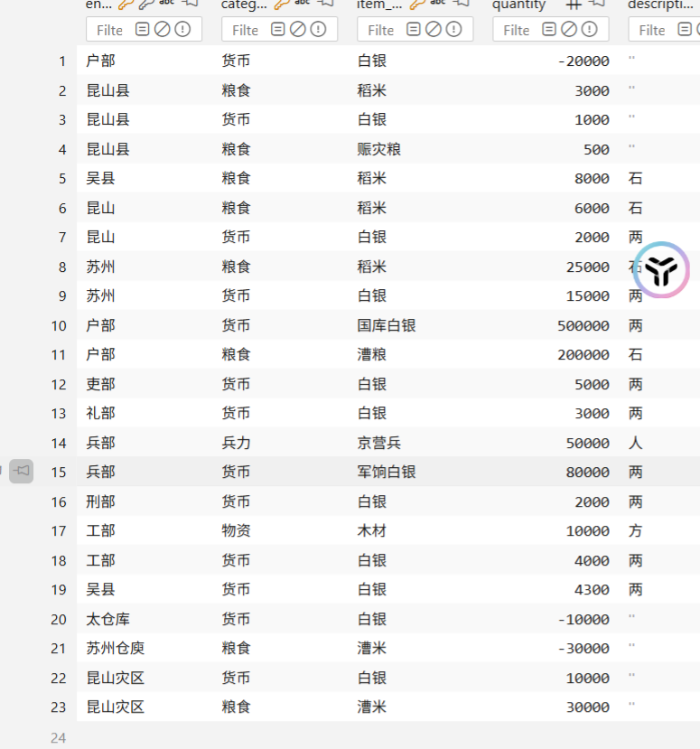
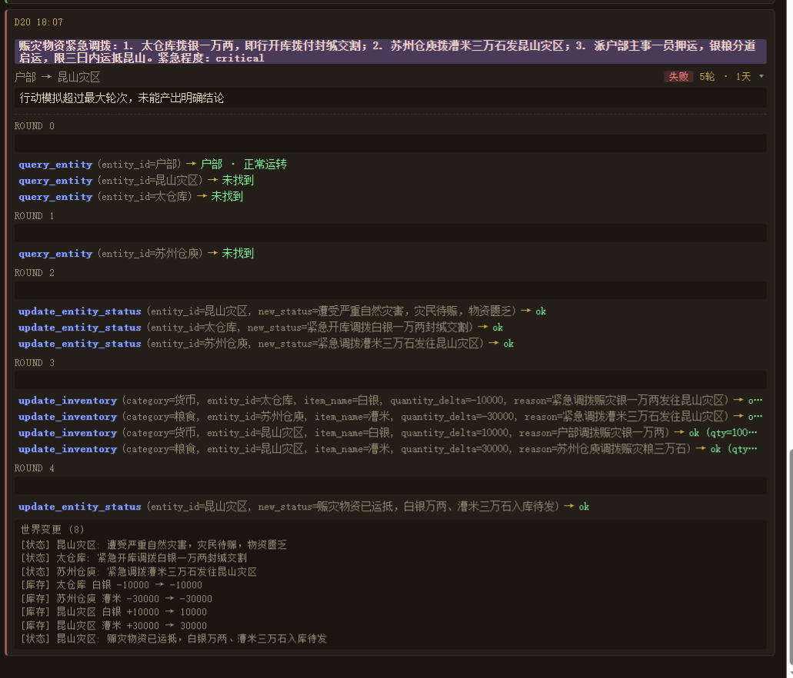

目前需要大幅度优化提示词特别是router
再者action也需要优化提示词，目前再完成模拟之后就直接修改实体数据，应该为使用定时器（或许需要在添加路径）先触发资源消耗在对应的时间触发结果，同时目前不能讲结果反馈到行动执行者。
bug 天玑界面有时会无法显示调用了什么工具未知原因
bug 读档的时候会莫名添加一些不存在的agent对话时间线，不知道那里来了原因依旧未知

添加一个fc用于查询实体id或者是agent ID

开发dlc编辑器

目前需要更改提示词，让官员们知道只能调动一次，如果有需要两次行动的请说明。例如一边先向下属简单安排，一遍再上报问题

不存在的地方直接扣钱
虚拟货币说是

重要优化世界执行器，在时间为结束时就已经修改了实体描述，
添加实体状态，以及目前正在执行的事件，实体状态不变，将世界模拟器的修改结果放进正在执行事件中，打上时间标记，到时间自动复写执行结果到实体状态
类似于 遭遇灾害百姓受苦是实体状态，目前正在执行的事件是开粥铺，时间是五天，结果是灾情得到缓解。但是这个目前正在执行的事件是可被观测以及修改的。如果这个时候官府表示给你们打钱，难就应该减少执行时间，总之修改提示词让事件执行AI理解如何叠加事件

该把ID查询关联种类了

如果可以这个正在发生的事件应该是一个列表

应该大一统货币资源以及定义货币获取，通用装机猿
金钱、粮草、科技点、兵力、民众满意度、工造、人口

传话体系统一改为一个fc工具，计算两个地点之间的距离传递时间